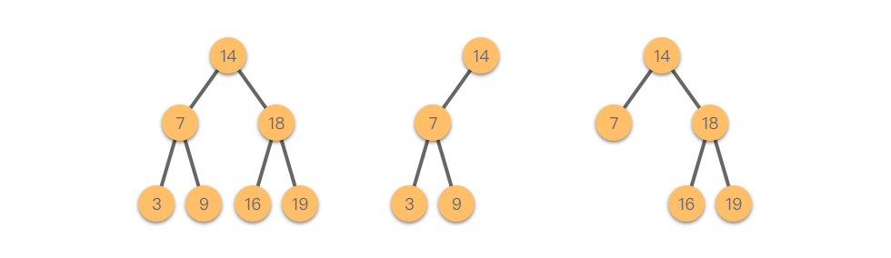
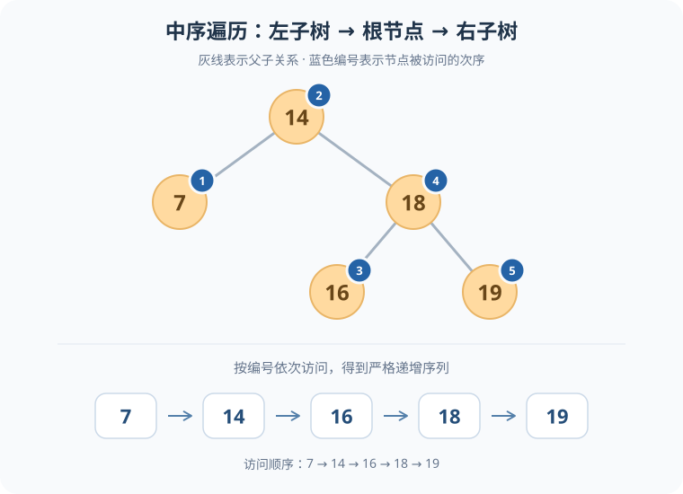
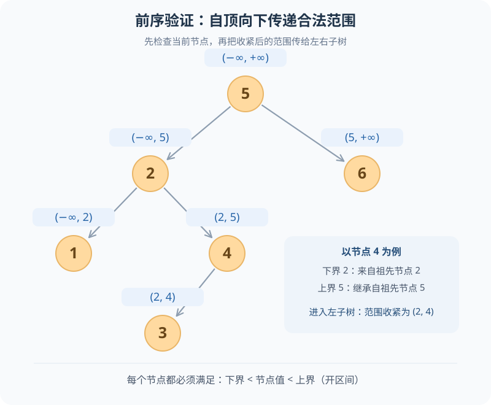
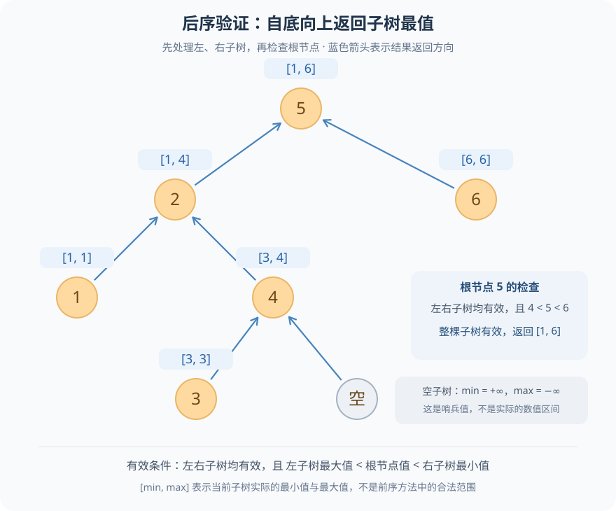
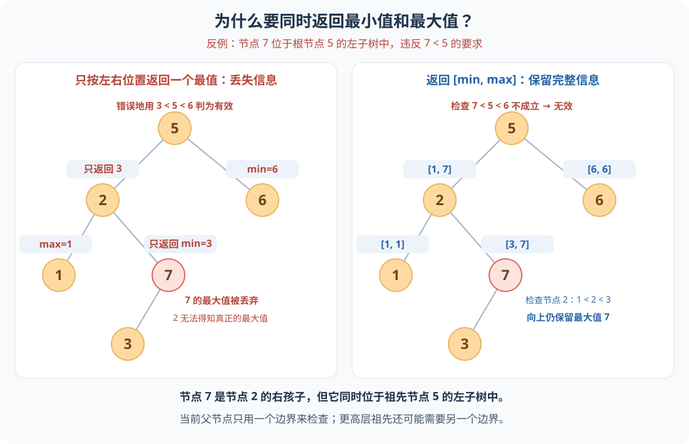

围绕 LeetCode 题目：[98. 验证二叉搜索树](https://leetcode.cn/problems/validate-binary-search-tree/)

## 1. 二叉搜索树简介

**二叉搜索树**（Binary Search Tree，简称 BST），也叫二叉查找树或二叉排序树。按照本题的定义，它是一棵空树，或者是一棵同时满足以下条件的二叉树：

- **左子树**：所有节点的值都严格小于当前根节点的值。
- **右子树**：所有节点的值都严格大于当前根节点的值。
- **递归性质**：左子树和右子树本身也都是二叉搜索树。



图 1：二叉搜索树示例

可以把它的大小关系概括为：

> 左子树中所有节点的值 < 根节点的值 < 右子树中所有节点的值。

这里有两个需要特别注意的地方：

1. **约束针对整棵子树，而不只是直接相连的孩子节点。** 即使每个节点都满足“左孩子 < 自己 < 右孩子”，整棵树也不一定是二叉搜索树；更深层的节点还必须满足祖先节点带来的大小约束。
2. **大小关系是严格的，不允许出现重复值。**

由于中序遍历的顺序是“左子树 → 根节点 → 右子树”，对一棵二叉搜索树进行中序遍历，会得到一个**严格递增**的节点值序列。反过来，如果一棵二叉树的中序遍历序列严格递增，它就是一棵符合本题定义的二叉搜索树。这也是后面使用中序遍历进行判断的依据。



图 2：中序遍历的访问顺序

## 2. 判断二叉搜索树的三种方法（前序、中序、后序）

### 2.1 前序

**思路：** 自顶向下传递合法范围，先检查当前节点，再递归检查左右子树。

为当前节点维护一个合法的开区间 `(lower, upper)`。这个范围记录了祖先节点对它的大小约束，当前节点的值 `x` 必须满足 `lower < x < upper`。

- **初始范围**：根节点没有祖先约束，因此范围是 `(−∞, +∞)`。
- **检查当前节点**：如果 `x ≤ lower` 或 `x ≥ upper`，说明违反了大小约束，直接返回 `false`。
- **进入左子树**：将上界收紧为 `x`，下界保持不变，范围变成 `(lower, x)`。
- **进入右子树**：将下界收紧为 `x`，上界保持不变，范围变成 `(x, upper)`。
- **递归结束**：空节点返回 `true`；当前节点合法，且左右子树都通过检查，才返回 `true`。

> **关键点：** 每向下一层，都要继承已有的祖先约束，再根据当前节点收紧范围，不能把另一侧边界重新设成无穷大。



图 3：前序遍历——自顶向下传递合法范围

**Java 实现**

```java
class Solution {
    public boolean isValidBST(TreeNode root) {
        return isValidBST(root, Long.MIN_VALUE, Long.MAX_VALUE);
    }

    private boolean isValidBST(TreeNode node, long left, long right) {
        if (node == null) {
            return true;
        }
        long x = node.val;
        return left < x && x < right &&
               isValidBST(node.left, left, x) &&
               isValidBST(node.right, x, right);
    }
}
```

### 2.2 中序

**思路：** 利用二叉搜索树的特性（参考图 2），中序遍历的值是严格递增的。

**Java 实现**

```java
class Solution {
    private long pre;

    public boolean isValidBST(TreeNode root) {
        pre = Long.MIN_VALUE; // 每次验证一棵新树前重置
        return inorder(root);
    }

    private boolean inorder(TreeNode root) {
        if (root == null) {
            return true;
        }
        if (!inorder(root.left)) { // 左
            return false;
        }
        if (root.val <= pre) { // 中
            return false;
        }
        pre = root.val;
        return inorder(root.right); // 右
    }
}
```

> **实现注意：** 每次调用入口方法都要重置 `pre`，避免复用同一个 `Solution` 对象验证多棵树时受到上次结果的影响。节点值为 `int`，因此用 `long` 的最小值作初始哨兵，可以正确处理值为 `Integer.MIN_VALUE` 的节点。以下代码中的 `TreeNode` 使用题目提供的定义。

### 2.3 后序

**思路：** 自底向上汇总子树的信息，先验证左右子树，再判断以当前节点为根的整棵子树是否是二叉搜索树。

每次递归返回三个信息：**当前子树是否有效、子树的最小值 `min`、子树的最大值 `max`**。按照“左子树 → 右子树 → 根节点”的顺序处理，当前节点就可以利用左右子树的结果完成判断。

- **先检查左右子树**：如果任意一棵子树不是二叉搜索树，当前子树也不是，直接向上返回无效状态。
- **再检查当前节点**：设当前节点值为 `x`，必须满足 `左子树最大值 < x < 右子树最小值`。只有左右子树都有效，且这个条件成立，当前子树才是二叉搜索树。
- **向上返回最值**：当前子树有效时，返回 `min = Math.min(左子树最小值, x)`、`max = Math.max(右子树最大值, x)`，供父节点继续判断。
- **空子树的处理**：返回有效状态，并令 `min = +∞`、`max = −∞`。这样，空的左子树不会阻碍 `左子树最大值 < x`，空的右子树也不会阻碍 `x < 右子树最小值`。这两个值是计算用的哨兵值，不表示实际区间；Java 中可用 `long` 的最大值和最小值表示。

> **关键点：** 左右子树各自有效还不够，还要检查它们与当前节点的大小关系。 前序方法向下传递的是“允许取值的范围”，后序方法向上返回的是“子树实际的最小值和最大值”。图中的 `[min, max]` 表示后者。



图 4：后序遍历——自底向上返回子树最值

**Java 实现**

```java
class Solution {
    public boolean isValidBST(TreeNode root) {
        return dfs(root)[1] != Long.MAX_VALUE;
    }

    private long[] dfs(TreeNode node) {
        if (node == null) {
            return new long[]{Long.MAX_VALUE, Long.MIN_VALUE};
        }
        long[] left = dfs(node.left);
        long[] right = dfs(node.right);
        long x = node.val;
        // 也可以在递归完左子树之后立刻判断，如果发现不是二叉搜索树，就不用递归右子树了
        if (x <= left[1] || x >= right[0]) {
            return new long[]{Long.MIN_VALUE, Long.MAX_VALUE};
        }
        return new long[]{Math.min(left[0], x), Math.max(right[1], x)};
    }
}
```

#### 后序遍历的思考

**为什么要同时返回子树的最大值和最小值？能不能左子树只返回最大值，右子树只返回最小值？**

在检查当前节点时，确实只需要“左子树的最大值”和“右子树的最小值”。但检查完成后，还需要向更高层的祖先返回当前整棵子树的最值。**相对于直接父节点的位置，并不能决定祖先只需要哪一个最值。**

例如，将图 4 中的节点 `4` 改为 `7`，并保留它的左孩子 `3`：

1. 节点 `7` 是节点 `2` 的右孩子。如果它只向节点 `2` 返回最小值 `3`，那么节点 `2` 可以通过 `1 < 2 < 3` 的检查，但无法从这个返回值中得知右子树的最大值是 `7`。
2. 节点 `2` 又是节点 `5` 的左孩子，需要向节点 `5` 返回整棵子树的最大值。如果仅根据节点值 `2` 和已经收到的 `1`、`3` 汇总，就会错误地得到最大值 `3`，从而让节点 `5` 通过 `3 < 5 < 6` 的检查。
3. 实际上，节点 `7` 位于节点 `5` 的左子树中，却满足 `7 > 5`，因此整棵树不是二叉搜索树。

如果同时返回 `[min, max]`，节点 `7` 返回 `[3, 7]`，节点 `2` 返回 `[1, 7]`。到节点 `5` 时，就能发现左子树最大值 `7` 不小于 `5`，正确判定无效。



图 5：只返回一个最值可能漏判；同时返回最小值和最大值可以保留祖先所需的信息

> **我的理解：** 当前节点做判断时只用到左右子树各一个边界，但向上汇总时需要保留两个边界。因此，在这种一次后序遍历、自底向上汇总信息的写法中，同时返回最小值和最大值最直接。

## 3. 三种方法对比总结

| 方法 | 核心思路 | 递归传递或维护的信息 | 时间复杂度（最坏） | 辅助空间复杂度 |
| --- | --- | --- | --- | --- |
| 前序（根 → 左 → 右） | 先检查当前节点是否落在合法开区间内，再收紧范围并检查左右子树。 | **向下传递**祖先约束 `(lower, upper)`；向上返回当前子树是否有效。 | `O(n)` | `O(h)`，主要为递归栈。 |
| 中序（左 → 根 → 右） | 按中序访问节点，检查节点值是否严格递增。 | **按访问顺序维护**前一个节点值 `pre`，由各层递归共享；向上返回是否有效。 | `O(n)` | `O(h)`，主要为递归栈；`pre` 只占 `O(1)`。 |
| 后序（左 → 右 → 根） | 先验证左右子树，再检查 `左子树最大值 < 当前节点值 < 右子树最小值`。 | **向上汇总**子树的最小值、最大值与有效性；本文代码用特殊的最值组合表示无效。 | `O(n)` | `O(h)`，包括递归栈及各层保留的常量大小返回信息。 |

其中，`n` 为节点总数，`h` 为树高。以上复杂度针对本文的三种递归实现：

- **时间**：每个节点至多处理一次，每次处理只做常数次比较或最值计算，因此最坏时间复杂度均为 `O(n)`。
- **空间**：递归深度由树高决定。平衡树中为 `O(log n)`，退化成链表时为 `O(n)`。中序方法虽然只额外维护一个 `pre`，但仍需计入递归栈，不能将总辅助空间写成 `O(1)`。
- **后序代码的返回值**：有效子树返回 `[min, max]`；空子树返回 `[Long.MAX_VALUE, Long.MIN_VALUE]`；无效子树返回 `[Long.MIN_VALUE, Long.MAX_VALUE]`。因此，有效性被编码在二元数组中，无需额外返回一个布尔值。

> **记忆要点：** 前序向下传约束，中序依次比较前后值，后序向上汇总最值。

## 4. 边界条件与自查

- **只检查父子关系不够**：例如 `[5, 1, 4, null, null, 3, 6]` 中，右子节点 `4` 小于根节点 `5`，应返回 `false`；更深层节点也必须遵守所有祖先的范围。
- **重复值不合法**：`[2, 2, 3]` 应返回 `false`，比较必须严格。
- **整数边界**：单节点值为 `Integer.MIN_VALUE` 或 `Integer.MAX_VALUE` 时仍应返回 `true`，范围和哨兵使用 `long`。
- **复用对象**：用同一个 `Solution` 先验证 `[2, 1, 3]`，再验证 `[1]`，两次都应返回 `true`。中序方法需要重置 `pre`。
- **空树与树高**：本文实现对空树返回 `true`；递归深度等于树高，极深的退化树可能导致栈溢出。

## 5. 相关链接

- [LeetCode 98：验证二叉搜索树](https://leetcode.cn/problems/validate-binary-search-tree/)

文中的 5 张图随笔记保存在同一目录，通过相对路径引用。
