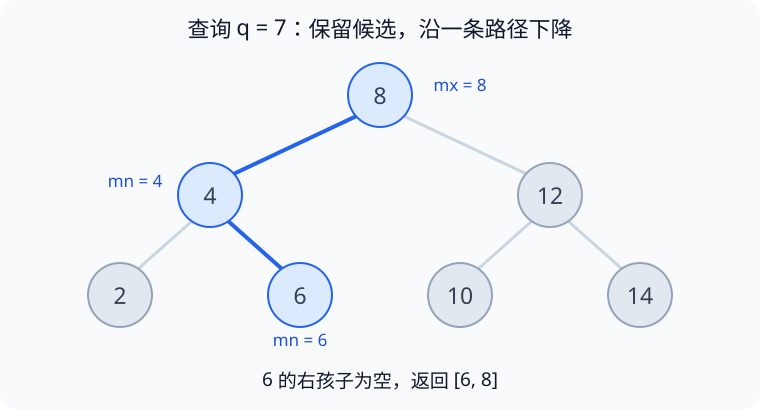
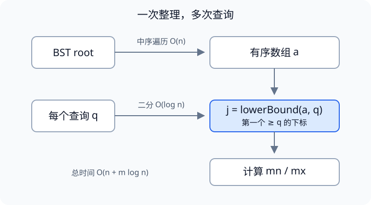

> 难度：中等｜标签：二叉搜索树、中序遍历、二分查找

题目：[LeetCode 2476. 二叉搜索树最近节点查询](https://leetcode.cn/problems/closest-nodes-queries-in-a-binary-search-tree/)

这篇笔记从两种直接查询方法出发，推导“中序遍历 + 二分查找”，再整理 Java 包装类型比较和递归深度两个容易忽略的问题。二叉搜索树的基础性质可以先看[前序、中序与后序验证笔记](../binary-search-tree/)。

## 一、题目要求

给定一棵 BST 和查询数组 `queries`，对每个 `q` 求：

- `mn`：树中 **≤ q** 的最大值，不存在为 `-1`
- `mx`：树中 **≥ q** 的最小值，不存在为 `-1`

返回 `[[mn, mx], ...]`。

下文统一用 `n` 表示树中节点数、`m` 表示查询次数，`q` 表示当前查询值。题目中节点数和查询次数最多均为 `10^5`，节点值与查询值均为正整数。

## 二、解题思路

### 1. 暴力解法：为什么直接搜会 TLE

BST 查找单个值的复杂度取决于树高，而**题目不保证平衡**：最坏情况是一条链，树高 `n`。单次查询最坏为 `O(n)`，`m` 次查询最坏为 `O(nm)`。当 `n = m = 10^5` 时，访问次数可能达到 `10^10` 量级，无法保证在时限内完成。

> BST 保证的是"有序"，不是"平衡"。看到 BST + 多次查询，第一反应应该是**能不能把它摊平成有序数组**。

暴力有两种常见写法，在逻辑上都能得到正确答案，但最坏时间复杂度都是 `O(nm)`。写法 A 的递归遍历还存在深链爆栈风险，后面的完整解法会改用迭代。

**写法 A：中序 + 每个 query 线性扫描**（最直觉，就是"用 `pre` 记前一个值"）

```java
class Solution {
    public List<List<Integer>> closestNodes(TreeNode root, List<Integer> queries) {
        List<Integer> a = new ArrayList<>();
        inorder(root, a);                        // 一次中序，O(n)

        List<List<Integer>> ans = new ArrayList<>();
        for (int q : queries) {                  // 每个 query 一次线性扫描，O(n)
            int p = -1, s = -1;                  // p: 最后一个 < q；s: 第一个 > q
            for (int v : a) {                    // v 的前一个值就是所谓的 pre
                if (v < q) { p = v; continue; }  // 还没到 q，更新前驱
                if (v == q) { p = q; s = q; }    // 命中：mn = mx = q
                else s = v;                      // 第一个 > q，即后继
                break;
            }
            ans.add(List.of(p, s));
        }
        return ans;
    }

    private void inorder(TreeNode node, List<Integer> a) {
        if (node == null) return;
        inorder(node.left, a);
        a.add(node.val);
        inorder(node.right, a);
    }
}
```

扫描过程（以 `q = 7` 为例）：指针从左往右走，边走边把"最后一个 `v < q`"记进 `p`，一旦遇到 `v ≥ q` 立刻停下。

```text
a = [ 2 ] [ 4 ] [ 6 ] [ 8 ] [ 10 ]
      ↑     ↑     ↑     ↑
     p=2   p=4   p=6   s=8
     v<7   v<7   v<7   v>7 → 停

p = 6  ← 最后一个 < q，即 mn 候选
s = 8  ← 第一个  > q，即 mx 候选
结果：mn = 6, mx = 8
```

`p`、`s` 的初值 `-1` 把两个越界情况都兜住了：

| `q` 的位置 | p（最后 < q） | s（第一 > q） | 输出 |
|---|---|---|---|
| 命中某个节点 | 被覆盖为 `q` | 被覆盖为 `q` | `[q, q]` |
| 夹在两值之间 | 前驱 | 后继 | `[前驱, 后继]` |
| 小于最小值 | `-1`（初值） | `a[0]` | `[-1, a[0]]` |
| 大于最大值 | `a[n-1]` | `-1`（没进过 else） | `[a[n-1], -1]` |

两个最容易写错的地方：

- **命中时**必须同时令 `mn = mx = q`。如果只写 `if (v <= q) p = v;`，再用后续第一个 `v > q` 更新 `s`，就会把上界误写成严格后继；这个条件本身不会让 `p` 超过 `q`。
- **`q` 大于所有值**时循环自然结束，此时必须保住 `s = -1`（别在循环外去取"最后一个没被覆盖的值"）。

> 常见误区：拿相邻两值 `(a[i-1], a[i])` 去 `queries` 里反查"哪些数落在这段区间内"。思路成立，但这是**反查**——每个值对都要扫一遍 `queries`，同样 O(n·m)，还得额外维护"哪些 query 已填过"，容易漏也容易重。反过来做更简单：对每个 query 扫一遍数组（就是上面的写法 A），结构也和正解完全同构。

**写法 B：利用 BST 性质，每个 query 从根下降一次**

```java
class Solution {
    public List<List<Integer>> closestNodes(TreeNode root, List<Integer> queries) {
        List<List<Integer>> ans = new ArrayList<>();
        for (int q : queries) {
            int mn = -1, mx = -1;
            TreeNode cur = root;
            while (cur != null) {
                if (cur.val == q) { mn = q; mx = q; break; }          // 命中，直接结束
                if (cur.val < q) { mn = cur.val; cur = cur.right; }   // 候选在右边
                else             { mx = cur.val; cur = cur.left;  }   // 候选在左边
            }
            ans.add(List.of(mn, mx));
        }
        return ans;
    }
}
```

不用中序，直接利用 BST 的有序性：`cur.val < q` 时它是"目前最好的 ≤ q"，左子树不可能改善已有边界，可以继续查找右子树；`cur.val > q` 时同理，保留上界候选并转向左子树。

下降路径（`q = 7`，蓝色为实际访问的节点，灰色整棵子树被剪掉）：



只走了 `8 → 4 → 6` 三个节点就结束：`8 > 7` 时先记录 `mx = 8`，再进入左子树寻找更优候选；`4 < 7`、`6 < 7` 一路把 `mn` 抬到 6；下一个右孩子为空 → `[6, 8]`。

**关键点**：单次复杂度是 **O(h)**，h 为树高。树平衡时 h = log n，这一版就是 **O(m·log n)**；但题目**不保证平衡**，退化成链时 h = n → O(n·m)，TLE。这就是题目开头那句"题目没说二叉搜索树是平衡的"的用意——它决定了这版敢不敢用。

**三版对比**

| 版本 | 单次查询 | 总复杂度 | 备注 |
|---|---|---|---|
| A：中序 + 线性扫描 | O(n) | **O(n·m)** | 最坏情况会超时 |
| B：BST 逐层下降 | O(h)，最坏 O(n) | **O(n·m)** | 效率依赖树高，链上最坏会超时 |
| 中序 + 二分（正解） | O(log n) | **O(n + m·log n)** | 见第三节 |

从 A 到正解只改一处：把内层线性扫描换成 `lowerBound`，外层结构完全不变。

### 2. 优化：中序遍历 → 有序数组

把"每个 query 都要扫一遍数组"改成"先摊平，再二分"。BST 的中序遍历结果天然有序，一次 O(n) 就把树变成有序数组 `a`，后续任意次查询都能二分：



整体复杂度从 O(nm) 降到 **O(n + m·log n)**。

### 3. 二分的落点 j 怎么用

二分的目标：找到 **第一个 ≥ q 的下标 j**（即 `lowerBound`）。此时数组被 `j` 切成了两半。以 `q = 7` 为例：

```text
a  =  [ 2 ][ 4 ][ 6 ][ 8 ][ 10 ]        n = 5
                       ↑
                  j = 3，a[j] = 8
   左边全 < q（含 j-1）     右边全 ≥ q（含 j）
```

| 情况 | q 示例 | j | mn | mx |
|---|---|---|---|---|
| q 存在于 a | 6 | 2 | `a[j] = 6` | `a[j] = 6` |
| 夹在中间 `a[j-1] < q < a[j]` | 7 | 3 | `a[j-1] = 6` | `a[j] = 8` |
| q 比最小值还小 | 1 | 0 | `-1` | `a[0] = 2` |
| q 比最大值还大 | 11 | n | `a[n-1] = 10` | `-1` |

归纳成两行判断：

```java
int mx = (j == n) ? -1 : a[j];
if (j == n || a[j] != q) j--;      // 值不在 a 中，前驱退一格
int mn = (j < 0) ? -1 : a[j];
```

## 三、完整解法（Java）

使用显式栈完成中序遍历，避免树退化成链时消耗过深的 Java 调用栈。`TreeNode` 由题目提供；本地运行时需要自行补充定义。以下写法需要 Java 9 或更新版本（使用了 `List.of`）。

```java
import java.util.*;

class Solution {
    public List<List<Integer>> closestNodes(TreeNode root, List<Integer> queries) {
        List<Integer> arr = new ArrayList<>();
        inorder(root, arr);                      // 1. 中序 → 有序序列

        int n = arr.size();
        int[] a = new int[n];
        for (int i = 0; i < n; i++) {
            a[i] = arr.get(i);               // 2. 转 int[]，后续比较全是基本类型（也可直接用 List 配合 int 比较）
        }

        List<List<Integer>> ans = new ArrayList<>(queries.size());
        for (int q : queries) {              // 3. 拆箱成 int 再二分
            int j = lowerBound(a, q);

            int mx = (j == n) ? -1 : a[j];

            if (j == n || a[j] != q) j--;    // a[j] > q：前驱是 a[j-1]
            int mn = (j < 0) ? -1 : a[j];

            ans.add(List.of(mn, mx));
        }
        return ans;
    }

    // 第一个 >= target 的下标；全部小于 target 时返回 a.length
    private int lowerBound(int[] a, int target) {
        int left = -1, right = a.length;     // 开区间 (left, right)
        while (left + 1 < right) {
            int mid = (left + right) >>> 1;
            if (a[mid] >= target) right = mid;
            else left = mid;
        }
        return right;
    }

    private void inorder(TreeNode root, List<Integer> a) {
        Deque<TreeNode> stack = new ArrayDeque<>();
        TreeNode cur = root;
        while (cur != null || !stack.isEmpty()) {
            while (cur != null) {
                stack.push(cur);
                cur = cur.left;
            }
            cur = stack.pop();
            a.add(cur.val);
            cur = cur.right;
        }
    }
}
```

**复杂度**：时间 `O(n + m·log n)`，空间 `O(n)`（返回值不计）。

**两点说明**

- `left = -1, right = n` 是开区间写法，和闭区间 `while (l <= r)` 完全等价：闭区间结束后 `l` 就是这里的 `right`，`r = l - 1`。使用闭区间模板也可以，关键是保持边界定义一致。
- 这里 `(left + right) >>> 1` 用来计算中点。进入循环时 `left + right` 非负，且本题下标范围不会导致加法溢出，因此 `/ 2` 也正确；不应把右移一概描述为更快。

## 四、我踩的坑（重点）

### 坑 1：`Integer == Integer` 比较对象身份

错误代码只有一行：

```java
} else if (arr.get(l) == queries.get(i)) {   // ❌ 两个 Integer 比引用
```

`arr.get(l)` 和 `queries.get(i)` 都是 **`Integer` 对象**，`==` 判断它们是否指向同一个对象，而不是比较整数值。这是 Java 的[引用相等规则](https://docs.oracle.com/javase/specs/jls/se21/html/jls-15.html#jls-15.21.3)。

[`Integer.valueOf(int)`](https://docs.oracle.com/en/java/javase/21/docs/api/java.base/java/lang/Integer.html#valueOf(int)) 保证缓存 `-128` 到 `127`，也允许缓存范围之外的值。因此，小值经过 `valueOf` 或自动装箱时往往会掩盖这个问题；范围外的两个同值对象是否相同，不能依赖。直接复用同一个对象引用也会让 `==` 为 `true`。

**为什么难查**：小值正确、大值错误。例如把树设成 `{1000,500,2000,300,800,1500,3000}`，若查询列表和节点值分别装箱、没有复用同一对象，错误分支可能产生以下结果：

| 查询 | 期望 | 可能的错误输出 | 原因 |
|---|---|---|---|
| 800 | `[800,800]` | `[500,800]` | 判为不相等，落进 else，mn 变成严格前驱 |
| 1000 | `[1000,1000]` | `[800,1000]` | 同上 |
| 3000 | `[3000,3000]` | `[2000,3000]` | 同上 |
| 900 | `[800,1000]` | `[800,1000]` ✅ | 值不在树中，走不到该分支 |

只使用随机查询容易漏掉这个问题：应主动覆盖“查询值恰好等于树中的较大值”，并用数值比较验证答案。缓存配置和对象构造方式会影响错误是否出现。

**三条修复路线**（任选，第一条最彻底）

```java
// ① 从类型上消灭：转成 int[] / 用 int 接住
int[] a = ...;                     // 标准答案的做法，a[j] != q 是基本类型比较
for (int q : queries) { ... }      // q 直接是 int

// ② 显式拆箱比较
if (arr.get(l) == queries.get(i).intValue())   // 或 int q = queries.get(i); arr.get(l) == q

// ③ 用 equals
if (arr.get(l).equals(queries.get(i)))
```

**规则**：

- 两侧都是引用类型、比"内容" → 一律 `equals` / `Objects.equals`
- 本题的 `Integer` 与 `int` 比较 → `Integer` 自动拆箱后按数值比较；如果引用为 `null`，拆箱会抛出 `NullPointerException`
- 直接判断是否为 `null` → 用 `== null`；比较两个可能为空的对象可用 `Objects.equals`

> `==` 的语义取决于两侧的**静态类型**，不是固定的"比地址"。这正是它危险的地方：同一个循环里 `arr.get(mid) < queries.get(i)` 完全正确（`<` 强制拆箱），换成 `==` 就错。
>
> IDEA 对 `Integer a == b` 会标黄提示 *Number objects are compared using '==', not 'equals()'*，`javac` 不报。看到这个黄标就当红牌。

### 坑 2：递归中序 + 退化链 → StackOverflowError

`n` 上限 10^5，若树是一条链，递归深度就是 10^5。这可能触发 `StackOverflowError`，具体阈值取决于 JVM、线程栈大小和调用帧。完整解法已经采用显式栈；其核心遍历过程如下：

```java
private void inorder(TreeNode root, List<Integer> a) {
    Deque<TreeNode> st = new ArrayDeque<>();
    TreeNode cur = root;
    while (cur != null || !st.isEmpty()) {
        while (cur != null) { st.push(cur); cur = cur.left; }
        cur = st.pop();
        a.add(cur.val);
        cur = cur.right;
    }
}
```

### 坑 3：`List.of()` 返回不可变列表

`ans.add(List.of(mn, mx))` 没问题，但如果后续想 `list.add(...)` 会抛 `UnsupportedOperationException`；需要可变就用 `new ArrayList<>(List.of(mn, mx))`。

### 必测用例清单

| 用例 | 专治 |
|---|---|
| 查询值 ≥ 128 且**存在于树中** | 坑 1（这条最关键，小值测不出来） |
| 查询值 > 树中最大值 | `j == n` 分支 |
| 查询值 < 树中最小值 | `j == 0`、`mn = -1` |
| 单节点树 / 查询等于该节点（额外健壮性测试，题目至少有 2 个节点） | 边界 |
| 10^5 节点的链 | 坑 2 爆栈 |

## 五、其他解法（了解即可）

- **TreeSet**：建 `TreeSet` 后直接 `floor(q)` / `ceiling(q)`，代码最短，但常数比 `int[]` + 手写二分大，且仍然要遍历建树。
- **双指针离线**：把 `queries` 带上下标排序，与已由中序遍历得到的有序数组 `a` 同向扫描，再按原下标还原结果。总时间为 `O(n + m log m)`，因为 `a` 不需要再次排序。它也是可行方案；是否适合取决于节点数、查询数及实现成本。
