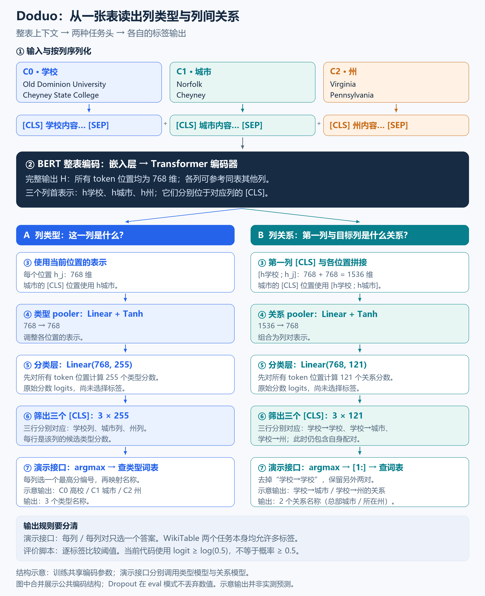

这篇笔记沿着 Doduo 的源码，记录一张表如何得到列类型和列间关系，以及模型分数如何变成最终标签。

> **源码版本**：本文的代码路径与行号对应作者仓库提交 [`f3ae5aa`](https://github.com/megagonlabs/doduo/tree/f3ae5aace5d8364065a3cc3b74ce6cde2c928679)。文中的“当前实现”均指这一版本。
>
> **配套阅读**：[Doduo 论文中英对照：用预训练语言模型标注表格列](/posts/doduo-translation/)。本篇侧重推理路径与源码理解，图和示意分数不代表模型实测结果。

## 个人理解
核心是：**先让模型理解整张表，再从每列的 `[CLS]` 位置读出这一列的信息。**

Doduo 首先按列将表格序列化，为每列添加 [CLS] 和 [SEP]，再将各列的 token 序列拼接成一条表级序列。随后，BERT 对整条序列进行编码，使各列 [CLS] 位置的表示能够融合本列内容和同表其他列的信息。在 BERT-base 配置下，每个位置的表示为 768 维。列类型分类使用目标列 [CLS] 对应的上下文表示，因此“用一个列向量分类”和“参考整张表”并不矛盾。多张表可以组成批次并行处理，但各表仍是独立序列，不因此发生跨表信息交互。

列间关系预测在这个基础上多走一步：**把第一列和目标列的表示拼在一起，判断这一对列是什么关系。** 当前作者实现固定以第一列作为配对起点；模型为每个候选关系打分，演示接口再选出一个最高分答案。这里要区分“模型计算了哪些分数”和“接口最终保留几个答案”。

下面继续用“学校—城市—州”这张小表理解两条推理路径：

| 学校 | 城市 | 州 |
|---|---|---|
| Old Dominion University | Norfolk | Virginia |
| Cheyney State College | Cheyney | Pennsylvania |

这张表用于教学说明。类型预测回答“这一列是什么”，关系预测回答“这两列之间是什么关系”；文中的示意分数不是模型实测结果。

## 推理过程



图中左右分别是类型预测和关系预测，公共编码结构合并绘制。联合训练时两任务共享嵌入层和编码器参数；演示接口则分别调用类型模型和关系模型，不表示推理时复用同一次 BERT 编码。图中标签仅作教学示意。

## 沿着代码走一遍：列类型预测

### 1. 把表格变成一条序列

我可以把这一步理解成“换一种方式摆放表格内容”：先把同一列的值接起来，再分词并添加特殊标记，最后把各列首尾相接。

```text
[CLS] 学校列的内容 [SEP]
[CLS] 城市列的内容 [SEP]
[CLS] 州列的内容   [SEP]
              ↓ 拼成同一条序列
交给 BERT 一起处理
```

每列有一个 `[CLS]`，所以三列就有三个。这个过程叫**序列化**，还没有进行上下文理解。

### 2. 用 BERT 形成上下文表示

下面只保留核心调用，省略参数和维度调整：

```python
embedding_output = self.embeddings(input_ids=input_ids)
encoder_outputs = self.encoder(embedding_output)
H = encoder_outputs[0]
```

这部分可以接上我对 Transformer 的理解：相同的 `[CLS]` 查到相同的词向量，但加入位置信息、经过自注意力计算后，会形成不同的上下文表示。

假设三个 `[CLS]` 在位置 `0、5、9`，那么 `H[0, 0, :]`、`H[0, 5, :]`、`H[0, 9, :]` 分别对应三列的 768 维表示。它们已经参考过整张表，不是只看各自列得到的结果。

### 3. 计算类型分数，再取出每列的结果

这是读代码时需要记住的顺序：**作者先给所有 token 位置计算类型分数，再筛出 `[CLS]` 位置。**

```python
# 核心思路示意，省略 Dropout、批次和维度处理
Z = tanh(linear_768_to_768(H))
logits = linear_768_to_255(Z)
column_scores = logits[CLS所在的位置]
```

前面的线性层和 Tanh 调整各位置的表示，最后的分类层把 768 维向量转换成 255 个类型分数。筛出三个 `[CLS]` 后，就得到一个 **3 × 255** 的分数矩阵：每一行是一列，每一项是一个候选类型的分数。

这些分数还不是概率。演示接口随后使用：

```python
coltype_pred = filtered_logits.argmax(1)
```

也就是每列选最高分的标签编号，再查标签词表，得到类型名称。

这里我需要区分：**演示接口每列展示一个首选答案；WikiTable 任务本身允许一列有多个正确标签。** 因此，这条演示流程不能直接代替论文的多标签评价。

## 沿着代码走一遍：列间关系预测

这里从 BERT 已经得到所有 token 的上下文表示开始，不再重复前面的序列化和编码过程。把三个列首 `[CLS]` 的向量记为 `h学校`、`h城市`、`h州`，每个都是 768 维，也都已经参考了同表上下文。

### 1. 固定取第一列表示，与当前位置拼接

源码位置：`doduo/model.py:61`，`BertMultiPairPooler.forward()`。

```python
hidden_states_first_cls = hidden_states[:, 0].unsqueeze(1).repeat(
    [1, hidden_states.shape[1], 1])

# 下面是下一行 self.dense(...) 内部的拼接操作
torch.cat([hidden_states_first_cls, hidden_states], 2)
```

`hidden_states[:, 0]` 取的是每张表序列中第 0 个 token 的表示。因为序列从第一列的 `[CLS]` 开始，所以这里取到 `h学校`。它没有判断哪列是学校，而是直接使用固定位置。

后面的 `repeat` 可以理解为把这份表示复制到每个位置，方便逐位置配对。拼接后的向量中，**前 768 维始终来自第一列的 `[CLS]`，后 768 维来自当前位置的 token**。

只看三个列首位置，结果是：

```text
学校的 [CLS] 位置：[h学校 ; h学校] → 1536 维
城市的 [CLS] 位置：[h学校 ; h城市] → 1536 维
州的   [CLS] 位置：[h学校 ; h州]   → 1536 维
```

这里的分号表示前后连接，不是相加。实际代码对所有 token 位置都做了拼接，只是后续关心的是 `[CLS]` 位置。

所以，为什么第三行不是“城市—州”？**在这里固定使用第一列的代码就已经决定了配对范围，后面的筛选不会改变它。**

### 2. 把两个列向量组合成一个列对表示

源码位置：`doduo/model.py:58`、`:70`。

```python
self.dense = nn.Linear(config.hidden_size * 2, config.hidden_size)
self.activation = nn.Tanh()

# forward 中执行
pooled_outputs = self.dense(
    torch.cat([hidden_states_first_cls, hidden_states], 2))
pooled_outputs = self.activation(pooled_outputs)
```

对“学校—城市”来说，这一步是：

```text
[h学校 ; h城市]：1536 维
          ↓ Linear + Tanh
学校—城市的列对表示：768 维
```

这时的 768 维输出已经不是单独的城市列表示，而是组合了学校与城市信息的**列对表示**。两个输入向量本身还包含整张表的上下文，所以它也可能利用州列提供的信息。

### 3. 给 121 个候选关系打分

源码位置：`doduo/model.py:323`、`:383`。

```python
self.classifier = nn.Linear(config.hidden_size, self.config.num_labels)

# forward 中执行
pooled_output = outputs[1]
pooled_output = self.dropout(pooled_output)
logits = self.classifier(pooled_output)
```

关系模型在 `doduo/doduo.py:177`、`:208` 设置 `num_labels=121`，所以分类层是 `Linear(768, 121)`。演示接口将模型设为 `eval()`，此时 Dropout 不随机丢弃数值。

```text
学校—城市的列对表示：768 维
           ↓ classifier
121 个候选关系各自的分数
```

**121 个分数不表示已经预测出了 121 种关系，只表示对每个候选关系都打了分。** 这些 logits 是原始分数，可以为负数，也不要求加起来等于 1。

与类型预测对照，可以记住这两条路径：

| 路径 | 送入 pooler 的表示 | pooler 输出 | 分类层输出 |
|---|---|---|---|
| 列类型 | 一个位置的 768 维表示 | 768 维 | 255 个类型分数 |
| 列关系 | 第一列与目标位置拼成的 1536 维表示 | 768 维 | 121 个关系分数 |

两条路径都先对所有 token 位置计算分数，再筛出列首位置。

### 4. 筛出各列 `[CLS]` 的关系分数

源码位置：`doduo/doduo.py:286`。

```python
cls_indexes = torch.nonzero(
    batch["data"].T == self.tokenizer.cls_token_id)

# 省略 filtered_logits 的初始化
for n in range(cls_indexes.shape[0]):
    i, j = cls_indexes[n]
    logit_n = logits[i, j, :]
    filtered_logits[n] = logit_n
```

它找到 `[CLS]` 所在位置，并取出该位置的全部 121 个分数。三列表格筛选后得到 **3 × 121** 的矩阵：

```text
第 0 行：学校→学校的分数
第 1 行：学校→城市的分数
第 2 行：学校→州的分数
```

此时第一列与自身配对的输出仍然存在，因为第一列的 `[CLS]` 同样满足筛选条件。

### 5. 演示接口选一个答案，去掉自身配对，再查关系名称

源码位置：`doduo/doduo.py:295`。

```python
colrel_pred = filtered_logits.argmax(1)
colrel_pred = colrel_pred[1:]  # Drop the first prediction
colrel_pred_labels = [
    self.colrel_mlb.classes_[x] for x in colrel_pred
]
adf.colrels = colrel_pred_labels
```

`argmax(1)` 从每行的 121 个分数中选出最高分对应的关系编号。例如，假设得到 `[7, 82, 84]`，`[1:]` 就把它变成 `[82, 84]`。

**这里去掉的是“学校→学校”这条预测，不是删除编号为 0 的关系类别。** 在当前任务里，自身配对不作为需要输出的列对，但学校的表示仍然参与另外两对关系的计算。

最后用编号查 `self.colrel_mlb.classes_`。标签表在 `doduo/doduo.py:183` 从作者的 `turl_colrel_mlb.pickle` 加载。已核对的作者标签映射中：

```text
82 → organization.organization.headquarters-location.mailing_address.citytown
84 → organization.organization.headquarters-location.mailing_address.state_province_region
```

可以分别理解为组织总部地址的城市、州／省／地区。返回的两个名称按顺序对应“学校→城市”“学校→州”。编号示例不代表运行模型后一定会得到这些答案。

这一步只是查固定词表，不是让模型生成关系描述。因此，**推理必须保持训练时“输出位置→关系名称”的对应关系**。即使权重和预测编号不变，换一份顺序不同的标签表，也可能显示成错误的关系名称。

## 我需要区分的两个问题

### 演示接口只给一个答案，不等于模型只支持一种关系

WikiTable 的关系任务允许一对列同时具有多个关系标签。模型已经计算了 121 个分数，是演示接口最后的 `argmax` 只保留一个。

评价脚本使用另一种选择规则。源码位置：`doduo/predict_multi.py:226`。

```python
all_preds = (filtered_logits >= math.log(0.5)
             ).int().detach().cpu().numpy()
```

它分别判断每个关系的分数是否达到阈值，因此可以选择多个关系，也可能一个都不选。

例如，对“学校→城市”，假设分数为：

| 候选关系 | 编号 | 示意分数 |
|---|---|---:|
| 位于某地 | 65 | 1.2 |
| 总部地址的城市 | 82 | 2.4 |
| 总部地址的州 | 84 | -1.8 |

演示接口只选择 82；上述阈值规则会选择 65 和 82。真实训练样例 `10002240-4` 的学校列与城市列，确实同时标有关系 65、82。如果真实标签是 `{65, 82}`，只输出 `{82}` 就是返回了一个正确关系，但漏掉了另一个；也不能为了不漏标签就全部选中，否则会引入错误关系。

这里必须按代码理解阈值：**比较的是原始 logit，阈值为 `log(0.5) ≈ -0.693`，不是“概率至少为 0.5”**。换算成 sigmoid 概率约为 `1/3`。此处只记录实现，没有修改或验证整套评价流程的正确性。

### 为什么当前只预测第一列与其他列，而不是任意列对？

我的理解是：**这是当前实现与基准任务的范围，不是 BERT 或列向量拼接方法的固有限制。**

[TURL 作者的关系任务说明](https://github.com/sunlab-osu/TURL#relation-extraction)明确规定，关系是最左边主体列与其他列之间的关系，并说明这样做是为了避免检查所有列对。Doduo 使用这一基准，其当前代码也固定采用第一列作为配对起点。论文 §4.3 的公式（2）则描述了第 j 列和第 k 列表示的拼接，公式本身没有把其中一列限定为第一列。

对于我们的例子，当前代码构造 `[h学校 ; h城市]` 和 `[h学校 ; h州]`。从表示结构看，也可以构造 `[h城市 ; h州]`，使用相同形式的分类头打分。但**能够计算分数，不代表现有权重已经能可靠预测这些新增列对**，还需要相应的训练标注和评价依据。

这里尤其不能把“没有标注城市→州”直接解释为“城市与州无关系”。缺少的是监督信息，关系本身可能很明确。如果直接当作负例训练，就可能把真实关系教成错误答案。

我需要分清三个状态：

| 状态 | 能说明什么 |
|---|---|
| 已标注某种关系 | 有该关系成立的监督信息 |
| 经核验不具有某种候选关系 | 可以作为该候选关系的负例依据 |
| 没有标注这个列对 | 缺少监督信息，不能直接视为负例 |

“不具有某种候选关系”也不等于“两列之间没有任何关系”。

列对数量同样会变化：n 列时，第一列指向其他列有 `n−1` 对；所有非自身的有向列对有 `n(n−1)` 对。10 列就是从 9 对变成 90 对。这会增加列对打分、标注和评价工作，但可以复用一次 BERT 编码得到的列表示，不意味着要把整张表重新编码 90 次。

## 主线

列类型预测：**表格序列化 → BERT 整表编码 → 所有位置计算类型分数 → 取出各列 `[CLS]` 分数 → 选择编号并映射为类型名称。**

列关系预测：**BERT 整表编码 → 第一列表示与各位置表示拼接 → 形成列对表示 → 计算关系分数 → 取出各列 `[CLS]` 分数 → 演示接口选最高分、去掉自身配对 → 映射为关系名称。**

对我来说，最关键的不是记住每一行数据整理代码，而是理解：**Transformer 负责结合上下文，分类头负责判断类型，`[CLS]` 让我们找到每列对应的结果。**

关系预测又让我补充了一点：**配对代码决定正在判断哪两列，分类层给候选关系打分，输出规则决定保留哪些答案，标签表负责把编号还原成名称。**

回看类型预测时，主要找三个位置：

- `doduo/doduo.py:48`：输入表格怎样整理成序列。
- `doduo/model.py:286`、`:385`：整表编码和类型打分。
- `doduo/doduo.py:261`：筛出列分数，再输出标签。

回看关系预测时，沿着这条路线：

- `doduo/model.py:54`：第一列与目标位置拼接，1536 维变为 768 维列对表示。
- `doduo/model.py:323`、`:383`：分类层把列对表示转换成关系分数。
- `doduo/doduo.py:281`：调用关系模型、筛选 `[CLS]`、选择答案、去掉自身配对、查关系名称。
- `doduo/predict_multi.py:226`：多标签评价的阈值选择方式，与演示接口的 `argmax` 对照。

> 阅读依据：[作者代码](https://github.com/megagonlabs/doduo/tree/f3ae5aace5d8364065a3cc3b74ce6cde2c928679)，以及[论文](https://arxiv.org/abs/2104.01785)图 1、§4.2–4.3、§5.1、§5.3；主体列配对范围参照 [TURL 任务说明](https://github.com/sunlab-osu/TURL#relation-extraction)。真实数据标签与编号依据本地 `records/data_audit.json`、`records/cpa_label_order.json`。本文记录的是源码理解，图、简化代码和示意分数用于说明思路，并非模型实际预测结果；本次笔记整合没有启动模型或训练，也没有修改作者实现。
