**副标题**：从 OpenXML 的“空壳网格”，到数据抽取中的“语义广播”——Excel 数据抽取专题笔记

## 前言
在开展 Excel 数据抽取研究时，**合并单元格（Merged Cells）** 是所有人都会撞上的第一堵墙。

在屏幕上，我们明明看到几个格子合成了一个完整的“大单元格”（例如跨列的分类表头、跨行的分组名称、或者底部的“合计”栏）。但在用程序读取时，却经常遇到匪夷所思的现象：**明明肉眼看得到表头，代码读出来却是 `None`（空值），导致整列数据的业务语义彻底断裂。**

为什么会这样？在 OpenXML（`.xlsx`）的底层世界里，合并单元格究竟是一个被捏合成整体的新对象，还是一个个各自独立的单元格？这篇笔记就从底层 XML 出发，把合并单元格的物理机制与工程处理方案彻底拆解清楚。

<!-- 这是一张图片，ocr 内容为： -->


## 一、 核心结论：物理独立，视觉遮罩
先给出最核心的结论：

💡 **在 OpenXML 的底层世界里，根本不存在一个物理上被合并成一个整体的“大单元格”对象。**

OpenXML 依然把它们看作是**保留各自坐标的单元格；XML 采用稀疏存储，并不要求每个坐标都有对应节点**，只不过遵循了两条特殊规则：

1. **左上角唯一存值原则（Top-Left Rule）**：只有合并区域**左上角**的那一个单元格保存真实的值；其余坐标不再拥有独立显示的值；对应的 XML 单元格节点可以为保存样式而保留，也可以省略。
2. **外部范围声明清单**：在数据区之外，额外用一张 `<mergeCells>` 清单记录合并的起止坐标，告诉 Excel 渲染引擎在画图时抹平内部网格线，把视觉边界打通。

| **观察视角** | **合并单元格的形态** | **角色定位** |
| --- | --- | --- |
| **OpenXML 物理存储层** | 按需保存的 `<x:c>`<br/> 节点 + 一条 `<x:mergeCell>`<br/> 范围记录 | 稀疏网格 + 范围索引 |
| **解析库内存模型（`openpyxl`）** | 1 个主 `Cell`<br/> 对象（有值） + $N$ 个 `MergedCell`<br/> 空壳对象（值为 `None`<br/>） | 独立坐标对象 |
| **Excel 屏幕视觉层** | 抹去内部网格线、按对齐设置显示文字的一个“大格子”（合并本身不等于居中） | 视觉遮罩（Visual Mask） |


## 二、 OpenXML 底层剖析：数据区与合并清单的分离
假设在之前的“水果示例”表格第 4 行，我们把 `A4`、`B4`、`C4` 三个单元格合并，显示为居中的 **“合计”**，右侧 `D4` 是汇总金额 `¥20.00`。

屏幕上看起来是这样：

| **行号 \ 列标** | **A** | **B** | **C** | **D** |
| --- | --- | --- | --- | --- |
| **2** | 苹果 | ¥3.50 | 4 | ¥14.00 |
| **3** | 香蕉 | ¥2.00 | 3 | ¥6.00 |
| **4** | **[ 合并区域 A4:C4 ] 合计** | _(被 A4 视觉覆盖)_ | _(被 A4 视觉覆盖)_ | **¥20.00** |


但在 `xl/worksheets/sheet1.xml` 文件中，它是分**上下两处**独立记录的：

### 1. 在 `<sheetData>`（数据区）里：按需保存独立的 `<x:c>` 标签
```xml
<!-- 第 4 行的数据记录示意：此例保留 B4、C4 的样式节点 -->
<x:row r="4">
  <!-- 1. 左上角主单元格 (A4)：存放显示内容，此处采用内联字符串 -->
  <x:c r="A4" s="12" t="inlineStr">
    <x:is><x:t>合计</x:t></x:is>
  </x:c>
  
  <!-- 2. 被吞并的从属单元格 (B4, C4)：只有坐标 r 和样式 s，完全没有 <x:v> 值标签！ -->
  <x:c r="B4" s="12" />
  <x:c r="C4" s="12" />
  
  <!-- 3. 右侧正常的金额单元格 (D4) -->
  <x:c r="D4" s="10" t="n">
    <x:f>SUM(D2:D3)</x:f>
    <x:v>20</x:v>
  </x:c>
</x:row>
```

📌 **为什么 `B4` 和 `C4` 没有值，却可能保留 `<x:c r="B4" s="12" />` 这样的空壳？**

`s="12"` 是指向 `xl/styles.xml` 中单元格格式记录的索引，可关联边框（Border）、背景色（Fill）等样式。`B4`、`C4` 节点可以用于保存样式，但并非必须存在；是否需要保留取决于具体样式和写入程序，不能断言删掉节点就一定导致边框或背景缺失。

### 2. 在 `<mergeCells>`（合并声明区）里：追加一条坐标范围记录
紧接着在 `sheet1.xml` 靠后的位置（与 `<sheetData>` 平级），会单独出现一个 `<mergeCells>` 容器节点，像贴胶带一样声明哪些区域需要视觉合并：

```xml
<!-- 独立于数据区之外的“视觉合并清单” -->
<x:mergeCells count="1">
  <x:mergeCell ref="A4:C4" />
</x:mergeCells>
```

上述 XML 是局部示例：`x` 前缀需在外层声明 SpreadsheetML 命名空间，样式索引 `12`、`10` 仅作示意。

### 📊 图解：物理存储 vs 视觉渲染的错位
下面这张架构图直观展示了 `sheet1.xml` 的底层物理结构（图中以保留 B4、C4 样式节点为例，字符串存储为简化示意），是如何分别走向“代码直接读取”与“Excel 屏幕渲染”两条不同路径的：


<!-- 这是一个文本绘图，源码为：graph LR
    subgraph XML ["📄 sheet1.xml 底层物理结构"]
        A4["<b>A4 左上角主格</b><br/>＜x:v＞合计＜/x:v＞<br/>s = 12"]
        B4["<b>B4 空壳占位</b><br/>无 ＜x:v＞ 标签<br/>s = 12 仅存边框底色"]
        C4["<b>C4 空壳占位</b><br/>无 ＜x:v＞ 标签<br/>s = 12 仅存边框底色"]
        M["<b>＜mergeCells＞ 清单</b><br/>＜x:mergeCell ref=A4:C4 /＞"]
    end

    subgraph Engine ["⚙️ 解析与渲染的分叉路口"]
        Code["<b>🐍 普通代码遍历数据区</b><br/>读 A4 ➔ 合计<br/>读 B4 ➔ None 丢失语义<br/>读 C4 ➔ None 丢失语义"]
        UI["<b>🖥️ Excel 渲染引擎</b><br/>读取 A4 的值 + 抹平 A4:C4 网格线<br/>➔ 渲染出跨三列的【合计】大格子"]
    end

    A4 --> Code
    B4 --> Code
    C4 --> Code

    A4 ==> UI
    M ==>|"联合渲染"| UI

    style A4 fill:#f6ffed,stroke:#73d13d,stroke-width:2px
    style B4 fill:#fff1f0,stroke:#ffa39e,stroke-dasharray: 5 5
    style C4 fill:#fff1f0,stroke:#ffa39e,stroke-dasharray: 5 5
    style M fill:#e6f7ff,stroke:#91d5ff,stroke-width:2px
    style Code fill:#fffbe6,stroke:#ffe58f,stroke-width:2px
    style UI fill:#f9f0ff,stroke:#d3adf7,stroke-width:2px -->


## 三、 解析库内存模型：程序里看到的是什么？
当我们使用 Python 的 `openpyxl` 将上述 XML 解析为内存中的结构化对象时，解析库会根据单元格数据和合并范围构建对象模型；即使 XML 没有保存某个从属单元格节点，也可以创建对应的占位对象：

1. **网格中依然是三个独立的单元格对象**：
    - `ws['A4']` 的类型是标准的 `<Cell 'Sheet1'.A4>`，其 `.value` 为 `"合计"`。
    - `ws['B4']` 和 `ws['C4']` 的类型变成了特殊的 `<MergedCell 'Sheet1'.B4>`，其 `.value` 永远为 `None`。
2. **合并范围挂在工作表的全局属性上**：
    - 单个 `Cell` 对象自身并不知道自己跨了几行几列。
    - 所有的合并坐标范围都集中存放在 `ws.merged_cells.ranges` 集合中（即解析自 XML 的 `<mergeCells>` 标签）。

我们可以通过一段简短的代码验证这一内存形态：

```python
import openpyxl

wb = openpyxl.load_workbook("水果示例_含合并.xlsx")
ws = wb.active

# 1. 遍历第 4 行的单元格对象与值
for col in ["A", "B", "C", "D"]:
    cell = ws[f"{col}4"]
    print(f"坐标: {cell.coordinate} | 对象类型: {type(cell).__name__:<10} | 值: {cell.value}")

# 2. 查看工作表级别的合并清单
print("全局合并范围清单:", [str(r) for r in ws.merged_cells.ranges])
```

**运行输出结果**：

```plain
坐标: A4 | 对象类型: Cell       | 值: 合计
坐标: B4 | 对象类型: MergedCell | 值: None
坐标: C4 | 对象类型: MergedCell | 值: None
坐标: D4 | 对象类型: Cell       | 值: =SUM(D2:D3)
全局合并范围清单: ['A4:C4']
```

## 四、 数据抽取的灾难：为什么合并单元格会破坏语义？
在数据抽取研究中，如果不专门处理合并单元格，直接按行列坐标提取文本，就会在多级表头（Multi-level Header）**和**纵向分组（Row Grouping）两类高频场景中引发严重的语义断裂。  


以最常见的**跨列多级表头**为例：

+ 第 1 行：将 `B1:C1` 合并，写上 **“苹果销量”**。
+ 第 2 行：`B2` 写 **“线上渠道”**，`C2` 写 **“线下渠道”**。

如果解析程序只读取 `<sheetData>` 而不结合 `<mergeCells>` 做处理，程序眼中的表头树就会发生错位：

<!-- 这是一个文本绘图，源码为：flowchart TD
    subgraph Human ["👁️ 人类视觉理解的表头层级（正确语义）"]
        H_B1C1["【B1:C1 苹果销量】"]
        H_B2["【B2 线上渠道】\n完整语义：苹果销量-线上渠道"]
        H_C2["【C2 线下渠道】\n完整语义：苹果销量-线下渠道"]
        H_B1C1 --> H_B2
        H_B1C1 --> H_C2
    end

    subgraph RawCode ["🤖 未处理合并单元格的程序视角（语义断裂）"]
        C_B1["【B1: 苹果销量】"]
        C_C1["【C1: None 空壳！】"]
        C_B2["【B2: 线上渠道】\n拼接表头：苹果销量_线上渠道 ✅"]
        C_C2["【C2: 线下渠道】\n拼接表头：None_线下渠道 ❌"]
        C_B1 --> C_B2
        C_C1 -.->|"丢失父级归属"| C_C2
    end

    style H_B1C1 fill:#e6f7ff,stroke:#1890ff,stroke-width:2px
    style C_C1 fill:#fff1f0,stroke:#ff4d4f,stroke-width:2px,stroke-dasharray: 5 5
    style C_C2 fill:#fff1f0,stroke:#ff4d4f,stroke-width:2px -->


同样的道理，如果在第一列用**纵向合并单元格**（如 `A2:A5` 合并为“华东地区”）来表示数据分组，普通程序读到第 3、4、5 行时，第一列全会变成 `None`，导致后续记录彻底丢失“华东地区”这一维度属性。

## 五、 工程解决方案：数据抽取管线中的两种归一化策略
既然 OpenXML 物理层把它们拆成了“左上角存值 + 空壳占位 + 外部范围清单”，那么在我们的“文件解析层 ->表格结构理解层”**之间，就必须加入一步专门的**合并单元格归一化预处理（Normalization）。

数据抽取时可以采用以下两种策略：

### 策略一：拆分并广播填充（Unmerge & Broadcast Padding）
+ **适用场景**：将表格转化为扁平化的二维矩阵（DataFrame）、拼接多级表头、或填补纵向分组维度。
+ **核心逻辑**：读取 `<mergeCells>` 清单，遍历每一个合并区域 `[min_col, min_row, max_col, max_row]`，取出左上角 `(min_row, min_col)` 的值，**填充到该矩形区域对应的输出数据中**，同时为这些单元格打上结构特征标签（如 `is_merged=True`,`merge_bounds="B1:C1"`）。

广播应结合区域用途：表头和分组标签通常适合填充，标题、说明、合计区域需要另行判断。若直接修改 openpyxl 工作表，需先解除合并再写入从属格；下文代码只构建输出字典，不修改原工作表，也不复制样式。

### 策略二：构建带跨度属性的拓扑结构（Span-based Representation）
+ **适用场景**：将复杂报表序列化为 HTML（`<table>`）输入给大语言模型（LLM）或视觉文档模型进行结构化抽取。
+ **核心逻辑**：在遍历网格时，遇到左上角主单元格 `B1`，查询 `<mergeCells>` 计算出它的跨行数与跨列数，将其封装为 `<td rowspan="1" colspan="2">苹果销量</td>`；而遇到被吞并的空壳单元格 `C1` 时，直接**跳过不输出**。这样就在逻辑表示层，真正把它们捏合成了一个“大单元格”整体。

<!-- 这是一个文本绘图，源码为：flowchart LR
    Raw["📄 OpenXML 原始解析结果\nB1 = 苹果销量, C1 = None\nmergeCell ref = B1:C1"]

    Raw ==>|"路线 A：面向矩阵计算 / 规则对齐"| S1["【策略一：广播填充 Broadcast】\nB1 = 苹果销量 (origin=B1)\nC1 = 苹果销量 (origin=B1)\n👉 消除 None 空洞，保证每列上下文完整"]

    Raw ==>|"路线 B：面向 LLM 抽取 / HTML 序列化"| S2["【策略二：跨度聚合 Span Folding】\n生成单节点：＜th colspan=2＞苹果销量＜/th＞\n直接剔除 C1 空壳节点\n👉 还原人类视觉拓扑，节省 Token 且结构清晰"]

    style Raw fill:#f5f5f5,stroke:#d9d9d9,stroke-width:2px
    style S1 fill:#e6f7ff,stroke:#91d5ff,stroke-width:2px
    style S2 fill:#f6ffed,stroke:#b7eb8f,stroke-width:2px -->


## 六、 附：标准预处理代码实现（Python）
在你的数据抽取项目中，可以使用下面这段通用代码，将 `openpyxl` 的原生工作表转化为**既保留完整广播值、又保留合并边界元数据**的结构化单元格字典：

这段代码适用于普通工作表（`read_only=False`），使用 Python 3.9+。默认读取公式文本；`data_only=True` 读取文件中保存的公式缓存结果，openpyxl 本身不计算公式。

```python
from dataclasses import dataclass
from typing import Any, Optional, Tuple
import openpyxl

@dataclass
class StructuredCell:
    coord: str                          # 单元格坐标，如 "C1"
    row: int                            # 行号 (1-based)
    col: int                            # 列号 (1-based)
    raw_value: Any                      # openpyxl 读取的值（占位单元格为 None），不是原始 XML 文本
    effective_value: Any                # 广播填充后的有效值（空壳单元格继承左上角的值）
    is_merged: bool = False             # 是否属于合并单元格区域
    is_merge_origin: bool = False       # 是否为合并区域的左上角主单元格
    merge_range: Optional[str] = None   # 所属合并范围，如 "B1:C1"
    row_span: int = 1                   # 跨行数（仅主单元格有效，用于转 HTML）
    col_span: int = 1                   # 跨列数（仅主单元格有效，用于转 HTML）

def parse_sheet_with_merged_cells(ws) -> dict[Tuple[int, int], StructuredCell]:
    """
    解析工作表，将 <mergeCells> 信息融合到每一个独立单元格对象中
    """
    grid: dict[Tuple[int, int], StructuredCell] = {}

    # 第一步：常规遍历，初始化所有独立物理单元格
    for row in range(1, ws.max_row + 1):
        for col in range(1, ws.max_column + 1):
            cell = ws.cell(row=row, column=col)
            grid[(row, col)] = StructuredCell(
                coord=cell.coordinate,
                row=row,
                col=col,
                raw_value=cell.value,
                effective_value=cell.value
            )

    # 第二步：遍历 <mergeCells> 清单，执行“左上角值广播”与“跨度计算”
    for merged_range in ws.merged_cells.ranges:
        min_col, min_row, max_col, max_row = merged_range.bounds
        origin_value = ws.cell(row=min_row, column=min_col).value
        range_str = str(merged_range)

        r_span = max_row - min_row + 1
        c_span = max_col - min_col + 1

        for r in range(min_row, max_row + 1):
            for c in range(min_col, max_col + 1):
                target = grid[(r, c)]
                target.is_merged = True
                target.merge_range = range_str
                # 核心：将左上角的值广播给区域内的所有空壳单元格
                target.effective_value = origin_value

                if r == min_row and c == min_col:
                    target.is_merge_origin = True
                    target.row_span = r_span
                    target.col_span = c_span

    return grid
```

🛠️ **这段代码如何同时支撑两种下游任务？**

+ 如果下游要做**多级表头对齐或行分组填充**：直接读取每个格子的 `cell.effective_value`，合并区域中的从属格会继承左上角的值；若左上角本身为空，结果仍为 `None`，区域外的空值不受影响。
+ 如果下游要把表格转成 **HTML 喂给大模型**：遍历网格时，若 `cell.is_merged` 为 `True` 且 `cell.is_merge_origin` 为 `False`，直接 `continue` 跳过；若为 `origin`，则输出 `<td rowspan="{cell.row_span}" colspan="{cell.col_span}">{cell.effective_value}</td>`。

生成 HTML 时，应先对单元格内容做 HTML 转义（例如 `html.escape(str(value))`），并将 `None` 按需要输出为空字符串。

## 小结
回到最初的问题：**合并单元格在解析时是一个整体，还是一个个独立单元格？**

1. **在 OpenXML 与基础解析层**：它们保留各自的坐标，合并范围由 `<mergeCells>` 清单记录。显示内容存于左上角，其他坐标的 XML 节点可省略；在 openpyxl 普通工作表模型中，从属格用值为 `None` 的 `MergedCell` 对象表示。
2. **在数据抽取的结构理解层**：我们不能放任它们保持这种“半残缺”的独立状态，必须通过预处理代码，将 `<mergeCells>` 的空间约束重新注入回网格——要么通过**值广播**填平空壳，要么通过 **Span 跨度属性**将它们折叠为逻辑整体。

