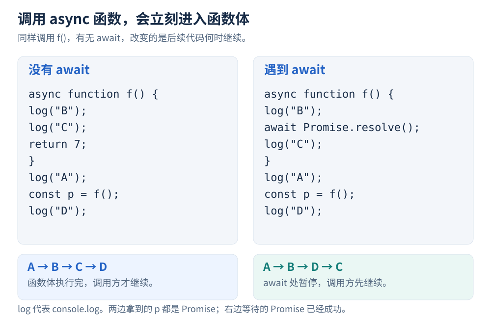
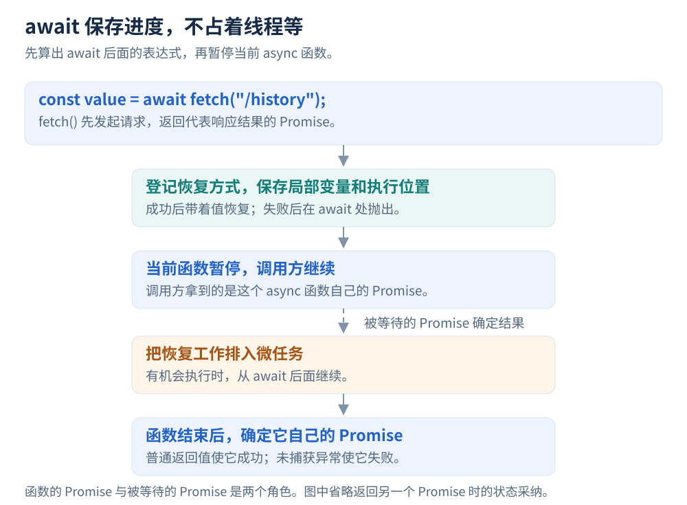
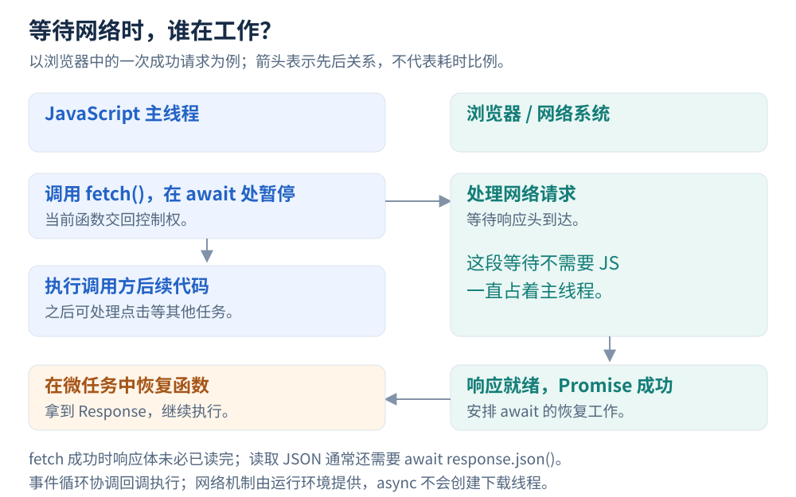
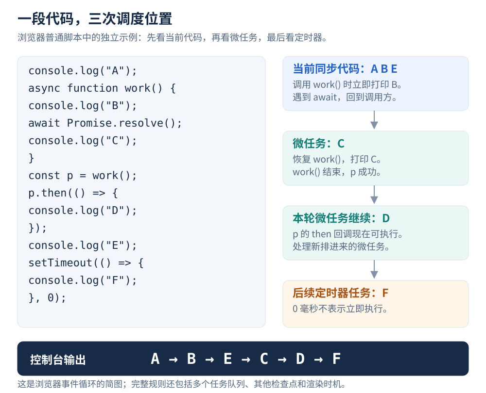
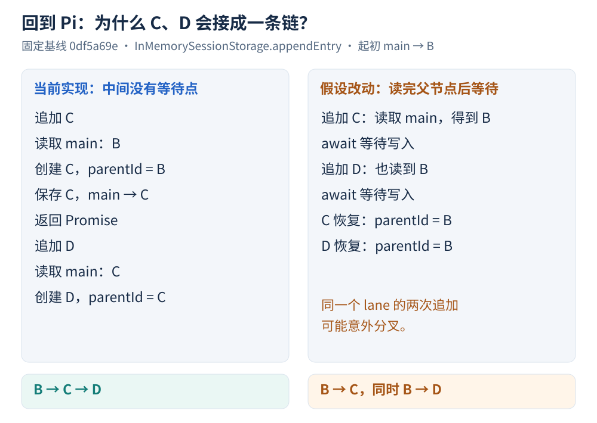
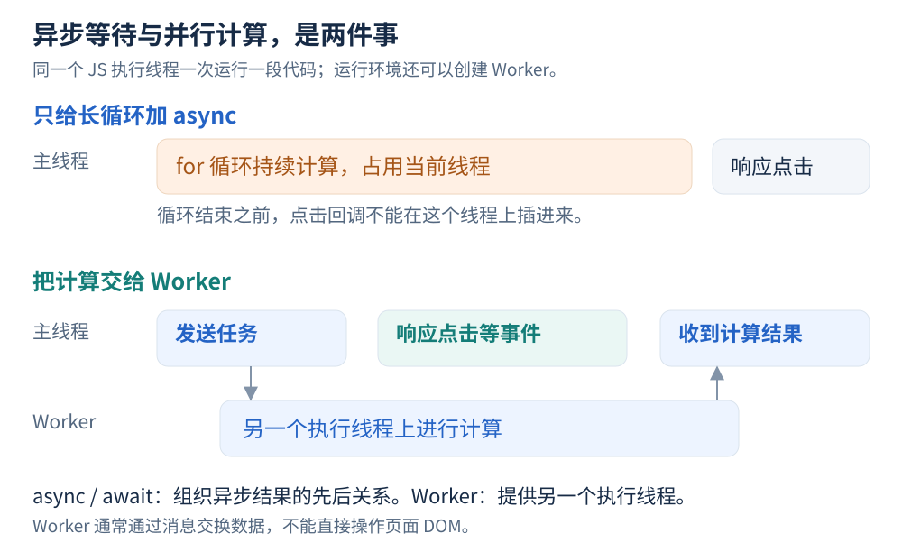

读 Pi 的 `appendEntry` 时，我卡在一个地方：方法明明写着 `async`，为什么还能说里面的一串更新会连续完成？

当时把“返回 Promise”理解成了“交给事件循环，稍后执行”。真正需要分开看的是：**函数什么时候开始，在哪里暂停，结果怎样交回来。**

## 调用后，先执行到哪里？



`async` 函数从调用处立即开始。执行路径没有遇到 `await`，函数体就会同步执行完；结果仍用 Promise 交付。右图即使等的是已经成功的 Promise，后半段也要稍后恢复。[MDN：async function](https://developer.mozilla.org/en-US/docs/Web/JavaScript/Reference/Statements/async_function#description)

## await 暂停了谁？



暂停的是这次函数执行，线程可以去执行别的代码。图里的“保存进度”对应规范中的执行上下文与恢复操作，不是给函数留一个阻塞线程。[ECMAScript：Await](https://tc39.es/ecma262/multipage/control-abstraction-objects.html#await)

```ts
async function readCount(): Promise<number> {
  return 7;
}

const p = readCount();     // p 是 Promise<number>
const count = await p;    // count 是 number；放在 async 函数或模块中
```

`Promise<number>` 是 TypeScript 的类型标注：成功结果是数字。`<number>` 不是线程数，也不会改变执行方式。[TypeScript 手册](https://www.typescriptlang.org/docs/handbook/2/everyday-types.html#functions-which-return-promises)

## 网络等待期间，线程在做什么？



Promise 记录结果状态：等待中、成功或失败。网络工作由宿主环境负责，Promise 本身不执行网络操作；`async` 也不负责创建线程。`fetch` 在收到响应状态和响应头后即可成功，读取完整响应体是下一步。[MDN：使用 Fetch](https://developer.mozilla.org/en-US/docs/Web/API/Fetch_API/Using_Fetch#handling_the_response)

## 事件循环到底把什么排到后面？



`work()` 当场打印 B。排到后面的是它在 `await` 之后的恢复工作。C 执行完，`work()` 的 Promise 才成功，D 才能进入微任务队列。

浏览器在微任务检查点持续取出微任务，直到队列清空。图中只是这个示例的顺序，不能把整个浏览器画成只有一条任务队列。[HTML 标准：微任务检查点](https://html.spec.whatwg.org/multipage/webappapis.html#perform-a-microtask-checkpoint)

## Pi 的追加操作为什么能接成一条链？



固定基线 `0df5a69e` 的关键语句如下，中间省略了校验、复制、索引与日志维护：

```ts
const parentId = this.requireLane(lane);
// …校验与复制
const entry = provisionEntry(clonedEntry, parentId, this.nextSequence());
// …保存条目与索引
this.lanes.set(lane, entry.id);
```

完整方法没有 `await`，这些内部操作也都是同步的。正常调用同一个内存实例时，C 已经推进末端，D 才开始读取。因此 `async` 没有破坏这里的连续更新。[Pi：memory.ts，第 137–149 行](https://github.com/earendil-works/pi/blob/0df5a69e5e119f8421f4f572d9a3c2ba4c0f5a39/packages/agent/src/harness/session/memory.ts#L137-L149)

右图是假设改动，用来说明风险。换成有异步 I/O 的后端，需要另外保证更新不交错；“放在一个函数里”本身不提供事务或失败回滚。

## 加上 async，长循环会让出线程吗？



不会。`async` 不会把计算搬走，甚至 `await heavyCalculation()` 也要先同步执行 `heavyCalculation()`。计算密集的工作可以交给 Worker；它与异步等待解决的是不同问题。[MDN：Web Workers](https://developer.mozilla.org/en-US/docs/Web/API/Web_Workers_API/Using_web_workers#web_workers_api)

## 再遇到 async 时，我会看这三处

- 调用后到第一个实际执行的 `await`，做了哪些同步工作？
- 被等待的操作是谁发起的，Promise 代表哪个结果？
- 恢复后要读写的状态，在等待期间有没有可能被改过？

学习入口用 MDN 和 TypeScript 手册；语言行为对照 ECMAScript，浏览器调度对照 HTML 标准。这里的事件循环图限定为浏览器示例，Pi 分析限定为上述固定提交。
