读完 Pi 的模型与工具循环后，我接着遇到一个问题：**Agent 正在工作时，用户又发来一句话，程序应该立即处理、排队等待，还是启动另一次运行？**

这篇从这个问题出发，用图解串起 `activeRun` 单飞检查、`steer()` / `followUp()` 两个队列，以及 `runLoop()` 的双层循环。重点是看清消息在什么时候生效，以及同一次运行怎样开始和结束。

> **版本说明**：源码基线固定为 [`0df5a69e`](https://github.com/earendil-works/pi/tree/0df5a69e5e119f8421f4f572d9a3c2ba4c0f5a39)，包版本号是 `0.83.0`，与正式 `v0.83.0` 标签不同。本文的行为判断只对应这一提交。
>
> **配套阅读**：[Pi 消息模型图解](/posts/pi-messages-content-blocks/) · [pi-agent-core V0.83.0 源码学习笔记](/posts/pi-agent-core-notes-v0-83-0/)。图中文字较多时，可以点击图片放大查看。

## 解决什么问题？

你让 Agent “读源码，解释项目架构”。它正在读文件，你又发来两句话：

- “重点解释消息队列，界面先不讲。”
- “讲完之后，再给我五道自测题。”

这两句话都要保存，但生效时机不同：第一句调整当前工作，第二句安排后续工作。

本文围绕一个问题展开：**一个正在工作的 Agent，怎样接住新的输入，又不让两次执行争着修改同一份对话状态？**

先约定几个会反复出现的词，读第一张图时不必猜：

| 本文用词 | 具体指什么 |
|---|---|
| 外部应用／调用者 | 使用 `Agent` 的程序，例如聊天界面背后处理发送按钮的代码 |
| 状态 | 程序当前保存的信息，例如历史消息、是否正在运行、哪些工具正在执行 |
| 队列 | 暂存尚未处理消息的列表，类似排队等候的人；“入队”就是放进去，“出队”就是取出来 |
| 一次运行 | 从启动处理到完成收尾的一段执行，可以多次调用模型和工具 |
| 一轮／轮次 | 一次模型响应，以及这次响应要求的工具处理；没有工具请求时，也算一轮 |
| 轮次边界／检查点 | 代码执行到的一个固定位置，例如这一轮完成后，检查有没有新消息 |

图中的 `prompt`、`steer`、`followUp` 是三个方法名，分别表示启动运行、补充当前要求、排队安排后续要求。`activeRun` 是 Agent 内部的一个字段，用来保存当前运行的控制信息；它存在，表示当前运行尚未收尾。


**看图要点：** 用户可以继续输入，但新输入不必等于新开一次运行。入口负责区分“启动”“调整”“排队”。程序不会自动理解一句话属于哪类，调用哪个接口由外部应用决定。

学完后，你应能回答：

1. 为什么有 `async`，仍然需要单飞？
2. `steer()` 和 `followUp()` 的队列结构有什么不同？
3. 为什么核心执行逻辑用了两层 `while`？
4. follow-up 与第二次 `prompt()` 有什么区别？
5. 取消后，历史和排队消息分别怎样变化？

---

## 1. 先认清三个尺度：Agent、Run、Turn

| 名称 | 初学者可以怎样理解 | 从什么时候存在，到什么时候结束 |
|---|---|---|
| Agent 实例 | 程序创建的一个 Agent 对象，保存自己的消息和运行状态 | 可以先后执行很多次运行 |
| Run，一次运行 | 从启动到完成收尾的执行过程 | 用 `activeRun` 跟踪 |
| Turn，一轮 | 一次模型响应，以及它引出的工具处理 | 一次运行可以包含多轮 |


**用户提出了两件事，不代表程序就创建了两次运行。** 看下面这个完整过程：

```text
你：解释项目架构。
    → 应用调用 prompt()，开始一次运行，创建 activeRun

Agent 还在解释时，你又说：解释完再出五道题。
    → 应用调用 followUp()，把这条消息加入队列
    → 不创建新的 activeRun

Agent 解释完架构
    → 取出队列里的“出五道题”
    → 继续调用模型，生成题目
    → 没有其他待处理输入后，结束本次运行，清除 activeRun
```

从你的角度看，先做了“解释架构”，再做了“出题”。从程序角度看，两件事在**同一次运行中先后完成**，中间没有重新启动运行。排队时保存的是“解释完再出五道题”这条消息，不是另一个已经启动的运行。

还有一个大小写区别：`ActiveRun` 是代码里定义的**类型名**，规定运行控制对象有哪些字段；`activeRun` 是 Agent 中**保存这个对象的字段名**。类型定义相当于规定表格有哪些栏目，实际对象相当于填写好的一张表。第 3 节会展开这些栏目。

**记忆与运行是两件事：** 一次运行结束，`activeRun` 会清除；`Agent._state.messages` 默认保留。同一个实例下次调用 `prompt()`，仍然可以使用历史。

`Agent._state.messages` 指 Agent 内部保存的消息数组。本文说的“上下文”，就是接下来调用模型时提供的材料，包括系统提示、对话消息和工具信息；“保留历史上下文”主要是说之前的消息还能用于后续调用。

源码入口：[Agent 状态](https://github.com/earendil-works/pi/blob/0df5a69e5e119f8421f4f572d9a3c2ba4c0f5a39/packages/agent/src/agent.ts#L68)、[ActiveRun](https://github.com/earendil-works/pi/blob/0df5a69e5e119f8421f4f572d9a3c2ba4c0f5a39/packages/agent/src/agent.ts#L161)。

## 2. 为什么“自由 async”可能把对话弄乱

### 2.1 异步不会自动替你排队

**两次调用同一个 `agent.prompt()`，使用的是同一个 Agent 对象，不会自动得到两套状态。**

```ts
// 假设移除了单飞检查：没有等待 A 完成，就尝试启动 B。
const first = agent.prompt("分析项目架构"); // A
const second = agent.prompt("修改 README"); // B
```

只需先记住三点：

| 概念 | 含义 |
|---|---|
| `async` / Promise | 调用异步函数就开始执行，并返回 Promise，用来观察操作完成或失败 |
| `await` | 当前函数等待这个操作，再执行后面的代码 |
| 交错执行 | A 等网络时，其他代码可以推进 B；不需要两个线程同时执行 |

**如果移除单飞检查，可能出现以下交错；当前 Pi 会拒绝第二次启动。**

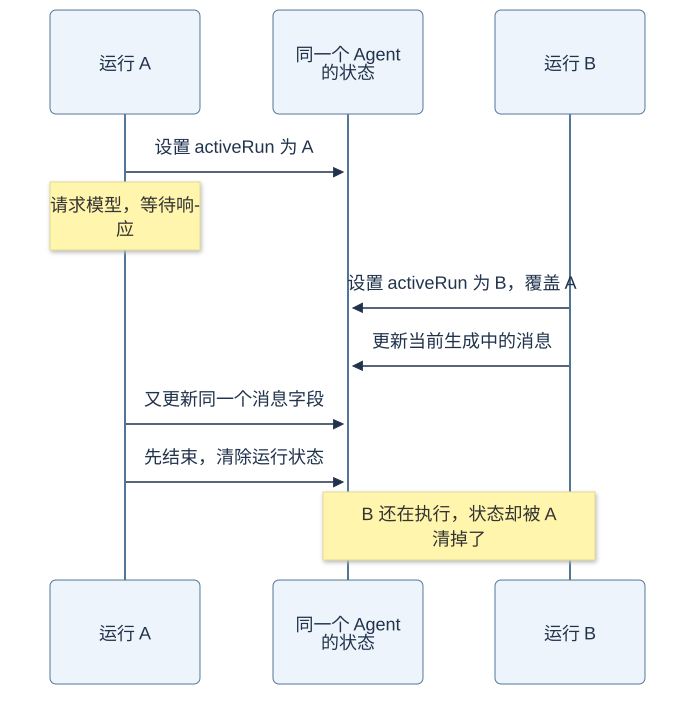

| 共享字段 | 可能乱在哪里 |
|---|---|
| `_state.messages`：消息历史 | A、B 的消息交错写入 |
| `_state.streamingMessage`：接收中的消息 | A、B 轮流覆盖；第 2.3 节画出它的更新方式 |
| `activeRun`：当前运行的控制信息 | 覆盖后取消对象不对，或提前清掉仍在使用的状态 |

这种结果依赖执行先后顺序、却没有被正确协调的问题，叫“竞态”。`_state` 是状态对象，`messages` 只是其中一个字段。

若只需顺序处理，可以写：

```ts
await agent.prompt("分析项目架构");
await agent.prompt("修改 README"); // 第一项完成后才开始
```

但其他按钮或请求处理代码也可能调用这个 Agent，所以 **Agent 自己仍要检查 `activeRun`，阻止重叠启动**。问题不是“调用两次”，而是“前一次没结束，又启动下一次”。

### 2.2 单飞：只让一个运行拥有当前执行位置

这里的“单飞”表示：**同一个 Agent 实例，同一时刻最多有一个活跃运行。** 它不是把相同请求合并，也不是让第二次 `prompt()` 自动等待。

`prompt()` 的入口检查，源码节选：

```ts
if (this.activeRun) {
    throw new Error(
        "Agent is already processing a prompt. Use steer() or followUp() to queue messages, or wait for completion.",
    );
}
```

见 [agent.ts:346](https://github.com/earendil-works/pi/blob/0df5a69e5e119f8421f4f572d9a3c2ba4c0f5a39/packages/agent/src/agent.ts#L346)。`continue()` 也检查；`runWithLifecycle()` 内部还有一次检查。

`if (this.activeRun)` 是在检查当前对象是否已经有运行；`throw new Error(...)` 表示报错，结束这次启动尝试。这里的 `continue()` 是 Agent 提供的方法，用已有消息继续执行，第 10 节再讲；`runWithLifecycle()` 则统一负责运行前的准备和运行后的清理。


`runWithLifecycle()` 接收一个叫 `executor` 的函数参数，里面是这次真正要执行的工作。它在开始等待这个函数完成之前，就先检查并设置 `activeRun`，中间没有 `await` 让出执行机会。这样，随后到来的启动调用就能看到“已经有运行”。

这项检查只管当前 Agent 对象，不能协调多个独立程序，也不能阻止其他代码绕开这些入口、直接修改状态。因此，它解决的是“同一 Agent 重复启动运行”的问题。

单飞限制的范围要看准：

| 情况 | 单飞是否禁止 |
|---|---|
| 同一 Agent 同时启动两个 `prompt()` | 禁止，第二次拒绝 |
| 两个不同 Agent 分别运行 | 不由这个实例级闸门禁止 |
| 一次运行中的多个工具并行执行 | 不禁止，由工具执行策略决定 |
| 运行中调用 `steer()` 或 `followUp()` | 不禁止，只入队 |

### 2.3 扩展：一张图看懂流式消息存在哪里

“流式”就是回答分多次到达，例如：`这个项目` → `这个项目是一个` → `这个项目是一个 Agent 工具库。`

**循环更新当前生成的消息；Agent 用临时字段展示进度，等消息结束再写入历史。**


**看图时只分两边：** `partialMessage` 属于函数本次调用；`_state` 里的字段属于 Agent 对象。`emit` 发出事件，也就是“消息更新了”这类通知，由 `processEvents` 处理。

图里的 `context.messages` 就是 `runLoop` 传入的 `currentContext.messages`，只是函数参数换了名字。

#### 用消息数量核对：11 → 12

假设模型响应前已有 11 条消息，包含本次用户输入。接下来生成一条 assistant 回答：

| 时刻 | 循环 `context.messages` | Agent `streamingMessage` | Agent `messages` |
|---|---|---|---|
| 开始前 | 11 条 | 空 | 11 条 |
| 开始生成 | 12 条，最后一条生成中 | 当前消息 | 11 条 |
| 内容更新 | 替换第 12 条，数量不变 | 更新为当前内容 | 11 条 |
| 消息结束 | 第 12 条成为最终消息 | 清空 | 追加最终消息，12 条 |

**每段文字不会变成一条新历史：生成中更新同一条，结束后才向 Agent 历史追加一次。**

#### 为什么要有两份数组？

```text
循环的 context.messages    → 给本次执行使用，包含生成中的消息
Agent 的 _state.messages   → 保存历史，在 message_end 时追加
```

在这条 `prompt()` 路径中，两者是不同数组，因此能采用不同的更新时间。不能直接改成同一个数组：循环已经追加了生成中的消息，Agent 在 `message_end` 时再追加，就会重复记录。

这不意味着每条消息内容都被彻底复制：**数组不同，但其中的消息对象仍可能被共享引用。**

#### 这与单飞有什么关系？

```text
假如允许两次运行重叠：
A 的 partialMessage ──发事件──┐
                             ├─ 同一个 Agent.processEvents
B 的 partialMessage ──发事件──┘          ↓
                              同一个 streamingMessage 被轮流覆盖
```

各自拥有局部变量，并不能避免最终更新同一个 Agent 状态时的冲突。

> 两个边界：`streamingMessage` 也会短暂接收用户消息或工具结果；`message_end` 只表示消息接收结束，不代表任务成功，错误或取消消息也可能进入历史。

源码对照：[循环更新消息](https://github.com/earendil-works/pi/blob/0df5a69e5e119f8421f4f572d9a3c2ba4c0f5a39/packages/agent/src/agent-loop.ts#L314)、[Agent 根据事件更新状态](https://github.com/earendil-works/pi/blob/0df5a69e5e119f8421f4f572d9a3c2ba4c0f5a39/packages/agent/src/agent.ts#L540)。

## 3. 两个 Promise：执行工作与等待收尾

`runWithLifecycle()` 为当前运行准备一个控制对象。下面是这个对象的类型定义，**只规定字段结构，不会启动任何工作**：

```ts
type ActiveRun = {
    promise: Promise<void>;
    resolve: () => void;
    abortController: AbortController;
};
```

| 字段 | 作用 |
|---|---|
| `promise` | 给 `waitForIdle()` 的调用者等待本次运行收尾 |
| `resolve` | 由 `finishRun()` 通知上述 Promise 完成 |
| `abortController` | 发出当前运行的取消信号 |

executor 是传进来的工作函数，它自己的返回 Promise 与 `activeRun.promise` 不是同一个对象：前者让 `runWithLifecycle()` 等待工作执行，后者让外部代码通过 `waitForIdle()` 等待整个运行收尾。`waitForIdle` 直译就是“等待空闲”。

`finishRun()` 是实际清理运行状态的方法。它放在 `finally` 中；`finally` 是 JavaScript 异常处理的一部分，意思是执行离开前面的处理代码时，无论成功还是出错，都进入这段收尾代码。


`Promise<void>` 的意思是“异步完成，但不提供有用的返回值”。`resolve: () => void` 表示“一个不接收参数、没有有用返回值的函数”。

`resolve()` 在这里负责通知等待者“完成了”。`abortController` 保存取消控制器，它的 `signal` 对象会一路传给模型调用和工具；调用控制器的 `abort()` 后，接收方通过检查或监听 signal 来响应取消。传入信号本身不会强制终止任意函数。

这里的“空闲”不是“成功”：即使工作失败，收尾完成后也可以变为空闲。源码：[runWithLifecycle](https://github.com/earendil-works/pi/blob/0df5a69e5e119f8421f4f572d9a3c2ba4c0f5a39/packages/agent/src/agent.ts#L482)、[finishRun](https://github.com/earendil-works/pi/blob/0df5a69e5e119f8421f4f572d9a3c2ba4c0f5a39/packages/agent/src/agent.ts#L525)。

## 4. 双队列：同一种容器，两种生效时机

把 Agent 想成正在给你讲课的老师：

- `steer`：递纸条说“这一段请用 Java 类比”。老师在当前讲解单元结束后，调整接下来的内容。
- `followUp`：递纸条说“这部分讲完，再出五道题”。老师在本来准备结束时，接上后面的安排。

类比只说明时机：程序不会判断用户是否满意，也不会保证现实中的工作已完成。

下面图中的“注入消息”就是**把取出的消息加入模型下一次要读取的上下文**。`pendingMessages` 是临时保存这些消息的局部变量；它与两个队列不同，里面的消息已经从队列取出了。

“发出事件”是通知其他代码某件事发生了，例如“消息开始”“工具结束”。`emit()` 负责发出通知；接收通知的函数叫监听器或订阅者。例如，界面可以用监听器显示进度，第 8 节会解释这些函数与收尾的关系。


### 4.1 入队不等于执行

以下为实际源码：

```ts
steer(message: AgentMessage): void {
    this.steeringQueue.enqueue(message);
}

followUp(message: AgentMessage): void {
    this.followUpQueue.enqueue(message);
}
```

见 [agent.ts:282](https://github.com/earendil-works/pi/blob/0df5a69e5e119f8421f4f572d9a3c2ba4c0f5a39/packages/agent/src/agent.ts#L282)。两者都要接收下面这种消息对象，不能像 `prompt("一句话")` 那样直接传字符串。

方法声明中的 `message: AgentMessage` 表示参数名是 `message`、类型是 `AgentMessage`；末尾的 `: void` 表示不返回有用的值。示例中的 `role` 标记谁发的消息，`content` 保存内容，`timestamp` 记录时间。

```ts
// 用法片段：假设 agent 已创建，并且正在运行。
agent.steer({
    role: "user",
    content: [{ type: "text", text: "重点讲消息队列，界面先不讲。" }],
    timestamp: Date.now(),
});

agent.followUp({
    role: "user",
    content: [{ type: "text", text: "讲完之后给我五道自测题。" }],
    timestamp: Date.now(),
});
```

这两个方法只是入队。空闲时调用它们，不会自动启动运行。运行中调用它们，也不会另外创建 `ActiveRun`。

### 4.2 steering 不会强制打断当前工具

```text
工具已经开始修改文件 ─────────────── 工具结束
          ↑                             ↓
      收到 steer                  在轮次检查点取出
   “先别修改文件”                        ↓
                                  下次模型才读到要求
```

因此，不能用 steering 保证撤销已经发生的修改，或阻止已经开始的写文件、发请求等操作。`abort()` 是另一条取消路径，发出信号后也要由模型调用或工具配合停止，这叫“协作式取消”。

在此版本的正常路径中，steering 的轮次检查点位于**本轮模型响应、工具批次处理、轮次事件及相关钩子之后**，不是随时检查，也不是每执行完一个工具就插入。

“工具批次”指一次模型响应里请求的那一组工具；“钩子”指调用者可以提供的额外处理函数，循环在约定位置调用它。例如，`shouldStopAfterTurn` 让应用在一轮结束后决定是否停止。第一次阅读时，可以先假设没有配置这些额外函数。

### 4.3 每次取一条，还是一次取全部

两个队列都由 [PendingMessageQueue](https://github.com/earendil-works/pi/blob/0df5a69e5e119f8421f4f572d9a3c2ba4c0f5a39/packages/agent/src/agent.ts#L125) 实现，默认模式均为 `one-at-a-time`。

```text
队列原来：[S1, S2, S3]

one-at-a-time：
    第一次 drain → 取出 [S1]，队列剩 [S2, S3]
    第二次 drain → 取出 [S2]，队列剩 [S3]

all：
    一次 drain   → 取出 [S1, S2, S3]，队列剩 []
```

图中的 S1、S2、S3 只是按到达顺序给消息起的编号。FIFO 表示先入先出：先来的 S1 先被取走。`drain()` 是这里“从队列取消息”的方法名；它不只是读取，还会把取出的消息从队列中移除。`all` 是一次注入多条消息，不是同时启动多个运行。

配置方式是：

```ts
agent.steeringMode = "all";
agent.followUpMode = "one-at-a-time";
```

## 5. 为什么是双层循环：外层专门接住 follow-up

### 5.1 内层与外层不是“内存层”

“内层循环”就是写在另一个循环花括号里的循环。两层都在同一个 `runLoop()` 函数中执行，不是两个线程，也不是两个 Agent。

```text
外层 while {
    内层 while {
        模型 → 工具 → 再调用模型
        期间在轮次边界接收 steering
    }

    模型不再请求工具，也没有待注入消息，内层结束
    检查 follow-up，要么再进入内层，要么结束
}
```

### 5.2 一张图走通正常路径

以下图只展示正常处理顺序；模型错误、取消结果或应用提供的停止判断可以让它提前退出。图中的 `turn_end` 表示“一轮结束”事件，`agent_end` 表示“本次循环结束”事件；二者不是同一件事。


**读图顺序：** 先沿着“模型—工具”的小圈走一遍，再沿着 follow-up 返回外层的大圈走一遍。

### 5.3 对照代码骨架

下面是教学伪代码，保留调度结构，省略模型异常、工具终止结果、事件细节和轮次钩子；不是可直接运行的源码替代品。

“伪代码”是为了说明步骤写的简化代码。下面的 `takeSteering()`、`callModel()` 等名字是教学用的，不是让你去源码中搜索的函数名。`||` 表示“或者”，`!` 表示取反；`batch` 是一批工具的执行结果，`batch.terminate` 表示这批结果是否要求不再因工具调用而继续下一轮。

```ts
let pendingMessages = await takeSteering();

while (true) {                         // 外层：在准备停止时承接 follow-up
    let hasMoreToolCalls = true;       // 确保至少先调用一次模型

    while (hasMoreToolCalls || pendingMessages.length > 0) {
        injectMessages(pendingMessages);
        pendingMessages = [];

        const message = await callModel();
        hasMoreToolCalls = false;

        if (hasToolCalls(message)) {
            const batch = await executeTools(message);
            appendToolResults(batch.messages);
            hasMoreToolCalls = !batch.terminate;
        }

        await finishTurn();
        pendingMessages = await takeSteering();
    }

    const followUps = await takeFollowUps();
    if (followUps.length > 0) {
        pendingMessages = followUps;
        continue;                     // 继续外层，复用同一个内层执行过程
    }

    break;                            // 退出外层
}

await emitAgentEnd();
```

真实位置：[runLoop 开始](https://github.com/earendil-works/pi/blob/0df5a69e5e119f8421f4f572d9a3c2ba4c0f5a39/packages/agent/src/agent-loop.ts#L155)、[steering 与 follow-up 检查点](https://github.com/earendil-works/pi/blob/0df5a69e5e119f8421f4f572d9a3c2ba4c0f5a39/packages/agent/src/agent-loop.ts#L259)。

三个语法要点：

- `while (条件)`：每次进入循环体前重新判断，条件为假就往循环后面走。
- `break`：退出所在的最近一层循环。
- `continue`：跳到所在循环的下一次迭代。这里 follow-up 分支的 `continue` 位于内层之外，所以继续的是外层。

### 5.4 外层专门区分“当前还要继续”和“之后还有事情”

**这段实现中，外层循环确实用于支持 follow-up：在当前工作本来可以停下时，取出后续消息，复用内层循环继续执行。**

源码的外层注释直接说明：

```ts
// Outer loop: continues when queued follow-up messages arrive after agent would stop
```

内层注释则是：

```ts
// Inner loop: process tool calls and steering messages
```

为什么不把 follow-up 和 steering 一起在每轮末尾取出？因为那会让“讲完再出题”的要求提前进入上下文，失去“当前执行本来要停时才接上”的调度语义。

| 层次 | 要回答的问题 |
|---|---|
| 内层 | 当前执行还有工具后续，或者有调整方向的新输入吗？ |
| 外层 | 内层已经结束，有没有排队的后续要求？ |

也可以把这些判断写进一个更复杂的 `while` 中，实现同样的处理顺序。**双层不是唯一写法，它把两个继续条件分开放在了结构里。** 也不是因为有两个队列就必然要写两层；关键是两种消息要求在不同时间被取出处理。

`hasMoreToolCalls = true` 的初始值是为了让循环先执行一次，不是模型已经请求了工具。工具执行后的这个标记则驱动后续轮次；不要把变量名理解成“已经收到了下一批工具调用”。

## 6. 两个队列同时有消息：谁先处理？

设默认每次取一条，在某轮结束前已经有：

```text
steeringQueue = [S1：重点讲队列, S2：加一个 Java 类比]
followUpQueue = [F1：出五道题, F2：给参考答案]
```

假设没有新输入、错误、取消和提前终止，并且模型有限轮次后不再请求工具：

下面图中“执行耗尽”只表示内层循环没有继续的条件：不再需要因工具结果继续调用模型，也没有待注入消息；不是说程序证明了用户目标已经完成。

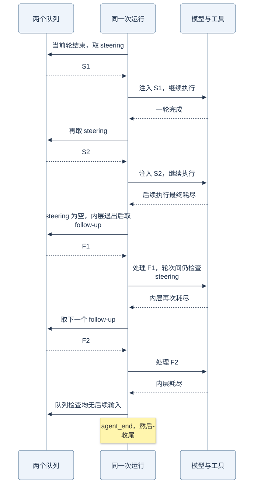

“steering 优先”的准确含义是：**循环先在轮次边界检查 steering，内层结束后才检查 follow-up。**

这种优先不是“后来的 steering 可以立刻挤掉正在处理的消息”：F1 已开始执行时新来 S3，S3 要等下一次 steering 检查点。程序只在固定位置查看当时已经排队的消息，不会随时重新排列所有工作。

如果 steering 不断到来，内层可能一直不退出，follow-up 就可能一直等待。这段代码没有“处理 N 条 steering 后必须执行一条 follow-up”的公平调度规则。

## 7. “结束后再 prompt 不就行了？”——可以

下面的用法完全成立：

```ts
await agent.prompt("解释项目架构");
await agent.prompt("根据刚才的解释，整理五道自测题");
```

第二次 `prompt()` 仍会使用同一 Agent 中保留的历史。`followUp()` 不是延续上下文的必要条件。


| 比较项 | 结束后再 `prompt()` | 运行期间 `followUp()` |
|---|---|---|
| 排队责任 | 外部应用保存输入、安排启动顺序 | Agent 内部保存并按检查点消费 |
| 历史上下文 | 同一实例可以保留 | 同一实例可以保留 |
| 活跃运行 | 前后两个 ActiveRun | 消费后续要求时仍是同一个 ActiveRun |
| 初始 prompt 的等待范围 | 第一次运行收尾 | 包含本次运行中继续消费的后续要求 |
| 取消控制器 | 两次运行分别创建 | 延续当前运行的控制器 |

例如：用户在“解释架构”尚未完成时又输入“之后出题”。应用可以自行存起来、等运行结束后调用 `prompt()`；也可以现在交给 `followUp()`。区别是由谁承担排队，以及是否需要分开两次运行的生命周期。

## 8. 收尾：agent_end 和空闲不是同一个瞬间


本版本会等待这些函数返回；如果监听器返回 Promise，就等待该 Promise 完成。因此，“循环发出了结束通知”和“整个运行已经清理完毕”之间，还可能有一段等待监听器的时间。下图中的 `Agent.processEvents` 是处理并分发这些事件的方法。

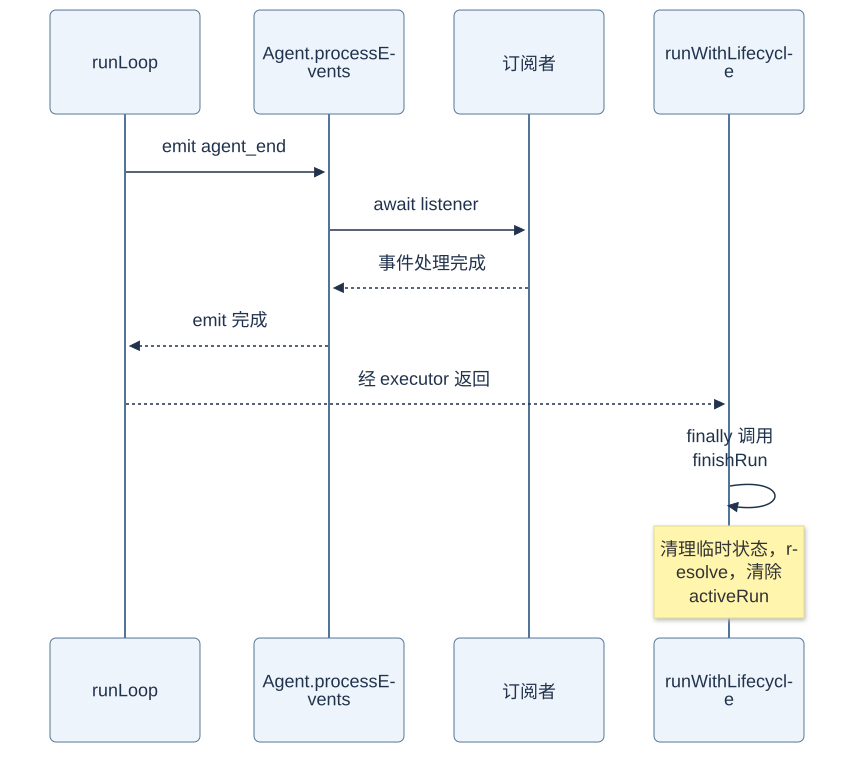

`agent_end` 是循环发出的最后一种正常结束通知；“事件流”就是这些通知按时间先后组成的序列。发出这条通知后，还要等相应监听器处理完成，再清理运行状态。`waitForIdle()` 等的是清理完成，而不只是收到结束通知。

因此，监听器里不要这样写：

```ts
// 错误示意：会形成相互等待。
agent.subscribe(async (event) => {
    if (event.type === "agent_end") {
        await agent.waitForIdle();
    }
});
```

```text
finishRun 等 executor 返回
executor 等事件监听器返回
监听器等 waitForIdle
waitForIdle 又等 finishRun
```

`waitForIdle()` 适合外部观察者等待。异步监听器是被当前运行等待的参与者，不能再等待当前运行自身收尾。源码：[processEvents](https://github.com/earendil-works/pi/blob/0df5a69e5e119f8421f4f572d9a3c2ba4c0f5a39/packages/agent/src/agent.ts#L540)。

如果循环抛异常，`runWithLifecycle()` 会尝试通过 `handleRunFailure()` 合成失败消息和结束事件，`finally` 负责收尾。但不要把它推广成“任意故障下事件流都绝对完整”：如果失败处理里的监听器再次抛错，后续事件仍可能无法发出。

## 9. abort 后，两个队列会清空吗？

**不会因为 `abort()` 或 `finishRun()` 自动清空。** 两个队列属于 Agent 实例，不属于某次 `ActiveRun` 的临时资源。


取消是协作式的，不是按下按钮就冻结所有代码。因此更准确的说法是：**取消收尾后仍留在队列中的消息，会继续保留。** 不能保证调用 `abort()` 那一瞬间的队列内容原样不动。

还要分清三个位置：

| 位置 | 消息处于什么状态 |
|---|---|
| 队列中 | 尚未被 `drain()` 取出 |
| 局部 `pendingMessages` | 已出队，正在等待注入，不再算队列中 |
| Agent 消息历史中 | 已通过消息事件进入历史，可能还没被模型充分处理 |

取消不会自动把已出队的消息重新放回队列；也没有“只要没处理完，就一定下次自动重试”的投递保证。已经进入历史的内容会随历史保留。

### 清理策略由应用选择

| 操作 | 取消当前运行 | 清空队列 | 清空历史 |
|---|---|---|---|
| `abort()` | 发出取消请求 | 否 | 否 |
| `clearSteeringQueue()` | 否 | 仅 steering | 否 |
| `clearFollowUpQueue()` | 否 | 仅 follow-up | 否 |
| `clearAllQueues()` | 否 | 两个队列 | 否 |
| `reset()` | 不替代取消流程 | 是 | 是 |

如果产品希望“停止并清除剩余排队输入”，可以按如下顺序组织。**前提是应用同时停止接收新的入队操作，也没有其他调用者启动新运行。**

```ts
agent.abort();
await agent.waitForIdle();
agent.clearAllQueues();
```

若还要清空对话，则在安全空闲后调用 `reset()`。不要把 `reset()` 当作强行停止正在运行的代码的方法。

本节源码：[清理队列与 abort](https://github.com/earendil-works/pi/blob/0df5a69e5e119f8421f4f572d9a3c2ba4c0f5a39/packages/agent/src/agent.ts#L292)、[reset](https://github.com/earendil-works/pi/blob/0df5a69e5e119f8421f4f572d9a3c2ba4c0f5a39/packages/agent/src/agent.ts#L332)。

## 10. 加餐：continue 为什么会读取队列

`continue()` 不会记住上次停在源码的哪一行并从那里恢复，而是根据当前保存的消息和排队输入，启动新的运行。它也不能在已有 `activeRun` 时启动。

这里是方法调用 `agent.continue()`，与前面循环里的 `continue;` 关键字不同：前者是 Agent 的功能入口，后者只是跳到下一次循环。下图的 `assistant` 是模型发出的消息的角色名；`user` 表示用户消息，`toolResult` 表示工具结果消息。


在默认每次取一条模式下，`skipInitialSteeringPoll` 避免已经取出 S1 当作本次输入后，循环开头立刻再取 S2，从而在首次模型响应前消费两条。它不是消息去重系统。

最后一条为 assistant 时，不能直接调用底层继续入口，是这个版本的入口约束；有排队输入时，`Agent.continue()` 可以把它们转成新的本次输入。见 [agent.ts:357](https://github.com/earendil-works/pi/blob/0df5a69e5e119f8421f4f572d9a3c2ba4c0f5a39/packages/agent/src/agent.ts#L357)。

## 11. 容易混淆的几个说法

读源码时，下面几种说法容易被理解得过宽，需要对照具体实现来看：

| 容易产生的理解 | 对照当前源码应怎样理解 |
|---|---|
| steer “打断当前工作” | 在检查点注入输入，不自动中断模型请求或工具 |
| 单飞消灭所有并发 | 限制同一 Agent 的重叠运行，不禁止并行工具或多个实例 |
| agent-loop “无状态” | 它不会像 Agent 对象那样跨多次调用保存自己的对话历史；单次执行仍有局部变量，并会更新传入的上下文 |
| 循环不知道两种队列 | 它通过 `getSteeringMessages` 等函数取消息，不直接访问队列对象；但仍决定何时调用这些函数。把函数交给另一段代码，在需要时调用，就叫“回调” |
| state 是完全只读快照 | 读取 `agent.state` 得到的是内部状态对象，不是一份所有内容都禁止修改的独立副本。例如，此版本允许给 `agent.state.messages` 赋值 |
| 失败时事件一定完整闭合 | 有失败补发路径，但监听器再次失败时不能作绝对保证 |

这是将概括性的教学语言落到具体行为上，不需要在第一遍就展开所有边界。

## 12. 自测：用图和源码回答

### 题目

1. 同一 Agent 正在运行时，再调用 `prompt()`，会自动排队吗？应该使用哪些入口？
2. 工具正在执行时调用 `steer()`，是否立即停止工具？新输入通常在哪个位置被读取？
3. 内层退出了，为什么整个 `runLoop()` 还可能不结束？
4. 两个队列都有消息，follow-up 是否一定在有限时间内被执行？
5. 第二次 `prompt()` 也能保留上下文，`followUp()` 还有什么价值？
6. `abort()` 收尾后，队列里还有一条旧 steering；此时输入全新的问题，可能发生什么？
7. 收到 `agent_end` 的监听器能否 `await agent.waitForIdle()`？
8. 如果只想保留“当前连续执行”，没有 follow-up 需求，外层循环还承担什么原有职责？

<details>
<summary>展开自测参考答案</summary>

1. 不自动排队；活跃时新 `prompt()` 会拒绝。调整输入用 `steer()`，后续要求用 `followUp()`，也可以由应用自行等空闲再调用 `prompt()`。
2. 不会自动停止。正常路径在轮次末尾读取 steering，下一轮模型请求前注入；启动时也检查一次。
3. 外层要检查 follow-up。有后续输入，就继续复用内层执行，不创建新的 ActiveRun。
4. 不保证。持续的 steering、持续的工具后续，以及异常或显式停止，都可能影响它的消费。
5. 将运行期间到达的后续输入交给 Agent 排队，并纳入当前运行的生命周期；不是为了让历史得以保留。
6. 旧 steering 可能在新运行开头被注入，与新问题共同影响模型。若产品不希望如此，应显式管理队列清理。
7. 不应这样做，会形成当前运行等待监听器、监听器又等待当前运行收尾的依赖环。
8. 外层原本承担“执行耗尽后接入 follow-up”的职责；没有这项需求时，概念上可只保留内层连续执行和退出收尾。但本文不建议直接删代码，真实改动还要核对事件与入口行为。

</details>

## 13. 源码阅读路线与证据边界

建议第二遍按以下顺序打开，每次先回答右侧问题，再看实现。

| 顺序 | 源码入口 | 要回答的问题 |
|---|---|---|
| 1 | [agent.ts:125](https://github.com/earendil-works/pi/blob/0df5a69e5e119f8421f4f572d9a3c2ba4c0f5a39/packages/agent/src/agent.ts#L125) | 队列怎样入队、取出、清空？ |
| 2 | [agent.ts:282](https://github.com/earendil-works/pi/blob/0df5a69e5e119f8421f4f572d9a3c2ba4c0f5a39/packages/agent/src/agent.ts#L282) | 两个公开入口是否立即启动工作？ |
| 3 | [agent.ts:346](https://github.com/earendil-works/pi/blob/0df5a69e5e119f8421f4f572d9a3c2ba4c0f5a39/packages/agent/src/agent.ts#L346) | 单飞在哪里拒绝重叠启动？ |
| 4 | [agent.ts:471](https://github.com/earendil-works/pi/blob/0df5a69e5e119f8421f4f572d9a3c2ba4c0f5a39/packages/agent/src/agent.ts#L471) | Agent 如何把具体队列交给循环？ |
| 5 | [agent-loop.ts:163](https://github.com/earendil-works/pi/blob/0df5a69e5e119f8421f4f572d9a3c2ba4c0f5a39/packages/agent/src/agent-loop.ts#L163) | 内层怎样启动、注入消息和继续？ |
| 6 | [agent-loop.ts:259](https://github.com/earendil-works/pi/blob/0df5a69e5e119f8421f4f572d9a3c2ba4c0f5a39/packages/agent/src/agent-loop.ts#L259) | 两种输入在哪两个时机被取出？ |
| 7 | [agent.ts:482](https://github.com/earendil-works/pi/blob/0df5a69e5e119f8421f4f572d9a3c2ba4c0f5a39/packages/agent/src/agent.ts#L482) | 一个 ActiveRun 的边界在哪里？ |
| 8 | [agent.ts:525](https://github.com/earendil-works/pi/blob/0df5a69e5e119f8421f4f572d9a3c2ba4c0f5a39/packages/agent/src/agent.ts#L525) | 收尾清理什么，又保留什么？ |

线上固定版本：[agent.ts](https://github.com/earendil-works/pi/blob/0df5a69e5e119f8421f4f572d9a3c2ba4c0f5a39/packages/agent/src/agent.ts)、[agent-loop.ts](https://github.com/earendil-works/pi/blob/0df5a69e5e119f8421f4f572d9a3c2ba4c0f5a39/packages/agent/src/agent-loop.ts)。

本文参考《agent 三十天速成》第 3 章，并根据固定提交源码核对。图中的对话、时间线与队列示例是教学推演，不是实际模型运行日志；伪代码已单独标注。这些说明不是模型或工具的运行测试结果，也不代表新版 pi-durable 的实现。

最后，请尝试不看源码，画出这条路线并解释每个箭头：

```text
单飞限制重叠启动
    ↓
双队列接住运行期间的新输入
    ↓
内层处理工具与 steering
    ↓
外层在准备结束时接上 follow-up
    ↓
没有后续输入，结束事件处理后统一收尾
```
