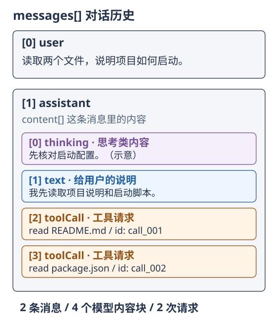
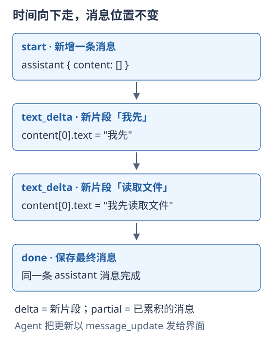
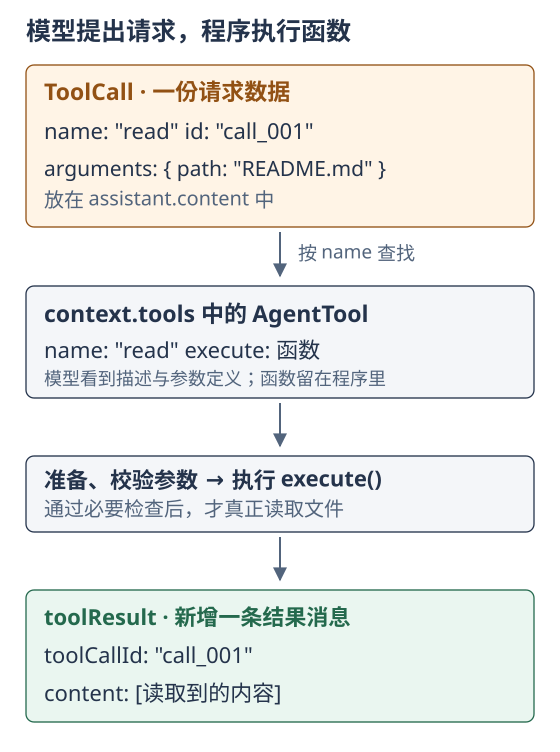
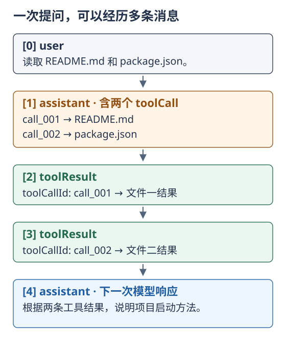
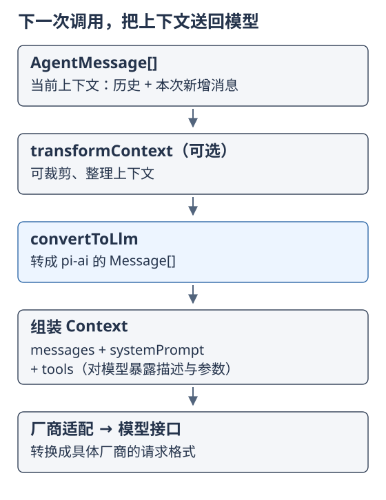

读 Pi 的 Agent 循环时，我最容易混淆的是三个层级：**消息、内容块、流式事件**。这篇用“读取两个文件，说明项目如何启动”串起它们，再看工具如何真正执行。

> 阅读基线：固定提交 `0df5a69e`，包版本号为 `0.83.0`，与正式 `v0.83.0` 标签不同。以下是普通流式路径的教学示意，省略了元数据和部分事件，不是真实运行记录。

## 一条消息，可以装下多个内容块

先记住两层标记：**`role` 回答“谁发来的”，`type` 回答“这块是什么”。**



图中的 `content[2]` 是第二条消息里的**第 3 个内容块**，因为数组从 0 开始计数。四个块仍属于同一条 `assistant` 消息。

| 消息的 role | content 可以包含什么 | 用途 |
| --- | --- | --- |
| `user` | 字符串，或文字 / 图片块数组 | 用户提出要求 |
| `assistant` | 文字 / 思考 / 工具调用块数组 | 模型表达说明、提出动作 |
| `toolResult` | 文字 / 图片块数组 | 程序返回执行结果 |

**`thinking` 不一定出现**，也不等于模型完整的内部推理。它承载接口提供的思考类内容，可能有可读文本，也可能带不透明的签名数据。即使其中写着“读取文件”，也不会因此执行工具。

<details>
<summary>补一点 TypeScript：怎么看内容块数组？</summary>

```ts
content: (TextContent | ThinkingContent | ToolCall)[];
```

`|` 表示“可以是其中一种”，`[]` 表示数组。数组中的每个元素分别选择一种类型，所以文字、思考、工具请求可以混在同一个数组里。代码通过 `type` 字段区分它们。

</details>

## 流式生成，更新的是同一条消息

一次模型响应可以产生很多事件。**事件记录变化过程；消息保存累积内容。**



| 字段 / 事件 | 快速理解 |
| --- | --- |
| `delta` | 这次新到的片段 |
| `event.partial` | 下层适配代码已累积出的当前消息 |
| `contentIndex` | 当前消息内的块下标，如 `content[2]` |
| `message_update` | Agent 向订阅者通知消息更新 |

收到 20 次增量，不会因此新增 20 条历史消息。文字、思考和工具参数都可以逐步到达；图中只画了文字更新。

**`message_end` 表示这条消息结束。** 后面仍可能执行工具、再次调用模型；`agent_end` 才是本次运行的最后一个事件。

## 工具请求，怎样变成真正的执行？

**`ToolCall` 是模型生成的请求数据；`AgentTool` 是程序提供的可执行工具。** 两者通过 `name` 连接。



这里有两种关联，作用不同：

- **`name` 找实现**：`read` 对应哪个工具函数。
- **`id ↔ toolCallId` 对结果**：同一个 `read` 调用两次，也能分清各自的返回值。

核心循环在模型消息结束后，筛选 `type === "toolCall"` 的块，再进入执行流程。普通文字和思考内容不参与这个筛选。

<details>
<summary>请求出现了，就一定会执行吗？</summary>

不一定。工具不存在、参数校验失败、执行前钩子拦截或取消，都可能阻止执行。本版本还会拒绝执行因 `length` 截断而可能不完整的工具请求，并生成错误结果；模型以 `error` / `aborted` 结束时，则直接结束这一轮运行。

</details>

## 工具结果，是新增的历史消息

工具结果通过调用 ID 关联请求，**以独立的 `toolResult` 消息加入历史**。正常继续运行时，模型再根据这些结果生成下一条回答。



这段示例最终有 **5 条消息**。结果不会填回原来的 `ToolCall` 块；两个工具请求也不会自动拆成两条 `assistant` 消息。图中展示的是历史排列，不表示工具必须按此顺序串行执行。

## 下一次调用，模型能看到哪些内容？

循环从**当前上下文中的消息列表**开始准备下一次请求，其中包含历史和刚加入的工具结果；具体送出哪些消息，由转换配置决定。



`AgentMessage` 允许应用扩展自定义消息，`Message` 是 pi-ai 的统一消息类型。`convertToLlm` 负责跨过这个边界；默认实现只保留 `user`、`assistant`、`toolResult` 三种角色，自定义消息需要自行转换。

`systemPrompt` 在 `Context` 中单独存放。它不属于本版本 `Message` 联合中的第四种角色。消息历史也是内存状态，仅有这些结构并不代表已经实现持久化或崩溃恢复。

## 30 秒回顾

| 看到什么 | 应该想到什么 |
| --- | --- |
| `messages → message → content[]` | 历史 → 一条消息 → 多个内容块 |
| `role / type` | 消息来源 / 内容块种类 |
| 很多 `delta` | 同一条消息逐步补全 |
| `toolCall` | 请求动作，等待程序处理 |
| `toolResult` | 独立结果消息，用 ID 关联请求 |
| 工具结果加入上下文 | 下一次模型调用可以利用执行结果 |

## 对照源码

按需要查这四处即可，不必先读完整个仓库。链接均固定到本文的阅读提交。

- [内容块与消息类型 · ai/src/types.ts](https://github.com/earendil-works/pi/blob/0df5a69e5e119f8421f4f572d9a3c2ba4c0f5a39/packages/ai/src/types.ts#L334-L444)
- [上下文转换与流式更新 · agent/src/agent-loop.ts](https://github.com/earendil-works/pi/blob/0df5a69e5e119f8421f4f572d9a3c2ba4c0f5a39/packages/agent/src/agent-loop.ts#L281-L372)
- [筛选工具请求与加入结果 · agent/src/agent-loop.ts](https://github.com/earendil-works/pi/blob/0df5a69e5e119f8421f4f572d9a3c2ba4c0f5a39/packages/agent/src/agent-loop.ts#L195-L228)
- [查找、校验与执行工具 · agent/src/agent-loop.ts](https://github.com/earendil-works/pi/blob/0df5a69e5e119f8421f4f572d9a3c2ba4c0f5a39/packages/agent/src/agent-loop.ts#L599-L686)

继续阅读：[Pi Agent Core 源码学习笔记](../pi-agent-core-notes-v0-83-0/)。
