模型提出工具调用以后，真正执行工具的是应用侧。这篇沿着 Pi 的 `runLoop`，梳理工具执行的三段管线，再看一批调用如何并发执行、如何按顺序写入对话。

文章保留了学习时的疑问，并用六张图串起调用关系。先看总图，再分别看 prepare、execute、finalize，以及顺序和并行路径；图片可点击放大。

> **阅读基线**：固定提交 [`0df5a69e`](https://github.com/earendil-works/pi/tree/0df5a69e5e119f8421f4f572d9a3c2ba4c0f5a39)，agent 包版本为 `0.83.0`，与正式 `v0.83.0` 标签不同。本文参考《agent 三十天速成》第二章并对照该提交静态核查，示例不是真实工具运行记录，讨论也不代表新版 durable 的行为。
>
> **配套阅读**：[Pi 消息模型图解](/posts/pi-messages-content-blocks/) · [Pi Agent 单飞与双队列](/posts/pi-agent-single-flight-dual-queues/)。

## 1. 工具执行在 loop 中的位置

### 1.1 工具调用总体图

这张图依据固定阅读基线的当前实现绘制。箭头表示处理关系；工具批次内部先展示单个调用的分支，具体并发时序后续单独展开。



读图时先抓住三点：

1. **模型提出调用，应用执行工具。** assistant 消息里的 `toolCall` 携带名称、参数和调用 ID，实际执行发生在 `tool.execute`。
2. **不是每个调用都会走完三段。** prepare 返回 `immediate` 时直接形成结果；只有返回 `prepared` 才进入 execute 和 finalize。整个响应被 length 截断时，还会绕过三段流程。
3. **工具结果回到上下文，供后续模型调用使用。** 是否继续还受 turn 后的停止判断和消息队列影响，`terminate` 不能直接等同于整个 run 无条件结束。

图中的批次区域合并展示了两条路径的共同职责，不表示二者具有相同的事件时序。全局配置为 sequential，或本批任一工具要求 sequential 时，整批走顺序路径；否则走并行路径。并行路径先逐个准备，再启动保存的执行函数。

源码入口：[模型响应与工具分流](https://github.com/earendil-works/pi/blob/0df5a69e5e119f8421f4f572d9a3c2ba4c0f5a39/packages/agent/src/agent-loop.ts#L193)、[顺序／并行选择](https://github.com/earendil-works/pi/blob/0df5a69e5e119f8421f4f572d9a3c2ba4c0f5a39/packages/agent/src/agent-loop.ts#L411)、[结果回填](https://github.com/earendil-works/pi/blob/0df5a69e5e119f8421f4f572d9a3c2ba4c0f5a39/packages/agent/src/agent-loop.ts#L215)、[turn 后的决策](https://github.com/earendil-works/pi/blob/0df5a69e5e119f8421f4f572d9a3c2ba4c0f5a39/packages/agent/src/agent-loop.ts#L224)。本图不包含尚未实现的 harness 持久化流程。

### 1.2 文字导航骨架

以下是导航骨架，省略了 turn 后续决策和其他循环分支，后面逐步展开。
```text
runLoop
  └─ streamAssistantResponse → assistant 消息
      ├─ stopReason 为 error / aborted → 结束当前 run
      └─ 从 content 筛出 toolCall
          └─ 存在工具调用
              ├─ stopReason 为 length → 为截断的调用生成失败结果
              └─ executeToolCalls
                  ├─ 顺序路径：executeToolCallsSequential
                  └─ 并行路径：executeToolCallsParallel
                      （两条路径均使用下列阶段）
                      prepareToolCall
                        ├─ immediate → 直接得到结果，跳过后两段
                        └─ prepared → executePreparedToolCall
                                       → finalizeExecutedToolCall
              → 批次返回 messages 和 terminate
              → 工具结果追加到 currentContext.messages 与 newMessages
      → turn_end → 后续循环决策
```

| 阅读位置 | 本次关注的问题 |
| --- | --- |
| 模型响应及错误分支 | 哪些响应会在工具执行前结束 run？ |
| 工具调用筛选与执行入口 | 为什么 length 截断响应走单独分支？ |
| 结果回填 | messages 和 terminate 如何影响 loop？ |
| 顺序／并行分流 | 谁决定整批工具的执行方式？ |

## 2. 第一段：prepare 准备阶段

### 2.1 prepare 代码流程图

源码位置：[prepareToolCall](https://github.com/earendil-works/pi/blob/0df5a69e5e119f8421f4f572d9a3c2ba4c0f5a39/packages/agent/src/agent-loop.ts#L600)。实线表示正常判断和返回，虚线表示抛出异常后进入 catch。



### 2.2 这一阶段主要做什么

这一阶段主要就是在正式执行前，去当前上下文的工具列表中找到对应工具，准备并校验工具参数；同时，也预留了工具执行前钩子，调用者可以注入自己的处理逻辑，比如接入工具权限系统，检查当前用户是否有权执行这个调用。

对于找不到工具、参数校验不通过、被钩子拦截或者已经取消的情况，这一阶段会直接返回错误结果，不再进入后面的工具执行。这些错误也是工具调用结果信息的一部分，后续会由外层包装成工具结果消息。

### 2.3 按代码顺序梳理

**第一步：从当前工具列表中找到对应工具。**

这里可以把 `currentContext.tools` 理解为本次调用使用的工具注册表，代码中的具体形式是一个工具数组。模型提供工具名称，prepare 根据名称找到对应的工具对象。如果没有找到，就直接返回错误结果。

```ts
const tool = currentContext.tools?.find((t) => t.name === toolCall.name);
```

这里的 `?.` 表示 tools 存在时才继续调用 find；`(t) => ...` 是箭头函数，可以结合 Java 的 lambda 理解：遍历时判断工具名称是否一致。源码见[第 607 行](https://github.com/earendil-works/pi/blob/0df5a69e5e119f8421f4f572d9a3c2ba4c0f5a39/packages/agent/src/agent-loop.ts#L607)。

**第二步：先准备参数，再校验参数。**

```ts
const preparedToolCall = prepareToolCallArguments(tool, toolCall);
const validatedArgs = validateToolArguments(tool, preparedToolCall);
```

这一部分还要区分参数准备和参数校验。工具如果提供了 `prepareArguments`，就先用它处理模型给出的参数；没有提供，就保留原调用。随后根据工具的参数 schema 进行校验，得到 `validatedArgs`，供前置钩子和后续执行使用。

也就是说，这里的顺序是：原始参数 → 可选的参数预处理 → 参数校验。源码见[参数准备函数](https://github.com/earendil-works/pi/blob/0df5a69e5e119f8421f4f572d9a3c2ba4c0f5a39/packages/agent/src/agent-loop.ts#L586)及[校验调用点](https://github.com/earendil-works/pi/blob/0df5a69e5e119f8421f4f572d9a3c2ba4c0f5a39/packages/agent/src/agent-loop.ts#L617)。

**第三步：执行调用者注入的前置钩子。**

如果配置了 `beforeToolCall`，prepare 就会等待这个钩子执行完。钩子可以拿到 assistant 消息、原始工具调用、已经校验的参数、当前上下文和取消信号，用这些信息完成自己的检查。

比如模型请求写文件，调用者可以在钩子中检查用户有没有目标目录的写入权限，没有权限就返回下面的内容。这是权限检查的教学例子，具体权限规则需要调用者实现：

```ts
{
    block: true,
    reason: "当前用户无权写入这个目录"
}
```

prepare 检查到 `block` 后，就把原因转成错误结果返回；没有要求拦截，则继续后面的检查。这里预留的是权限检查的接入位置，Pi 本身并没有在这个函数中实现完整的权限系统。源码见[前置钩子调用及拦截判断](https://github.com/earendil-works/pi/blob/0df5a69e5e119f8421f4f572d9a3c2ba4c0f5a39/packages/agent/src/agent-loop.ts#L619)。

**第四步：检查取消状态，返回准备结果。**

代码在等待钩子返回之后，先检查一次 `signal?.aborted`，再判断钩子有没有拦截；离开钩子分支后，还会统一检查一次取消状态。所以即使没有配置前置钩子，也会进行取消检查。

这里检查的是信号是否已经处于取消状态。信号对象存在，并不代表已经取消。如果检查通过，就返回 `prepared`，表示已经拿到工具对象和校验后的参数，可以交给外层安排执行。源码见[第 629 行](https://github.com/earendil-works/pi/blob/0df5a69e5e119f8421f4f572d9a3c2ba4c0f5a39/packages/agent/src/agent-loop.ts#L629)和[第 644 行](https://github.com/earendil-works/pi/blob/0df5a69e5e119f8421f4f572d9a3c2ba4c0f5a39/packages/agent/src/agent-loop.ts#L644)。

### 2.4 返回什么，后面怎么接着处理

prepare 的返回类型是：

```ts
Promise<PreparedToolCall | ImmediateToolCallOutcome>
```

`Promise` 表示异步完成后返回结果，`|` 表示结果可以是两种类型中的一种。调用方通过 `kind` 判断接下来走哪条分支。

| 返回情况 | 对象中的主要信息 | 后续处理 |
| --- | --- | --- |
| `kind: "prepared"` | `toolCall` 是原工具调用；`tool` 是找到的工具对象；`args` 是校验后的参数 | 交给 execute 阶段执行 |
| `kind: "immediate"` | `result` 是已经生成的错误结果；`isError: true` 表示错误 | 跳过 execute 和 finalize，由外层直接处理结果 |

这里还要注意，prepare 返回的 `ImmediateToolCallOutcome` 是内部处理结果，此时还不是写入上下文的 `ToolResultMessage`。后面由调用方构造工具结果消息，再由 runLoop 追加到上下文，这样模型在后续调用时才能看到这次失败的原因。

类型见[第 556 行](https://github.com/earendil-works/pi/blob/0df5a69e5e119f8421f4f572d9a3c2ba4c0f5a39/packages/agent/src/agent-loop.ts#L556)，外层分支见[第 452 行](https://github.com/earendil-works/pi/blob/0df5a69e5e119f8421f4f572d9a3c2ba4c0f5a39/packages/agent/src/agent-loop.ts#L452)，消息构造见[第 473 行](https://github.com/earendil-works/pi/blob/0df5a69e5e119f8421f4f572d9a3c2ba4c0f5a39/packages/agent/src/agent-loop.ts#L473)。

### 2.5 错误处理与阶段边界

前面说的“校验不通过就返回错误”，在代码中有两种处理方式：找不到工具、钩子主动拦截、检测到取消，都是判断后显式返回；参数准备、参数校验或前置钩子抛出的异常，则由 `catch` 捕获并转换成错误结果。它们最终都返回 `kind: "immediate"`。catch 的位置见[第 657 行](https://github.com/earendil-works/pi/blob/0df5a69e5e119f8421f4f572d9a3c2ba4c0f5a39/packages/agent/src/agent-loop.ts#L657)。

这一阶段还没有调用 `tool.execute()`，也就是工具主体还没有执行。但 `prepareArguments` 和 `beforeToolCall` 都是外部提供的逻辑，代码没有禁止它们写文件或发送请求。因此，教材里说的“零副作用”需要限定理解，不能直接认为 prepare 内部的所有处理都不会产生外部效果。

## 3. 第二段：execute 执行阶段（真实效果）

**execute 子流程图**



图中的进度分支是工具调用回调时触发的旁路；finally 会在返回或抛出前执行。图示保留事件处理拒绝的异常路径，不能把所有失败都理解为正常错误结果。

### 3.1 我的理解

执行阶段主要就是基于准备阶段提供的 tool 和已经校验的参数，调用工具自己的 execute 方法，真正完成工具操作；同时，工具可以通过回调报告执行中的进度，Pi 再将其转成事件通知订阅者，但这些进度不会像模型的 message_update 一样自动更新 Agent 的 streamingMessage，也不会直接加入 messages。工具执行结束后，包装函数还要等待已经发出的进度事件处理完成，再把执行结果交给 finalize；最终结果经过 finalize 处理并被包装成工具结果消息后，通过 message_end 加入 Agent 实例的 messages，整批结果返回 runLoop 后，再加入循环的 currentContext.messages 和 newMessages。因此，工具刚执行完时只是局部变量拿到了结果，并不是循环已经立即保存了最终消息；streamingMessage 在完整工具结果的 message_start 与 message_end 之间只承担一个过渡状态，不负责保存工具执行中的实时进度。

### 3.2 源码

先看完整函数，再拆解关键处理和阅读中的疑问。以下代码来自固定阅读基线的 [executePreparedToolCall](https://github.com/earendil-works/pi/blob/0df5a69e5e119f8421f4f572d9a3c2ba4c0f5a39/packages/agent/src/agent-loop.ts#L666)。

```ts
async function executePreparedToolCall(
    prepared: PreparedToolCall,
    signal: AbortSignal | undefined,
    emit: AgentEventSink,
): Promise<ExecutedToolCallOutcome> {
    const updateEvents: Promise<void>[] = [];
    let acceptingUpdates = true;

    try {
        const result = await prepared.tool.execute(
            prepared.toolCall.id,
            prepared.args as never,
            signal,
            (partialResult) => {
                if (!acceptingUpdates) return;
                updateEvents.push(
                    Promise.resolve(
                        emit({
                            type: "tool_execution_update",
                            toolCallId: prepared.toolCall.id,
                            toolName: prepared.toolCall.name,
                            args: prepared.toolCall.arguments,
                            partialResult,
                        }),
                    ),
                );
            },
        );
        acceptingUpdates = false;
        await Promise.all(updateEvents);
        return { result, isError: false };
    } catch (error) {
        acceptingUpdates = false;
        await Promise.all(updateEvents);
        return {
            result: createErrorToolResult(error instanceof Error ? error.message : String(error)),
            isError: true,
        };
    } finally {
        acceptingUpdates = false;
    }
}
```

`executePreparedToolCall` 是循环提供的包装函数，`prepared.tool.execute` 才是具体工具的实现。传给工具的四个参数分别是本次调用的 ID、校验后的参数、取消信号和进度回调。`prepared.args as never` 是类型断言，不会在运行时转换参数，也不会再做一次校验；取消信号则需要工具实现配合响应。参数定义见 [AgentTool.execute](https://github.com/earendil-works/pi/blob/0df5a69e5e119f8421f4f572d9a3c2ba4c0f5a39/packages/agent/src/types.ts#L389)。

### 3.3 这里有两个值得关注的处理

**一是工具的进度更新与最终结果走不同的通道，并且在返回前等待已有进度事件处理完成。**

工具执行过程中，可以调用第四个参数传入的回调，将中间结果交给 Pi。Pi 立即调用 `emit` 发出 `tool_execution_update`，并将事件处理对应的 Promise 放入 `updateEvents`。工具返回后，先把 `acceptingUpdates` 设为 false，不再接受后续迟到的更新，再通过 `Promise.all` 等待此前接受的更新处理完成。正常路径下，外层因此会在这些更新处理完后才继续 finalize、发送工具完成事件。

这里的“关闭更新”只表示回调收到迟到的调用后直接 return，并不是强制终止工具遗留的异步任务。工具也可以不报告任何进度，直接返回最终结果，此时 `updateEvents` 为空。

**二是将工具执行异常转换成结果值，供后面的流程继续处理。**

正常完成返回 `{ result, isError: false }`；工具抛出的异常进入 catch，在等待已有更新事件完成后，返回包含错误文本的 `{ result, isError: true }`。这个返回值是 `ExecutedToolCallOutcome`，还不是最终写入上下文的工具结果消息。

教材将这一点概括成“异常不逃逸到循环”，但当前实现需要加上条件：事件处理本身也可能失败。`Promise.all(updateEvents)` 遇到拒绝会抛错，而 catch 中又等待了一次同一批 Promise；如果其中存在被拒绝的 Promise，函数仍然可能抛出异常。因此，准确理解是“工具执行异常会在事件处理正常完成的情况下转成错误结果”，不能扩展为整个函数无论如何都只返回值。

### 3.4 我的疑问与澄清

**疑问一：execute 已经返回了，为什么还要 await Promise.all(updateEvents)？updateEvents 保存的是什么？**

工具执行结束，不代表它此前触发的异步事件处理也已经结束。比如工具下载完成了，但订阅者收到进度后发起的日志写入还在进行。进度回调没有等待这些操作，而是把对应的 Promise 收集起来，最后统一等待。

`updateEvents` 的类型是 `Promise<void>[]`，也就是 Promise 数组，保存的是每次进度事件处理的完成凭据，不是进度内容或待执行的回调。`emit(...)` 在 push 之前就已经调用，`Promise.all` 只负责等待，不负责启动事件处理。`Promise.resolve` 则将 emit 的同步或异步返回统一成 Promise。

```text
工具上报进度 → emit 开始处理事件 → 保存对应 Promise
工具继续执行，事件处理也可能仍在进行
工具返回最终结果
    → 关闭进度入口
    → 等待已经保存的 Promise
    → 返回执行结果，交给 finalize
```

**疑问二：工具可以像模型一样实时更新结果，是不是也存在 Agent 的 streamingMessage 中？**

实时通知这一点相似，但事件和状态处理不同。模型的 `message_update` 会更新 `streamingMessage`；工具的 `tool_execution_update` 不会自动更新它，也不会追加到 `messages`。Agent 会把工具进度事件继续传给订阅者，界面如果需要展示进度，由订阅者维护自己的显示状态。

| 事件 | Agent 默认的状态处理 |
| --- | --- |
| `message_start` / `message_update` | 将事件中的消息赋给 `streamingMessage` |
| `tool_execution_update` | 没有专门的状态更新分支，继续通知订阅者 |
| `message_end` | 清空 `streamingMessage`，将完整消息追加到 `messages` |

源码见 [Agent.processEvents](https://github.com/earendil-works/pi/blob/0df5a69e5e119f8421f4f572d9a3c2ba4c0f5a39/packages/agent/src/agent.ts#L540)。工具的 execute 返回最终结果的 Promise，进度则通过可选回调报告，并不是直接向循环返回一个与模型响应相同的事件流对象。

**疑问三：是不是 finalize 完成后才存入 Agent.messages，但循环内部更早就立即存了一份？**

前半句需要补上具体触发点：finalize 后，外层构造工具结果消息，再发送 `message_end`，Agent 才追加消息。后半句需要区分局部变量与消息历史：`result`、`executed` 提前接住的是中间结果，不代表 `currentContext.messages` 已经更新。

普通 Agent 驱动的顺序执行路径如下：

```text
execute 返回 → 等待进度事件 → finalize
    → tool_execution_end
    → 构造 ToolResultMessage
    → message_start：Agent.streamingMessage 指向完整工具结果
    → message_end：清空 streamingMessage，追加到 Agent.messages
    → 批次内部 messages 数组收集这条消息
    → 整批处理完成，返回 runLoop
    → 追加到 currentContext.messages 和 newMessages
```

因此，这条路径上 Agent.messages 通过事件先更新，循环上下文随后拿到批次结果再更新。并行路径还会先等待本批保存的执行函数完成，再按顺序发送结果消息。

**疑问四：这里的 streamingMessage 感觉没用，和直接更新 messages 有什么区别？**

对于工具最终结果，这个判断有一定道理：结果已经完整，只是经过 message_start 和 message_end 的过渡，并没有利用 streamingMessage 逐步积累工具进度。如果界面只需要显示完整工具结果，可以只处理 message_end。

对于模型生成中的消息，streamingMessage 的作用更明显：它保存当前正在形成的消息，messages 保存已经结束的消息。外部不必再判断历史数组中的最后一条是不是还没生成完。直接更新 messages 也可以设计出类似功能，但需要额外维护这些状态；当前代码选择用两个字段区分。

工具最终结果沿用同样的消息开始、结束处理。message_start 会先更新 streamingMessage，再等待订阅者，所以这个过渡状态是订阅者可以观察到的；它的作用是保持这一消息生命周期的处理方式，而不是承担工具执行中的实时进度。这是基于当前代码结构的解释，不意味着工具结果必须经过这个字段才能实现。

## 4. 第三段：finalize 收尾阶段

**finalize 子流程图**



finalize 调整回报结果，不会回滚工具已经产生的效果；完成事件和消息投递由外层调用方负责。

### 4.1 我的理解

这一阶段主要就是接收 execute 阶段返回的结果，通过预留的工具调用后置钩子，让调用者注入自己的处理逻辑，比如整理工具返回的内容、调整错误标记或者记录日志；如果钩子返回了需要修改的字段，就用这些字段替换原结果中的对应值，没有提供的字段继续保留。工具执行失败后返回的错误结果也会进入这一阶段，钩子自身抛出的异常则会被转换成新的错误结果。处理完成后，finalize 将工具调用和最终结果一起返回，由外层继续发送完成事件、构造工具结果消息；它本身不负责写入 Agent 的 messages，也不会撤销已经发生的工具操作。另外，后置钩子还可以修改 terminate，但这个字段需要经过整批结果汇总，才会影响是否继续由工具调用触发下一轮模型请求。

### 4.2 源码

以下代码来自固定阅读基线的 [finalizeExecutedToolCall](https://github.com/earendil-works/pi/blob/0df5a69e5e119f8421f4f572d9a3c2ba4c0f5a39/packages/agent/src/agent-loop.ts#L709)，对应教材《agent 三十天速成》“阶段三：finalize（补丁）”。

```ts
async function finalizeExecutedToolCall(
    currentContext: AgentContext,
    assistantMessage: AssistantMessage,
    prepared: PreparedToolCall,
    executed: ExecutedToolCallOutcome,
    config: AgentLoopConfig,
    signal: AbortSignal | undefined,
): Promise<FinalizedToolCallOutcome> {
    let result = executed.result;
    let isError = executed.isError;

    if (config.afterToolCall) {
        try {
            const afterResult = await config.afterToolCall(
                {
                    assistantMessage,
                    toolCall: prepared.toolCall,
                    args: prepared.args,
                    result,
                    isError,
                    context: currentContext,
                },
                signal,
            );
            if (afterResult) {
                result = {
                    ...result,
                    content: afterResult.content ?? result.content,
                    details: afterResult.details ?? result.details,
                    usage: afterResult.usage ?? result.usage,
                    terminate: afterResult.terminate ?? result.terminate,
                };
                isError = afterResult.isError ?? isError;
            }
        } catch (error) {
            result = createErrorToolResult(error instanceof Error ? error.message : String(error));
            isError = true;
        }
    }

    return {
        toolCall: prepared.toolCall,
        result,
        isError,
    };
}
```

### 4.3 按代码顺序梳理

**第一步：拿到执行阶段的结果。**

`let result = executed.result` 和 `let isError = executed.isError` 先接住执行结果与错误标记。这里用 let，是因为后面可能重新赋值；result 此时引用原结果对象，并没有做深复制，也没有重新执行工具。

**第二步：执行可选的后置钩子。**

配置了 `afterToolCall`，就把 assistant 消息、原工具调用、校验后的参数、执行结果、错误标记和当前上下文交给它，同时传入取消信号。这样调用者可以知道执行了什么、使用什么参数以及返回了什么，再决定如何处理。

这里没有“只有成功才执行钩子”的判断。只要 execute 阶段正常返回了一个 outcome，无论其中 isError 是 true 还是 false，都可以进入后置处理；如果 prepare 直接返回 immediate，则外层会跳过 execute 和 finalize，也不会调用这个后置钩子。

**第三步：按字段应用钩子返回的补丁。**

没有配置钩子，或者钩子返回 undefined，代码就保留原结果。返回了补丁对象，则调整下面这些字段：

| 字段 | 可以调整什么 | 替换方式 |
| --- | --- | --- |
| `content` | 工具回报中的文本、图片内容 | 整个数组替换，不是追加 |
| `details` | 附加的结构化信息 | 整个值替换，不合并内部字段 |
| `usage` | 工具结果附带的用量信息 | 整个值替换 |
| `terminate` | 当前工具结果的批次结束提示 | 替换原布尔值 |
| `isError` | 这个结果是否作为错误处理 | 替换原错误标记 |

对应的类型契约见 [AfterToolCallResult](https://github.com/earendil-works/pi/blob/0df5a69e5e119f8421f4f572d9a3c2ba4c0f5a39/packages/agent/src/types.ts#L67)。这里需要理解两个语法：`...result` 会把原对象字段浅复制到新对象中，后面同名字段覆盖前面的值；`a ?? b` 只有在 a 为 null 或 undefined 时才使用 b，因此 false 和空数组都能作为新值生效。这里无法通过返回 null 来清空原字段，因为 null 也会触发回退。

比如工具原来的 content 很长，钩子只返回精简后的 content，那么 content 整体替换，details 等其他字段保留。如果钩子返回 `details: { count: 10 }`，旧 details 中的其他字段不会自动保留，需要钩子自己明确组装。

**第四步：处理钩子异常，返回最终 outcome。**

如果钩子抛出异常，catch 会将 result 替换成异常对应的错误结果，并设置 `isError = true`。最后返回 `{ toolCall, result, isError }`，由外层继续发送工具完成事件、构造工具结果消息。

这个阶段修改的是回报结果。如果工具已经修改文件或数据库，后置钩子将其标记为错误，也不会自动回滚之前的操作。

### 4.4 我的疑问与澄清

**疑问一：单个工具设置 terminate，怎么影响整批工具？**

工具可以在返回结果中设置 terminate，后置钩子也可以修改它。最终参与判断的是 finalize 之后的值。工具返回 true 而钩子返回 false，会以 false 为准；钩子没有提供则保留工具的值。

顺序和并行路径都会在批次处理结束时调用 [shouldTerminateToolBatch](https://github.com/earendil-works/pi/blob/0df5a69e5e119f8421f4f572d9a3c2ba4c0f5a39/packages/agent/src/agent-loop.ts#L582)：

```ts
function shouldTerminateToolBatch(finalizedCalls: FinalizedToolCallOutcome[]): boolean {
    return finalizedCalls.length > 0 &&
        finalizedCalls.every((finalized) => finalized.result.terminate === true);
}
```

`every` 表示每一项都满足条件。也就是至少有一个已收集的结果，并且这些结果的 terminate 全部明确为 true，批次的 terminate 才为 true。

| 工具 A 最终值 | 工具 B 最终值 | 批次 terminate |
| --- | --- | --- |
| true | true | true |
| true | false | false |
| true | 未设置 | false |
| 未设置 | 未设置 | false |

如果批次只有一个结果，它为 true 就满足条件。判断函数不检查 isError，只检查 terminate。通常产生的错误结果没有 terminate，因此不会满足条件；但 execute 返回的错误结果仍可能由 afterToolCall 补上 terminate。

terminate 不会中断同批的其他工具。顺序路径不会因为 A 返回 true 就跳过 B，它在每个调用之后检查的提前退出条件是取消信号，最后才汇总批次标记。并行路径也会先等待任务完成，再汇总。

**疑问二：批次 terminate 为 true，整个 Agent 就结束了吗？**

runLoop 接收批次结果后执行：

```ts
hasMoreToolCalls = !executedToolBatch.terminate;
```

批次为 true，hasMoreToolCalls 就变成 false，表示不再仅仅因为本轮执行了工具，就继续请求下一轮模型。工具结果仍然写入上下文，turn_end 和后续决策也仍然执行。源码见[第 215 行起](https://github.com/earendil-works/pi/blob/0df5a69e5e119f8421f4f572d9a3c2ba4c0f5a39/packages/agent/src/agent-loop.ts#L215)。

这里的 hasMoreToolCalls 是循环控制变量，不表示已经知道下一轮模型一定会调用工具；下一轮也可能只是根据工具结果生成一段文字回答。

内层循环判断的是：

```ts
while (hasMoreToolCalls || pendingMessages.length > 0)
```

所以即使 hasMoreToolCalls 为 false，只要没有被 shouldStopAfterTurn 提前结束，有 steering 消息仍然可以继续；内层退出后，外层还会检查 follow-up，有消息也可以重新进入循环。

```text
工具结果中的 terminate
    → afterToolCall 可以覆盖
    → 非空批次中，所有已收集结果都为 true？
        → 否：批次 terminate = false，保留工具触发的续行
        → 是：批次 terminate = true，取消工具触发的续行
    → 仍执行本轮收尾与后续决策
    → 是否继续，还要看停止钩子和消息队列
```

比如 A、B 都已完成任务并设置 true，且没有后续排队消息，run 可以在工具结果交付后结束，不再请求模型补一段总结；如果只有 A 为 true，B 未设置，则仍保留下一轮模型请求。

**疑问三：后置钩子一般做什么，有实际应用例子吗？**

下面是应用场景的教学示例，不表示当前 Pi 已经内置这些业务逻辑。

| 场景 | 后置钩子可以做什么 |
| --- | --- |
| 查询结果过长 | 把交给模型的 content 改成前 10 条或摘要，减少后续输入 |
| 返回内容含有不需要交给模型的字段 | 将 content 中的手机号等内容替换为脱敏文本；其他需要隐藏的字段也应单独处理 |
| 请求成功，但业务失败 | 检查 details 中的 success、reason，返回 isError: true 和业务失败说明 |
| 记录审计日志 | 根据工具名、参数、结果写日志，返回 undefined，保持原结果 |
| 工具已经完成交付 | 设置 terminate: true，参与整批结束提示的汇总 |

例如，假设 search_records 工具将查询记录数组放在 details.rows 中，后置钩子只想让模型看到前 10 条，可以返回新的 content。下面只展示后置钩子的配置片段，字段结构是教学约定：

```ts
afterToolCall: async ({ toolCall, result, isError }) => {
    if (toolCall.name !== "search_records" || isError) return undefined;

    const rows = result.details?.rows;
    if (!Array.isArray(rows)) return undefined;

    return {
        content: [{
            type: "text",
            text: JSON.stringify(rows.slice(0, 10)),
        }],
    };
}
```

这里返回的补丁只替换 content，details 仍保留原值。`slice(0, 10)` 取出最多前 10 项，不修改原数组；JSON.stringify 将这些记录转换为工具结果中的文本。这个处理发生在工具操作完成之后，调整的是后续回报内容。

## 5. 并行还是顺序：执行并发，投递有序

### 5.1 我的理解

这一节主要就是看同一条 assistant 消息提出多个工具调用时，循环如何安排这一批调用。Pi 先根据全局配置和工具自身的 executionMode 选择执行方式，只要全局要求 sequential，或者本批有一个工具要求 sequential，整批就按顺序处理；否则进入并行路径。并行路径中的 prepare 仍然逐个完成，准备成功后先把执行逻辑包装成函数保存，随后再调用这些函数，让各个任务的异步执行过程重叠。每个任务完成 execute 和 finalize 后就发送自己的完成事件，但工具结果消息要等整批汇总后，再按模型原先给出的调用顺序发送。因此，完成事件可以是 B、C、A，写入对话的结果消息仍然是 A、B、C。

### 5.2 源码入口：先决定整批的执行方式

**顺序执行子流程图**



前一个调用的准备、执行、收尾及消息投递完成后，才处理下一个。terminate 在批次收尾时汇总，循环中的提前退出判断是取消信号。

```ts
async function executeToolCalls(
    currentContext: AgentContext,
    assistantMessage: AssistantMessage,
    config: AgentLoopConfig,
    signal: AbortSignal | undefined,
    emit: AgentEventSink,
): Promise<ExecutedToolCallBatch> {
    const toolCalls = assistantMessage.content.filter((c) => c.type === "toolCall");
    const hasSequentialToolCall = toolCalls.some(
        (tc) => currentContext.tools?.find((t) => t.name === tc.name)?.executionMode === "sequential",
    );
    if (config.toolExecution === "sequential" || hasSequentialToolCall) {
        return executeToolCallsSequential(currentContext, assistantMessage, toolCalls, config, signal, emit);
    }
    return executeToolCallsParallel(currentContext, assistantMessage, toolCalls, config, signal, emit);
}
```

`filter` 从消息的 content 中筛出工具调用，保留原顺序；`some` 检查是否至少有一个调用满足条件；内部的 `find` 则根据调用名称找到工具定义，读取它的 executionMode。

| 全局 toolExecution | 本批是否有工具要求 sequential | 整批执行方式 |
| --- | --- | --- |
| sequential | 不论有没有 | 顺序 |
| parallel 或未设置 | 有 | 顺序 |
| parallel 或未设置 | 没有 | 并行 |

executionMode 是工具开发者在工具定义中声明的约束，不是模型在调用参数中决定的策略。当前代码也没有把一批调用拆成不同执行组；任一工具要求顺序，就让整批顺序执行。

### 5.3 并行路径：逐个准备，保存任务，再启动任务

**并行执行子流程图**



图示为没有向外抛出异常的路径。取消会结束准备循环，但代码仍会启动已经保存的任务，并将 signal 传给工具；这不是强制杀停。各任务发出 end 的先后不决定结果消息的排列顺序。

**第一步：在普通 for 循环中逐个 await prepare。**

先发送当前调用的 tool_execution_start，再等待 prepareToolCall。当前调用准备完成后，才进入下一个调用的准备。

```text
发送 A 的 start → prepare A 完成
发送 B 的 start → prepare B 完成
发送 C 的 start → prepare C 完成
```

这里的 start 表示开始处理该工具调用，不代表工具主体已经开始 execute。prepare 返回 immediate 时，循环直接发送该调用的完成事件，并保存现成的结果对象；返回 prepared 时，则保存一个待执行函数。

**第二步：prepare 成功后创建函数，但暂时不调用。**

```ts
finalizedCalls.push(async () => {
    const executed = await executePreparedToolCall(preparation, signal, emit);
    const finalized = await finalizeExecutedToolCall(
        currentContext,
        assistantMessage,
        preparation,
        executed,
        config,
        signal,
    );
    await emitToolExecutionEnd(finalized, emit);
    return finalized;
});
```

`async () => { ... }` 是创建一个异步函数，不是立即执行。函数通过闭包记住本轮的 preparation，等到以后被调用时，再使用这份准备结果。结合 Java 可以理解为先保存一个任务，再调用任务的执行方法。

所以 finalizedCalls 数组里有两类元素：已经得到的结果对象，以及准备成功后保存的异步函数。数组元素仍按原始调用顺序排列。

**第三步：map 调用任务，Promise.all 等待并按原位置汇总。**

```ts
const orderedFinalizedCalls = await Promise.all(
    finalizedCalls.map((entry) => (typeof entry === "function" ? entry() : Promise.resolve(entry))),
);
const messages: ToolResultMessage[] = [];
for (const finalized of orderedFinalizedCalls) {
    const toolResultMessage = createToolResultMessage(finalized);
    await emitToolResultMessage(toolResultMessage, emit);
    messages.push(toolResultMessage);
}
```

`typeof entry === "function"` 判断当前元素是不是任务函数；是就调用 `entry()`，不是就把已有结果包装成完成的 Promise。真正启动任务的是 entry()，Promise.all 负责等待。

map 调用 A 后拿到 Promise，不等待 A 完成就继续调用 B、C，因此它们的异步执行过程可以重叠。但这不是自动创建多个线程：工具在首次异步让出之前的同步工作仍会影响后续任务何时启动。

### 5.4 我的疑问：不分析工具间的数据依赖，顺序执行有什么意义？

工具自身可以声明 `executionMode: "sequential"`，但 Pi 并不会自动分析工具间的数据依赖。如果独立工具可以并行，而有依赖的工具又需要传递结果，那么单纯按顺序执行有什么作用？

**我的理解：顺序执行的一个重要用途，是避免同批工具同时操作共享资源产生冲突；它不会自动把前一个工具的返回值填入后一个工具的参数。** 这里要区分“参数需要前一个结果”和“操作共享状态”两种情况。

| 情况 | 例子 | 顺序执行能做什么 |
| --- | --- | --- |
| 参数上的数据依赖 | A 创建订单，B 需要 A 返回的新订单 ID | 仅靠 sequential 不会自动把 ID 传给 B |
| 共享资源上的冲突 | A、B 都读取并修改同一个配置文件 | 避免这两个调用同时读写，后执行者可以读取前者修改后的状态 |

**例子一：参数各自完整，但操作的是同一个文件。**

假设 A 给 `config.json` 增加 theme 字段，B 增加 language 字段，工具实现都是“读取文件 → 修改对象 → 写回文件”。这是教学例子，不是对仓库内具体工具实现的描述。

```text
并行时可能发生：
A 读取旧文件 {}
B 读取旧文件 {}
A 写入 { theme: "dark" }
B 写入 { language: "zh" }
→ A 增加的字段被覆盖

顺序执行：
A 读取 {}，写入 { theme: "dark" }
B 读取 A 修改后的文件
B 写入 { theme: "dark", language: "zh" }
→ 两个修改都保留
```

B 的参数不需要引用 A 的返回值，但 B 会读取 A 修改后的共享状态。因此，没有参数依赖分析，顺序执行仍然有意义。同样，多个工具操作同一个浏览器页面时，跳转和点击同时进行也可能互相干扰。

工具上的 sequential 是开发者预先提供的执行约束，不是工具在运行时分析出了依赖关系。当前 Pi 只要发现本批任一工具要求 sequential，或全局要求 sequential，就让整批按模型给出的调用顺序处理。这个约束只安排当前批次的执行，并不是跨 Agent 或其他进程的资源锁，也不保证模型给出的顺序符合业务要求。

**例子二：后一个工具的参数必须使用前一个工具的结果。**

如果 A 创建订单后才知道订单 ID，而 B 必须拿这个 ID 查询详情，sequential 不会自动完成参数传递。通常需要分成两轮：

```text
第一轮：模型调用 A 创建订单
    → 工具结果携带新订单 ID，回填上下文
第二轮：模型读取 ID，生成 B 的调用及参数
    → 执行 B 查询详情
```

所以，顺序执行控制的是“这些操作不要同时发生”；后一个调用的参数如何从前一个结果中产生，仍需要模型后续决策或宿主明确编排。

### 5.5 我的疑问：为什么 prepare 还是逐个执行？

当前代码把“准备顺序”和“执行并发”分开安排，类型注释也明确规定 parallel 模式是先逐个准备，再并发执行允许执行的调用。见 [ToolExecutionMode](https://github.com/earendil-works/pi/blob/0df5a69e5e119f8421f4f572d9a3c2ba4c0f5a39/packages/agent/src/types.ts#L34)。

可以直接观察到的效果是：参数处理、校验和 beforeToolCall 按模型调用顺序进行；前一个准备完成后才开始下一个，循环也能在准备过程中检查取消信号。在没有提前退出的正常路径上，所有调用准备完之后，保存的执行任务才开始运行。这些是代码行为，不能仅凭函数结构推断作者的全部设计动机。

教材把它与权限系统检查整批调用联系起来。这里需要区分：beforeToolCall 能查看整批请求，是因为参数中包含完整的 assistantMessage；串行准备保证的是这些检查按顺序发生。它仍是逐个调用的钩子，并不是对整批请求只调用一次的审批接口。某个调用被拦截，也不会仅因此阻止其他已放行调用执行。

### 5.6 我的疑问：完成顺序是 B、C、A，为什么结果还是 A、B、C？

**Promise.all 按输入位置组织返回值，不按完成时间追加结果。**

```ts
const results = await Promise.all([promiseA, promiseB, promiseC]);
// 全部成功完成后：results = [resultA, resultB, resultC]
```

A 的位置一开始就是 0，B 是 1，C 是 2。即使 B 最早完成，它的值仍放在索引 1，等待其他任务完成后一起返回。这里讨论正常完成路径；如果某个 Promise 被拒绝，Promise.all 会抛错，并不保证返回这组完整结果。

对应到 Pi，就形成两种顺序：

| 对象 | 发送位置 | 顺序与作用 |
| --- | --- | --- |
| `tool_execution_end` | 各任务内部，execute 和 finalize 之后 | 谁先到达这里就先发送，便于及时通知工具已完成 |
| `ToolResultMessage` 的消息事件 | Promise.all 完成后的 for 循环 | 按原始调用顺序逐个发送，形成顺序稳定的对话消息 |

“完成”还要包含 finalize：B 的工具主体先返回，但它的后置钩子更慢，仍可能是 C 先发送完成事件。对于准备失败的 immediate 调用，完成事件在准备循环中就已经发送，不需要等到后面的执行阶段。

下面以 A、B、C 都准备成功、执行和事件处理都正常为例：

```text
模型给出的调用顺序：A、B、C
    ↓
prepare A → prepare B → prepare C
    ↓
调用任务 A、B、C，异步执行过程重叠
    ↓
B 完成 execute 和 finalize → 发送 B 的 tool_execution_end
C 完成 execute 和 finalize → 发送 C 的 tool_execution_end
A 完成 execute 和 finalize → 发送 A 的 tool_execution_end
    ↓
Promise.all 得到 [结果 A, 结果 B, 结果 C]
    ↓
A 的工具结果消息：message_start → message_end
B 的工具结果消息：message_start → message_end
C 的工具结果消息：message_start → message_end
    ↓
批次返回 messages，runLoop 按 A、B、C 回填上下文
```

因此，界面可以通过完成事件先显示“B 已完成”，但 B 的结果消息此时可能还没有进入 Agent.messages。消息发送时，Agent 通过 message_end 按 A、B、C 追加结果；随后循环上下文也保持这个顺序。见[消息事件发送](https://github.com/earendil-works/pi/blob/0df5a69e5e119f8421f4f572d9a3c2ba4c0f5a39/packages/agent/src/agent-loop.ts#L789)、[Agent 状态更新](https://github.com/earendil-works/pi/blob/0df5a69e5e119f8421f4f572d9a3c2ba4c0f5a39/packages/agent/src/agent.ts#L550)及[循环回填](https://github.com/earendil-works/pi/blob/0df5a69e5e119f8421f4f572d9a3c2ba4c0f5a39/packages/agent/src/agent-loop.ts#L215)。

### 5.7 我的疑问：terminate 是工具结果自带的吗？为什么设置，谁来决定？

terminate 是 [AgentToolResult](https://github.com/earendil-works/pi/blob/0df5a69e5e119f8421f4f572d9a3c2ba4c0f5a39/packages/agent/src/types.ts#L354) 中的可选字段，不是每个结果自动带有 true。设置它的是开发者写的逻辑：工具作者可以在 execute 返回值中给出提示，宿主也可以通过 afterToolCall 补充或覆盖。模型一般只生成工具名称和参数，不直接填写这个结果字段；模型选择调用某个工具，可能间接触发该工具预设的行为。

| 决策位置 | 可以做什么 |
| --- | --- |
| 工具 execute 实现 | 按工具用途或业务条件返回 terminate |
| 宿主 afterToolCall | 结合应用流程补充、保留或覆盖该值 |
| shouldTerminateToolBatch | 按固定规则汇总所有已收集的最终结果 |
| runLoop | 根据批次标记调整续行条件，并继续处理停止钩子与消息队列 |

为什么需要它，可以从工具用途理解。查天气、搜索资料之后，通常还需要模型读取结果并回答，所以不设置即可；如果某个工具已经完成报告交付，应用也已向用户展示，开发者可以认为不需要模型再补一段总结，设置 true。这是业务选择，不是 Pi 自动判断任务已经完成。

比如让工具专心执行，由宿主统一决定是否续行，可以这样配置。下面是教学示例，假设 deliver_report 成功就代表应用完成了交付：

```ts
afterToolCall: async ({ toolCall, isError }) => {
    if (toolCall.name === "deliver_report" && !isError) {
        return { terminate: true };
    }
    return undefined;
}
```

这里也不表示单个工具能立即结束整个 run。非空批次中，所有已收集的最终结果都明确为 true，批次 terminate 才为 true；它不会跳过同批其他工具，只会令 `hasMoreToolCalls = false`，取消工具调用本身带来的下一轮请求。steering、follow-up 仍可能让循环继续。
