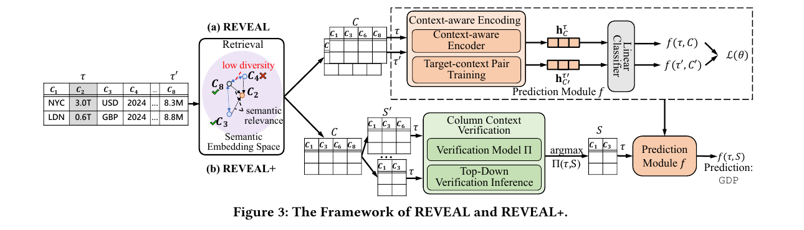
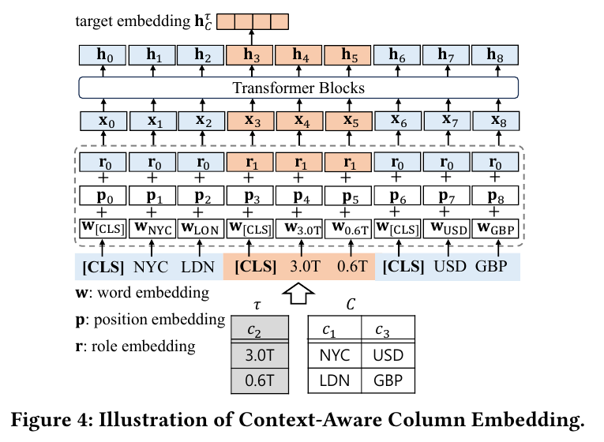
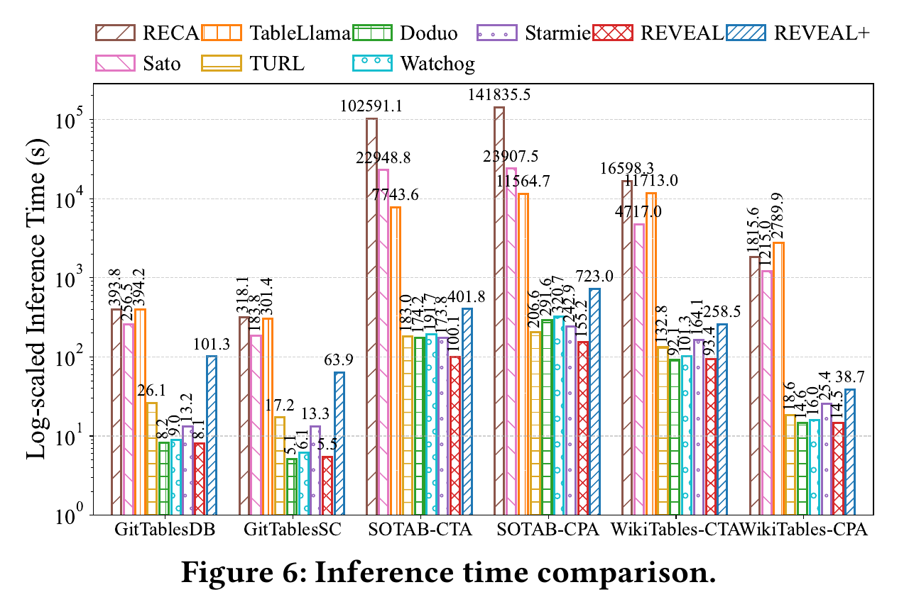

这是一份持续更新的 REVEAL 论文学习笔记。我沿三遍阅读法，结合与 AI 阅读搭档的逐步问答，记录方法理解、自己的疑问，以及原文证据能支持到什么程度。

> **待补充 · 更新于 2026-11-21**
>
> 第一遍鸟瞰与第二遍通读、收尾复述已完成。第三遍尚未完成：目前只提出 CPA 检索相关性的自行重构问题，尚未作答，也未开展源码核对或复现。实验公平性、实际数据划分等仍待核验，本文继续保留“待补充”标记，在原地址更新。
>
> **版本范围**：arXiv:2508.17203v1（2025-08-24，15 页）。作者报告的结果、课堂示例与我的推测分别标注；本文不代表已复现论文指标。
>
> **配套阅读**：[REVEAL 论文中英对照](../reveal-translation/) · [三遍阅读法](../deep-learning-paper-reading/) · [Doduo 源码阅读](../doduo-column-type-relation-notes/)

文中的“我的回答”保留学习过程中的原意，“阅读搭档的反馈”记录当时的解释与纠正；尚未作答的问题保留待答，不用整理后的结论冒充已完成的理解检验。三张配图截取自原论文，图注与方法归属作者。

## 1. 我在读什么，为什么读

**论文**：Retrieve-and-Verify: A Table Context Selection Framework for Accurate Column Annotations。作者为 Zhihao Ding、Yongkang Sun、Jieming Shi，提出 REVEAL 和 REVEAL+。

**本次固定版本**：arXiv:2508.17203v1，2025-08-24。已核对所读 PDF 首页的版本标识，正文共 15 页。后续引用指标时仍以这个版本的表格和实验设置为准。

我的研究重点是规整表格的列间关系识别（CPA），列类型识别（CTA）作为辅助，最终希望获得有来源依据的三元组。我已经沿 Doduo 代码看过列序列化、BERT 整表编码、CLS 筛选、关系 pooler、BCE、反向传播和优化器，因此这次重点关注：**怎样为当前目标选择有用的表内上下文，以及选择之后怎样完成注释。**

当前学习范围是论文理解，尚未开展 REVEAL 复现。文中 Doduo 的比较分数来自 REVEAL 论文，不代表我的个人训练结果。

## 2. 我采用的三遍阅读方式

依据[《深度学习论文三遍阅读法》](https://endlessroad-max.github.io/posts/deep-learning-paper-reading/)，每一遍都要留下可检查的产出。

| 阅读阶段 | 我要解决的问题 | 应留下的产出 | 当前状态 |
| --- | --- | --- | --- |
| 第一遍：鸟瞰 | 做什么、为什么做、总体怎么做、作者报告了什么结果 | 一句话“任务＋方法＋作者报告的主要结果” | 已完成；归因问答和总结反馈已记录 |
| 第二遍：通读 | 输入输出、模块连接、训练目标和实验依据是否讲得通 | 能复述动机、方法、结果与局限 | 已完成收尾复述与反馈；未解决的证据问题转入待核查清单 |
| 第三遍：精读与复现 | 我能否自行重构，公式和实现是否一致 | 重构流程、核对记录、实际验证结果 | 尚未完成；已提出首个重构问题，未开展源码核对或复现 |

我的记录规则：论文描述的方法、作者对效果的解释、课堂教学例子、我自己的推测分开写；图表按标题和内容定位；“阅读搭档讲过”不自动等于“我已经掌握”；“跑通流程”与“复现论文指标”分开记录。

## 3. 第一遍：我已经学到的内容

### 3.1 任务与动机

**阅读位置**：摘要、Introduction 的部分动机；与已有 Doduo 学习经验联系理解。

CTA 为一列预测语义类型；CPA 为一对列预测语义关系。它们关注的不是简单的字符串、整数等存储类型。

我目前的理解是：把整张表的所有列都作为上下文，虽然可能带来有用线索，也可能带入无关信息和重复信息。REVEAL 的出发点是根据当前目标选择上下文；换一个目标，有用的上下文也可能变化。这是作者提出方法的动机，实际收益要结合实验检查。

**我此前已经表达过的理解：相关不等于相似。** 评分、年龄、页数即使数值都在同一个范围内，也不能据此认定年龄和页数能帮助识别评分。这里的数值范围是帮助理解的例子，不能据此把论文的语义检索算法理解成比较数值区间。

**课堂教学例子：信息互补。** 对于“电影中文名｜电影英文名｜评分满分值”，若只能选择两列，我此前选择任意一个电影名加评分满分值，因为两种名称可能提供重复信息。这个例子帮助我理解相关性和多样性，不是论文实验结果。

阅读搭档提醒我谨慎理解两类证据：

- 两个目标的表示更容易区分，不足以单独证明分类准确率提高。
- 某项实验中列数较多时效果下降，不足以推出所有数据集都存在同一个最佳列数阈值，也不能单独确定下降的原因。

本笔记暂不重复这些例子的具体实验数值；需要引用时回到对应版本原图核对。

### 3.2 方法总览图：先认清各模块的职责

**阅读位置**：所读 v1 PDF 第 3 页，Figure 3，标题为 “The Framework of REVEAL and REVEAL+”；配合 §3 Overview。阅读讨论已直接查看 PDF 页面和原图。



我先用一张符号表固定理解，避免把目标、上下文和预测结果混在一起。

| 符号或模块 | 我目前的理解 |
| --- | --- |
| 表 T | 当前正在处理的同一张表 |
| 目标 τ | CTA 中的一列；CPA 中待判断关系的一对列 |
| Retrieval | 针对目标，考虑语义相关性与多样性，选出表内上下文 |
| 上下文 C | 检索得到的列集合；REVEAL 直接使用，REVEAL+ 进一步筛选 |
| 子集 S′ | REVEAL+ 在筛选过程中考虑的一组候选上下文 |
| 验证模型 Π | 估计某个上下文子集是否有助于正确注释目标 |
| 上下文 S | 经验证过程选定、最终供预测使用的上下文 |
| 预测模块 f | 利用目标和上下文，输出语义类型或关系标签 |

#### 上路：REVEAL

我按箭头复述为：

```text
同一张表 T ＋ 当前目标 τ
           ↓
检索上下文 C
           ↓
目标 τ ＋ 上下文 C
           ↓
预测模块 f：区分角色的编码 → 线性分类器
           ↓
目标的类型标签或关系标签
```

预测模块编码时区分“目标列”和“上下文列”。图中还画出了另一个目标 τ′ 及其上下文 C′，提醒我同一张表中不同目标可以使用不同上下文。

第一遍时，我只认识“上下文感知编码”和“目标—上下文配对训练”在总体方法中的位置。第二遍已补充角色嵌入、训练样本和论文损失定义，见第 4.3—4.5 节；源码层面的精读尚未开展。

#### 下路：REVEAL+

我按箭头复述为：

```text
同一张表 T ＋ 当前目标 τ
           ↓
使用相同的检索方法得到上下文 C
           ↓
考虑 C 的候选子集 S′，由验证模型 Π 估计质量
           ↓
通过自顶向下的验证推理过程选出上下文 S
           ↓
目标 τ ＋ 上下文 S → 已训练的预测模块 f
           ↓
目标的类型标签或关系标签
```

原图用 CTA 举例：目标列包含 `3.0T、0.6T`，检索上下文示意为 C₁、C₃、C₆、C₈，进一步筛选后示意留下 C₁、C₃，最终预测为 GDP。这是图中的流程示例，不能据此推断所有目标都应保留两列上下文。

我需要记住：**Π 负责估计上下文是否有帮助，f 负责输出注释标签。** REVEAL+ 在检索与最终预测之间加入上下文验证，沿用已经训练的预测模块。

图中的打分与选择不能被我理解成“穷举所有子集并保证找到全局最优”。本轮仅知道存在自顶向下的搜索过程，搜索规则和停止条件留待第二遍核查。

### 3.3 我必须保留的几个边界

- 检索步骤使用无监督信息，不表示整套方法没有监督训练。
- 验证模型在推理时估计上下文质量，不表示它能查看待预测目标的真实答案。
- 被选中的上下文只是模型认为更有帮助，不保证最终预测正确。
- 对 CPA 而言，目标是一对列；额外选择的上下文是帮助判断这对列关系的证据。
- 论文当前讨论的输出是列类型或列关系标签。它是否足以支持我最终需要的有来源依据的三元组，还需要单独分析，不能由总览图直接推出。

### 3.4 阅读搭档本轮留下的问题

> 假设我要判断一对目标列的关系，检索已经选出 4 列上下文。从这里开始，REVEAL 和 REVEAL+ 分别怎样走到最终关系标签？请用自己的话各描述一条路线。

**作答状态：已在阅读讨论回答，并完成一次追问。** 以下按实际对话记录我的初始理解、阅读搭档的纠正和修正后的认识；初答保留原有问题，不用整理后的正确表述替换学习过程。

#### 我的第一次回答（整理原意）

我认为 REVEAL 会把这四列上下文和目标列按一定方式“压缩成 token 序列”，再通过预训练模型得到上下文向量，基于四列上下文向量和目标列向量，通过线性分类层预测语义类型。REVEAL+ 则在检索之后进一步校验，筛选出更加有效的子集 S，再与目标列一起交给预测模型。

#### 阅读搭档确认和纠正的地方

阅读搭档确认，我抓住了两条路线的核心区别：REVEAL 直接使用检索上下文，REVEAL+ 进一步筛选后再预测；我也没有把验证模块误认为直接输出语义类型的模块。

同时，阅读搭档指出四处需要校准：

1. **“压缩成 token 序列”应改为“序列化并分词”。** 先把单元格内容按规定方式组织成输入，再转成 token；经过模型编码，才得到向量表示。排列、截断和角色标记的细节留到第二遍。
2. **上下文参与编码，不等于分类器直接接收所有上下文列向量。** 在图示的 CTA 场景中，进入线性分类器的是目标在上下文帮助下得到的表示 `h_C^τ`。上下文先影响目标表示，再间接影响分类结果。
3. **“更加有效”应限定为“验证模型估计更有效”。** 是否真的提高注释效果，还需检查实验。
4. **我把 CPA 的问题答成了 CTA。** 原问题的目标是一对列，输出是关系标签；我回答中的“一列 → 语义类型”属于 CTA。整体上下文选择思路可以用于两种任务，但不能混淆任务对象和输出。

#### 阅读搭档的追问

> 如果分类器接收的是融合上下文后的目标表示，而没有直接接收那四列各自的向量，为什么那四列仍然能够影响最终预测？

**我的回答（整理原意）**：融合上下文后的目标表示已经包含相关上下文信息，因此四列仍能影响预测。我还认为，图中的两个 h 对应不同目标及其上下文，得到的表示不同，通过线性分类层输出预测；训练时再计算一个批次的损失并反向传播。

**阅读搭档的反馈**：我已经串起“上下文参与编码 → 目标表示 → 分类 → 损失”的主线，对两个 h 对应不同目标—上下文组合、损失用于反向传播的理解是对的，但还要保留两个精度边界：

- 目标表示是在编码过程中与上下文信息交互形成的，不必理解成先独立算好每列的最终向量，再统一合并。
- 两个目标—上下文组合使用同一个预测模块。图里的 `L(θ)` 表明预测参与训练损失，但没有交代批次包含哪些目标、损失怎样汇总；我关于“一个批次”的说法尚需第二遍核对。

#### 经过反馈后，我现在怎样复述

针对原问题的 **CPA** 场景，REVEAL 将目标列对和检索出的四列上下文组织为模型输入，经编码形成用于关系预测的目标表示，再由预测模块输出关系标签。REVEAL+ 则先对候选上下文子集估计质量，选出 S，再把目标列对与 S 交给已训练的预测模块输出关系标签。CPA 中具体怎样组织两列的表示，仍待第二遍核对。

第一遍问答后，我最需要记住的是：**上下文可以通过改变目标表示来影响预测；验证模块选择上下文，预测模块给出注释。** 当时序列化、CPA 表示构造、批次与损失尚待深入；第二遍已补充的部分见第 4 节，未核验的实现细节仍保持待查。

### 3.5 主结果表：先看与我相关的 CPA

**阅读位置**：所读 v1 第 9 页，Table 3，标题为 “Overall performance by Micro-F1 (%) and Macro-F1 (%) (mean ± std)”；实验设置位于第 8 页 §6.1。阅读讨论已对照 PDF 原页检查主结果表。本节记录作者报告的结果，不是我的复现实验。

论文使用六个数据集，其中四个用于 CTA、两个用于 CPA。本轮重点看 SOTAB-CPA 和 WikiTables-CPA。下面摘录我熟悉的 Doduo、这两个 CPA 数据集上两个指标均值最高的外部基线 Starmie，以及作者的两种方法。

| 方法 | SOTAB-CPA Micro-F1 | SOTAB-CPA Macro-F1 | WikiTables-CPA Micro-F1 | WikiTables-CPA Macro-F1 |
| --- | ---: | ---: | ---: | ---: |
| Doduo | 78.85 ± 0.49 | 74.95 ± 0.49 | 91.60 ± 0.23 | 83.81 ± 0.15 |
| Starmie | 78.92 ± 0.13 | 75.69 ± 0.31 | 92.51 ± 0.36 | 85.69 ± 0.47 |
| REVEAL | 80.45 ± 0.25 | 77.81 ± 0.24 | 92.76 ± 0.11 | 86.40 ± 0.07 |
| REVEAL+ | **80.81 ± 0.07** | **78.15 ± 0.15** | **92.80 ± 0.18** | **86.81 ± 0.23** |

分数单位为 %，格式为均值 ± 标准差。按作者的实验设置，上述方法在这两个数据集上使用五个不同随机种子运行。例如，`78.85 ± 0.49` 表示均值为 78.85%，标准差为 0.49 个百分点；不是置信区间，也不表示每次结果一定落在均值加减一个标准差内。

#### 我的疑问：这些列名是数据集吗？

**我的提问**：“这边列名是数据集么？”

**阅读搭档的回答**：列名由“数据集名称＋评价指标”组成。四个分数列对应两个数据集，每个数据集用两种指标评价。

- **SOTAB-CPA、WikiTables-CPA** 是用于列间关系标注的数据集名称。
- **Micro-F1** 汇总所有样本的预测计数后计算 F1，常见关系类别对结果影响较大。
- **Macro-F1** 先计算每种关系类别的 F1，再等权平均，各类别权重相同，更容易体现少数类别上的不足。
- 最左列 Doduo、Starmie、REVEAL、REVEAL+ 是方法名称。沿一列向下看，是在相同数据集和指标下比较方法；沿一行向右看，是查看同一方法在不同数据集和指标上的表现。

**整理后的理解**：`SOTAB-CPA Micro-F1` 表示“某方法在 SOTAB-CPA 数据集上的 Micro-F1”，不是第三个数据集。这里记录了阅读搭档的解释，尚没有我独立复述这部分的后续作答。

#### 怎样读提升幅度

阅读搭档区分了两类比较：整套方法与外部基线比较，以及 REVEAL+ 与 REVEAL 比较。

| 比较对象 | SOTAB-CPA Macro-F1 差值 | WikiTables-CPA Macro-F1 差值 | 当前能读出的含义 |
| --- | ---: | ---: | --- |
| REVEAL+ 相对 Starmie | 78.15 − 75.69 = **2.46** 个百分点 | 86.81 − 85.69 = **1.12** 个百分点 | 整套方法相对该外部基线的均值优势 |
| REVEAL+ 相对 REVEAL | 78.15 − 77.81 = **0.34** 个百分点 | 86.81 − 86.40 = **0.41** 个百分点 | 增加验证流程后的报告均值变化；仍需核对对照设置 |

此外，WikiTables-CPA 的 Micro-F1 从 REVEAL 的 92.76 到 REVEAL+ 的 92.80，仅增加 **0.04 个百分点**。

这些数值是两个百分数直接相减，因此使用“百分点”，不能直接写成相对提升百分比。均值更高也不自动证明统计显著、收益很大或值得额外计算成本。主表能提示后续研究方向，基线公平性、消融、随机种子波动和成本仍需第二遍检查。

#### 主结果归因问答（已回答并收到反馈）

**阅读搭档的问题**：如果有人根据 SOTAB-CPA 的结果说“验证模块让 Macro-F1 提高了 2.46 个百分点”，我会怎样用表里的数字纠正？

**我的实际回答**：

> 验证模块的提升应该基于没有验证模块的原始方法reveal。2.46百分点指的是reveal+和论文外当时的sota模型的提升

**阅读搭档的确认与修正**：我的比较思路正确。判断增加验证步骤带来的变化，应比较 REVEAL+ 与 REVEAL：SOTAB-CPA 的 Macro-F1 差值为 `78.15 − 77.81 = 0.34` 个百分点。`2.46` 个百分点是 REVEAL+ 相对 Starmie 的差值，包含整套方法之间的差异，不能全部归给验证模块。

“当时的 SOTA”需要收紧为：**Starmie 是这篇论文主结果表中，在该数据集、该指标上表现最好的外部基线。** 主表不能证明它优于当时所有已发表方法。“外部”指 REVEAL 系列之外，Starmie 本身就在论文比较范围内。

**作答状态**：已回答，阅读搭档确认核心判断；基线称谓的精度已补充纠正。

### 3.6 代码、数据与版本边界

阅读讨论已只读核查以下入口：

| 资源 | 已观察到的内容 | 尚未验证的部分 |
| --- | --- | --- |
| [官方代码仓库 TommyDzh/REVEAL](https://github.com/TommyDzh/REVEAL) | 有源码目录、依赖清单、REVEAL 训练入口、验证数据构造入口和验证模型训练入口 | 未逐行核对实现，未安装环境或运行代码 |
| [仓库 README](https://github.com/TommyDzh/REVEAL/blob/main/README.md) | 给出训练流程、数据入口和论文名称与代码任务名的映射；WikiTables-CTA/CPA 对应 `turl`/`turl-re` | 名称相同不证明与我的 Doduo 实验使用完全相同的数据处理、划分和评测协议 |
| [作者处理后的数据仓库](https://huggingface.co/datasets/Tommy-DING/table-column-annotation-benchmark/tree/main) | 可见 SOTAB-CTA/CPA、WikiTables-CTA/CPA 和两个 GitTables 数据集目录 | 未下载、校验文件完整性或核对具体划分 |

**版本提醒**：当前 README 的引用条目指向 27 页的正式发表版本（DOI：`10.1145/3769823`），本次阅读的是 15 页的 arXiv v1。资源存在不等于当前代码与 v1 完全对应。后续核对实现时要固定代码版本；本笔记中的主结果继续使用 v1，不能混入正式版本的指标。

### 3.7 与 Doduo 的联系及第一遍产出

结合已有 Doduo 源码学习和本轮总览，我把两者的联系整理为：它们都利用表内上下文形成用于注释的表示；论文将 Doduo 作为整表序列化编码的代表，REVEAL 则针对当前目标先选择上下文，再显式区分目标与上下文角色，并以目标—上下文配对组织训练。REVEAL+ 进一步增加对上下文质量的学习与筛选。

所以，REVEAL 相对 Doduo 的变化涉及上下文选择、角色区分及训练组织，不能把两者之间的整体分数差只归因于验证模块。也不能把论文中的 Doduo 分数直接等同于我自己的实验结果；个人实验与论文设置的对应关系尚未核验。

**我的第一遍总结**：我把任务概括成先检索目标相关的其他列，再校验筛选上下文，以辅助 CTA 和 CPA；把核心方法概括成“检索＋校验”；认为 CPA 指标相对外部方法均有较大提升，验证模型也带来一定提升。

**阅读搭档的反馈**：我抓住了主线，第一遍可以收尾，但需要校准三点：任务是预测目标列的类型或目标列对的关系，检索与验证属于方法；验证关注对注释任务的有效性，不只是再次判断相关性，同时不能遗漏 REVEAL 的上下文感知编码，也不能把验证模块算进 REVEAL 本身；“均有较大提升”偏强，应报告具体比较对象和幅度。

**经阅读搭档修正后的第一遍一句话产出**：REVEAL 系列面向列类型与列关系注释，通过按目标检索相关且多样的同表上下文、区分目标与上下文进行编码，并在 REVEAL+ 中进一步验证上下文有效性；作者报告，在 SOTAB-CPA 上，REVEAL+ 的 Macro-F1 比表中最强外部基线 Starmie 高 2.46 个百分点，比 REVEAL 高 0.34 个百分点。

**阶段状态**：我已确认第一遍阅读完成。完成的是任务、方法、主要结果与资源的鸟瞰，不表示整篇精读或复现完成，也不取消尚待回答和核查的问题。

## 4. 第二遍：方法主线、实验取舍与数据使用（阅读与收尾复述已完成）

### 4.1 一次 CPA 预测的对象是什么

**阅读位置**：所读 v1 PDF 第 3 页，CPA 定义与 §3 Overview。

一次 CPA 预测的输入是表格 T 和指定目标列对 `(c_i, c_j)`，输出是预定义关系类别集合中的关系标签。其他列作为上下文参与编码，不因此自动成为本次预测的目标；输出列关系标签也不等于已经完成实体识别、实体链接和带来源的三元组构造。

**阅读搭档的问题**：指定目标为 `(A, B)`，C 作为上下文参与编码，是否意味着本次也输出 `(A, C)` 和 `(B, C)` 的关系？

**我的回答（整理原意）**：不是，模型用来预测指定目标列对，其他列只提供辅助信息，不是本次预测对象。

**阅读搭档的确认与修正**：核心判断正确，但我说“训练的时候就确定了”需要限定。训练样本指定当前目标，模型并非训练后只能预测某一对固定的列。同一个模型可以处理不同目标，本次的上下文列下次也可能成为目标的一部分。

**作答状态**：已回答并收到反馈。

### 4.2 检索：相关性与动态的冗余惩罚

**阅读位置**：所读 v1 PDF 第 4 页 §4.1 Column Context Retrieval。课堂先沿原文的 CTA 单列目标解释；CPA 检索用的目标表示怎样构造仍待核对。

阅读搭档把检索过程拆成三步：

1. 将每列的单元格值拼成字符串，通过文本编码器得到检索向量 `e_c`，再用余弦相似度比较列。
2. 上下文集合 C 初始为空，先选与目标最相似的其他列。
3. 后续采用最大边际相关性（MMR）思路，逐列选择得分最高的候选，每加入一列就重新评价剩余候选，直到达到设定数量。

```text
候选列得分
= 它与目标的相似度
− 它与已选集合中最相似那一列的相似度
```

第一项奖励相关性，第二项惩罚与已有上下文的重复。惩罚项取与整个已选集合比较后的最大相似度，不是仅与最后加入的一列比较。

**论文正文示例**：目标为价格列，已选 ID 时，PAGES 与目标的相似度为 0.76、与 ID 为 0.71，得分为 0.05；CURRENCY 两项分别为 0.55、0.34，得分为 0.21。因此 CURRENCY 尽管与目标的相似度较低，仍会在这两者中得分更高。这是正文用来解释规则的示例，不是我做的实验，也不证明相似度得分能保证分类正确。

**两个阶段的向量不要混淆**：`e_c` 用于检索；`h_C^τ` 是选好上下文后，预测模块联合编码得到的目标表示。

**阅读搭档的问题**：候选列与目标的相似度没变，为什么新加入一列上下文后，它下一轮得分可能下降？

**我的回答（整理原意）**：当前上下文里已经有与它高度相似的内容，选列不仅看相关性，还看多样性。

**阅读搭档的确认**：我理解了动态冗余惩罚。候选列没变，但已选集合改变了，它能够补充的不同信息也随之变化。

**作答状态**：已回答并得到确认。CPA 的检索表示、编码器具体配置、K 的选择及边界处理仍待深入核查。

### 4.3 角色编码：在编码阶段标明谁是目标

**阅读位置**：所读 v1 PDF 第 5 页 §4.2 Context-Aware Encoding，Figure 4，标题为 “Illustration of Context-Aware Column Embedding”。阅读讨论已直接查看原页及图。



图示为 CTA：c₂ 是目标，c₁、c₃ 是上下文。目标与上下文按原表列顺序组织，每列前放一个 `[CLS]`：

```text
[CLS] NYC LDN  [CLS] 3.0T 0.6T  [CLS] USD GBP
   上下文列         目标列          上下文列
```

按论文公式（4），每个 token 的输入向量为 `x_j = w_j + p_j + r_j`，即 token 内容、序列位置、角色三种同维度向量逐元素相加，不是首尾拼接。目标列的 token（含该列 `[CLS]`）选用角色向量 r₁，上下文选用 r₀；0 和 1 是查找角色向量的编号，不是把上下文乘零或屏蔽。两个角色向量都参与训练。

所有 token 一起经过 Transformer；图中取目标列 `[CLS]` 对应的输出 h₃，作为 `h_C^τ` 送给分类器。上下文通过注意力交互影响目标表示。该设计希望让“当前目标是谁”在编码过程中就影响信息交互，其收益仍要看实验。

### 4.4 我的质疑：不加角色编码，直接取目标 CLS 不行吗

**阅读搭档原来的问题**：每列前已有 `[CLS]`，为什么还要加入角色嵌入？

**我的回答与追问（整理原意）**：`[CLS]` 像 Doduo 中一样帮助区分列；REVEAL 关注当前目标，因此作者用角色编码区分目标和上下文。但我认为，不加角色编码，直接取目标列 `[CLS]` 的上下文向量分类也应该可行。我猜测作者保留角色编码是因为实验效果有提升。

**阅读搭档的回应**：这个替代方案成立。角色编码不是让任务能够训练和预测的必要条件。阅读搭档也修正了原问题中容易暗示“必须加入”的措辞；一次只预测一个目标，本身并不强制要求角色编码。对于 CPA，也可以取两个目标列的表示再组合起来预测。

| 方案 | 编码时 | 分类时 |
| --- | --- | --- |
| 不加角色编码 | 依据内容和位置联合编码，没有显式目标角色标记 | 选定目标位置的 `[CLS]` 输出 |
| 加入角色编码 | 输入即标明目标与上下文，让目标身份参与信息交互 | 同样取目标位置的表示 |

固定列内容、顺序和推理条件时，不加角色编码而仅改变最终读取哪个目标位置，会得到同一组编码输出；加入角色编码后，将目标从 A 换为 B 会改变输入角色向量，后续表示也可能变化。机制合理不等于一定提高准确率，我关于作者保留设计的原因不能仅凭猜测确定。

#### 对照消融：观察到收益，但不能过度归因

**阅读位置**：所读 v1 PDF 第 11 页 Table 5 “Ablation study in Macro-F1 (%)”及相邻编码消融段落。阅读讨论已直接查看原页。

| 论文设置 | GitTablesDB | GitTablesSC | SOTAB-CTA | SOTAB-CPA |
| --- | ---: | ---: | ---: | ---: |
| w/o encoding | 30.69 | 39.22 | 87.05 | 77.48 |
| context-aware encoding | 36.40 | 41.98 | 87.60 | 77.81 |
| 差值（百分点） | +5.71 | +2.76 | +0.55 | +0.33 |

作者据此认为区分目标与上下文的编码有效。课堂保留的证据边界是：这段正文未充分交代 `w/o encoding` 的具体修改；§4.2 同时包含角色嵌入和配对训练，尚不能确认对照严格只移除了角色嵌入，也不能断言一定同时移除了两项。表中未给出这组消融的标准差。**上下文感知编码有报告收益；角色嵌入的独立贡献与稳定性仍待核对。**

#### 追问：为什么其他列的表示也可能改变

**阅读搭档的问题**：把 A 从上下文改为目标，为什么另一列 C 的输出也可能变化？

**我的回答（整理原意）**：Transformer 通过 token 之间的相关性和加权交互计算表示，所以一处输入变化会让所有 token 的输出都变化。

**阅读搭档的确认与修正**：我抓住了信息交互机制，但“所有都会变化”应改为“其他 token 的输出也可能变化”。改变的是角色向量，文字内容和排列可以不变；A 的变化能通过交互影响 C，但不保证每个输出必然变化，更不保证变化带来更好的预测。

**作答状态**：替代方案讨论及机制追问均已得到反馈，关于角色编码不是必要条件的纠正已明确保留。

### 4.5 目标—上下文配对训练：一个训练样本是什么

**阅读位置**：所读 v1 PDF 第 5 页 Target-Context Pair Training，公式（6）—（7）。

REVEAL 将训练样本组织为 `(τ, C, gt_τ)`：当前目标、为它选择的整组上下文，以及目标的真实注释标签。

| 容易混淆的 pair | 含义 |
| --- | --- |
| CPA 的目标列对 | 待判断关系的两列，如 `(A, B)` |
| 目标—上下文配对 | 目标 `(A, B)` 与上下文集合 `{C, D, E}` 配成一组 |

整组上下文共同服务于当前目标，不按上下文列的数量拆分样本。同表中另一个有标签的目标可以配上另一组上下文形成另一个样本。配对训练决定围绕哪个目标组织输入，角色编码在输入内部标明目标身份。

论文公式（7）把训练目标写成这些训练样本上交叉熵损失的平均值。这里记录的是论文定义；实际组批、梯度累积和实现细节尚未核对，不能用我此前读 Doduo 的 BCE 经验直接替代。

**阅读搭档的问题**：一张表有 3 个带关系标签的目标列对，每个目标检索出 4 列上下文，构成多少个训练样本？

**我的实际回答**：

> 3个训练样本，因为每个目标列对和它对应的4列上下文共同组成一个样本，4列上下文只是一起提供辅助信息，不会拆成4个样本。

**阅读搭档的反馈**：回答正确，REVEAL 的“检索—编码—预测—训练”主线已串起来，可以进入 REVEAL+。这不代表已完成源码核验或训练复现。

### 4.6 验证模型的标签：根据预测是否正确构造

**阅读位置**：所读 v1 PDF 第 6 页 §5.1，Labeled Data for Verification Model 与公式（9）。**当前状态：已讲解，理解问题已回答并收到反馈。**

原数据有类型或关系标签，但没有直接标注哪组上下文有用。作者先训练预测模型 f，再用它构造验证模型的监督数据：

1. 对一个有真实标签的目标 τ，从检索结果 C 中取上下文子集 S′。
2. 用已训练的 f 对 `(τ, S′)` 进行注释预测。
3. 将预测与真实标签 `gt_τ` 比较；相同标 1，不同标 0，形成验证训练样本 `(τ, S′, y)`。

**课堂教学示例，非实验记录**：若真实关系是“出生地”，三个子集分别使 f 预测“出生地、居住地、出生地”，对应的验证标签就是 `1、0、1`。

| 模型 | 学习的输出或目标 |
| --- | --- |
| 预测模型 f | 类型或关系标签，例如“出生地” |
| 验证模型 Π | 估计使用当前上下文子集时，f 是否能预测正确 |

一个目标可以配多个子集，所以验证阶段一个目标可以产生多个训练样本；不要把第 4.5 节“一目标一组检索上下文”的构造直接套到这一阶段。

论文正文使用原训练集与验证集的真实标签构造 0／1 标签，并在 f 训练完成后训练 Π。推理阶段没有真实标签，依靠 Π 估计质量分再选择上下文。具体的数据隔离、验证集用途及实现一致性仍待检查。

阅读搭档指出，“高质量”在这里被操作性地定义为**该上下文下，当前 f 预测正确**，与“上下文造成多少额外提升”不是同一个判断。

**阅读搭档的问题**：

> 假设 f 不使用上下文就已经预测正确，加入某个子集 S′ 后仍然预测正确——按论文规则，S′ 会得到什么标签？这个标签能否单独证明它帮助模型提高了预测效果？

**我的回答（整理原意）**：S′ 的标签是 1，但不能证明它一定提高预测效果；要判断提高，需要比较不带上下文与带上下文的预测。我起初把验证标签说成“由预测模型 f 决定”。

**阅读搭档的确认与修正**：核心判断正确，但标签由“f 的预测与真实标签是否一致”决定，不是由 f 单方面决定。f 即使很自信，预测错误仍标 0。单个样本的有／无上下文对照可以观察是否由错变对；整体增益需要在一批样本上比较。论文的 0／1 标签没有包含这种增益比较。

**我现在需要区分**：当前上下文下预测正确，不等于该上下文造成了额外收益，也不证明其中每一列都不可缺少。

### 4.7 验证模型的输入、质量分与训练／推理边界

**阅读位置**：所读 v1 PDF 第 6 页 §5.1 Verification Model Design，公式（10）—（11）。

先利用上下文感知编码获得目标在候选子集 S′ 下的表示 `h_{S′}^τ`，再将它送入验证 MLP（多层感知机）。MLP 输出负类与正类的两个分数，经 softmax 后取正类概率作为 `Π(τ, S′)`：

```text
目标 τ ＋ 候选上下文 S′
          ↓
上下文感知编码 → 目标表示 h
          ↓
验证 MLP → “f 预测错误／正确”的两个分数
          ↓ softmax
取正类概率作为上下文质量分
```

预测模块学习具体类型或关系；验证模型学习估计预测模块在这组上下文下能否预测正确。质量分是学到的估计，例如 0.8 不能直接当成已经校准、实际正确率恰为 80% 的证据。

**阅读搭档的问题**：构造验证训练数据需要真实关系标签，为什么推理时没有真实标签，MLP 仍然可以打分？

**我的回答（整理原意）**：训练阶段根据已训练 REVEAL 预测模型的结果构造验证标签，MLP 在训练中学会判断子集，推理时不再需要真实标签。

**阅读搭档的确认与补充**：方向正确，构造标签仍要比较预测与真实答案。真实标签在训练阶段提供监督，推理时根据学到的参数与当前目标表示估计质量分。

**作答状态**：已回答并收到反馈；具体模型实现、编码参数如何复用等尚未查源码。

### 4.8 自顶向下搜索：逐轮删一列，不保证全局最优

**阅读位置**：所读 v1 PDF 第 7 页 §5.2，公式（13）—（14）及 Algorithm 2。

搜索从完整检索上下文 C 开始。目标列或目标列对始终保留，只删除上下文列：

1. 对当前上下文集合打分。
2. 生成所有“从当前集合删除一列”的候选，分别计算质量分。
3. 选本轮得分最高的候选。如果其分数低于当前集合，就停止并保留当前集合；否则接受删除，沿这个候选继续下一轮。
4. 只剩 1 列上下文时停止，不继续走到空集。

v1 的提前停止条件是严格的“小于”，所以分数相等时也会接受删除。算法只沿当前选中的分支向下走，不回头遍历其他分支。它可能错过“先降分、再删一列后升分”的子集，因此优化目标中的 argmax 不代表算法保证找到全部子集中的全局最优。

**课堂教学示例，非论文实验分数**：完整集合 `{A,B,C,D}` 得分 0.72；删除 A、B、C、D 后分别得到 0.68、0.81、0.75、0.70，于是接受删除 B，当前集合变为 `{A,C,D}`。下一轮三个候选得分为 0.78、0.80、0.76。

**我的回答（整理原意）**：保留未继续删除的版本，后面的分数都低，直接停止。

**阅读搭档的确认与修正**：最终保留 `{A,C,D}`，得分 0.81。需要把“后面都低”限定为“已经评估的再删一列的三个候选都更低”；更深层子集未被检查，不能说它们也一定更差。

#### 搜索次数与实际计算开销不是一回事

若初始上下文有 K 列，全部子集有 `2^K` 个（含空集）。该贪心路径在不提前停止时，计入初始完整集合，最多评分：

```text
1 + K + (K−1) + … + 2 = K(K+1)/2
```

K=8 时，穷举全部子集有 256 个组合；这条路径最多进行 36 次集合评分，而且不搜索空集。这说明候选评估次数是平方级，不等于整套模型的运行时间就是一个脱离编码成本的平方函数。

**阅读搭档的问题**：上下文从 `{A,C,D}` 换为 `{A,D}`，为什么不能直接复用前一个目标表示，只让 MLP 再打分？

**我的回答（整理原意）**：Transformer 的注意力涉及全局内容，多一列或少一列会影响其他列的向量。

**阅读搭档的确认**：上下文变化会改变参与注意力交互的内容，目标表示也可能变化；按论文定义，需要目标在新子集下的对应表示。验证 MLP 小，不意味着对多个子集编码的成本可以忽略。这里没有核验实现中的缓存、批处理或具体优化。

### 4.9 推理开销：把额外精度与额外耗时放在一起

**阅读位置**：所读 v1 第 10 页 §6.3，Figure 6 “Inference time comparison”；指标对应第 9 页主结果表。阅读讨论已直接查看 PDF 原图，纵轴为对数刻度。



| 数据集 | REVEAL → REVEAL+ 耗时（秒） | 耗时变为原来的 | Micro-F1 增加 | Macro-F1 增加 |
| --- | ---: | ---: | ---: | ---: |
| SOTAB-CPA | 155.2 → 723.0 | 约 4.66 倍 | 0.36 个百分点 | 0.34 个百分点 |
| WikiTables-CPA | 14.5 → 38.7 | 约 2.67 倍 | 0.04 个百分点 | 0.41 个百分点 |

这是作者在对应数据集实验中报告的推理耗时，不是单个列对的延迟。是否计入检索预处理、怎样缓存与组批，尚未核验。表中耗时取自 Figure 6，不混用其他实验图的计时。

我需要区分两个比较：自顶向下搜索相对穷举减少搜索成本；REVEAL+ 相对不做验证的 REVEAL 仍增加计算。前者更高效，不意味着后者没有额外开销。

作者认为注释可以离线完成、质量比时间更重要，因此接受这种取舍。这是作者对应用需求的判断，不是所有业务场景的共同要求。

**阅读搭档的问题**：主要考核 WikiTables-CPA 的 Micro-F1、时间预算又紧时，更倾向哪种方法？

**我的回答**：“注重速度就reveal，更注重精度就reveal+”。

**阅读搭档的反馈**：粗略方向可以，但在题设场景里优先 REVEAL：Micro-F1 均值只高 0.04 个百分点，耗时约为 2.67 倍。“更注重精度就用 REVEAL+”还要确认收益是否稳定、是否落在重要指标上，不能无条件概括。

### 4.10 结果稳定性：均值更高不代表每次都更好

**阅读位置**：所读 v1 第 8 页 §6.1 与第 9 页主结果表。按作者描述，两个 CPA 数据集上的这些方法使用五个不同随机种子运行。

| 方法 | WikiTables-CPA Micro-F1（%） | WikiTables-CPA Macro-F1（%） |
| --- | ---: | ---: |
| REVEAL | 92.76 ± 0.11 | 86.40 ± 0.07 |
| REVEAL+ | 92.80 ± 0.18 | 86.81 ± 0.23 |

均值反映平均表现，标准差描述运行波动，不是置信区间，也不是所有结果必然落入的范围。Micro-F1 均值差 0.04 小于各自标准差，提示需要进一步检查；不能仅因此判定“无提升”，也不能仅凭均值更高就宣称稳定地更好。

**阅读搭档的问题**：均值分别是 92.76 和 92.80，能否推出 REVEAL+ 五次都更好？

**我的回答与疑虑（整理原意）**：不能，平均值高不等于每次高，还要看标准差；这组 REVEAL+ 的标准差更大，我觉得它不特别稳定，好像没有想象中那么好。

**阅读搭档的反馈**：在 WikiTables-CPA 这五次结果中，可以说 REVEAL+ 波动更大；不能泛化为所有数据集都不稳定。均值与标准差仍不能判断是否每次胜出，需要逐次结果，并在可配对条件下看差值。两个模型可能在相同困难条件下一起下降，只看各自标准差会遗漏这种关系。

**经反馈后的判断**：如果重点是 WikiTables-CPA 的 Micro-F1，现有报告尚未显示很有吸引力的收益与成本比；如果重视 Macro-F1，仍有进一步评估价值。REVEAL+ 的增量收益有限，不等于基础 REVEAL 无效。这些是结合论文报告作出的条件性判断，不是统计检验或复现结论。

### 4.11 场景相关性：整体 Macro-F1 不能替代分类别结果

**阅读搭档的问题**：如果业务特别重视一些样本少但重要的关系类别，还希望作者提供什么结果，判断 Macro-F1 增加 0.41 个百分点是否有价值？

**我的实际回答**：“无法回答”。这一步由阅读搭档补充解释，不能记成我独立提出了完整分析方案。

阅读搭档建议查看各关系类别的 Precision、Recall、F1、测试样本数以及两种模型的预测差异：

- Recall 关注真实存在的该类关系找回多少，有助于判断漏识别。
- Precision 关注预测为该类的结果有多少正确，有助于判断错误关系。
- 样本数说明指标建立在多少证据上；少量样本中，多对或错一个就可能造成大幅变化。
- 具体错误案例可区分修正了哪些旧错误、又引入了哪些新错误。

**课堂教学示例，非论文结果**：某类别有 20 个真实样本，正确识别数从 10 增至 15，召回率从 50% 增至 75%。这可能减少遗漏，但仍要看是否同时把其他关系大量误报成该类。不能只看召回率就判定三元组质量提高。

整体 Macro-F1 的同样增幅可能来自不同类别，未必发生在我关心的类别上。目前尚未核查作者是否提供上述分类别材料。

**阅读搭档的简化追问**：整体 Macro-F1 提高，但最关心的“出生地”关系效果下降，能否仅凭整体指标认定更适合？

**我的实际回答**：“不能，我们关注的是我们场景对应类别的识别指标”。阅读搭档确认此判断。

### 4.12 按表划分与按列对划分：评测要对应新表泛化

**阅读位置**：所读 v1 第 8 页 §6.1。阅读搭档核查后指出：这段实验说明提到了重复随机种子与基线 BERT 设置，但没有明确交代两个 CPA 数据集按表还是按列对划分。实际划分仍要查数据来源与处理流程，不能据此断言作者使用了哪一种。

**课堂教学示例**：同表 T 有两个有标签目标 `(A,B)` 和 `(A,C)`。按列对随机划分可能将前者放训练、后者放测试；按表划分则让 T 的目标处于同一数据部分，测试使用其他表。

按列对划分时，测试关系标签可能未用于训练，但模型处理训练目标时可能已通过上下文看到同一张表的内容。它可以适用于补全已有表关系的任务，却不充分代表处理新表的能力。按表划分更符合新表泛化评估，但仍要检查表间重复或近似重复。

**阅读搭档的问题**：实际处理训练时未见的新表，希望哪种划分？

**我的实际回答**：

> 按表划分，因为我们实际要处理的是没见过的新表，按列对划分的话模型可能已经在训练中见过测试列对所在表的内容，不能很好地验证对新表的泛化能力。

**阅读搭档的反馈**：判断正确；我的研究应重点核对未见表上的 CPA 表现。重复五次随机种子主要反映运行波动，不替代数据划分检查；当前也不能将 REVEAL 已按表隔离视为确认事实。

### 4.13 验证集的角色变化与额外监督信息

**阅读位置**：所读 v1 第 6 页 §5.1 与第 8 页 §6.1。**状态：理解问题已回答，阅读搭档确认归因边界；实际数据使用条件仍待核验。**

将整个 REVEAL+ 流程合起来看，原验证集在不同阶段承担不同角色：

| 数据部分 | 对预测模块 f 的用途 | 对验证模型 Π 的用途 |
| --- | --- | --- |
| 原训练集 | 训练预测模块 | 利用预测是否正确构造标签，训练 Π |
| 原验证集 | 根据验证指标选择 f 的 checkpoint | 利用真实标签构造 0／1 标签，训练 Π |

因此，“原验证集不参与 f 的参数更新”不等于“整个 REVEAL+ 没用这部分数据训练”。它对 f 是模型选择数据，对 Π 已成为监督训练数据；名称不能替代对实际用途的检查。

**作者的理由**：f 在自身训练数据上容易预测正确，生成的正样本较多；原验证集有助于提供更多负样本。课堂将此记为作者解释，尚未实际检查标签分布或数据平衡。

**证据边界**：这不自动等于测试集泄漏。分阶段系统可以分配数据用途，但需清楚说明，并保留独立最终测试数据。比较方法时，还要核对各方法获得的标注数据及使用方式。

阅读搭档提出一个**尚未确认前提的公平性问题**：如果基线只使用原训练集更新模型，而 REVEAL+ 还通过 Π 利用原验证集标签，那么两者除了结构设计，还有额外监督信息使用上的差异。当前尚未核实基线有没有相应机会，不能直接判定比较不公平。

**阅读搭档的问题**：

> 假设上述数据使用差异确实存在，REVEAL+ 的提升能否全部归因于“验证机制设计得更好”？还是还需要区分另一种可能的提升来源？

**我的实际回答**：

> 不能全部归因于验证机制，也可能是因为REVEAL+额外利用了验证集的标签，相当于获得了更多监督信息，需要控制数据使用条件再比较。

**阅读搭档的反馈**：我正确区分了机制设计与额外监督信息这两种潜在收益来源。但基线是否获得相应的数据使用机会尚未核实，因此当前是待查的控制条件，不是已经确认的不公平或测试集泄漏。

### 4.14 把检索上下文也交给基线：检验的是哪一步

**阅读位置**：所读 v1 第 12 页，Table 8 “Performance of baselines with C” 与 Applying Baselines over C。阅读讨论已对照 PDF 原页检查；以下是作者报告的结果，不是我的复现结果。

作者把 §4.1 检索得到的上下文 C 提供给 Watchog 和 Starmie，让它们使用所选上下文进行预测。这里的 C 没有经过 REVEAL+ 的验证筛选，不能与最终上下文 S 混淆。

| 方法 | SOTAB-CPA Micro-F1（%） | SOTAB-CPA Macro-F1（%） |
| --- | ---: | ---: |
| Watchog | 76.52 | 72.60 |
| Watchog＋C | 79.66 | 75.91 |
| Starmie | 78.92 | 75.69 |
| Starmie＋C | 80.40 | 76.78 |
| REVEAL+ | 80.81 | 78.15 |

使用 C 后，Watchog 的 Macro-F1 增加 3.31 个百分点，Starmie 增加 1.09 个百分点。这支持一个有限结论：**在这些实验条件下，按目标检索上下文也能改善其他列注释模型的表现。** 它不保证任何模型或业务数据都会受益。

REVEAL+ 相对 Starmie＋C 仍有差距，但两者还存在编码、训练和验证等差异，不能将剩余差值全部归因于验证模块。检索本身的价值，也不因某个场景下额外验证的收益有限而被否定。

**阅读搭档的问题**：如果有人把“Starmie＋C 比 Starmie 更好”当作验证模型有效的证据，怎样纠正？

**我的实际回答**：

> 这里只能说明检索上下文有帮助，因为C只是检索得到的上下文，没有经过验证模型筛选，所以不能作为验证模型有效的证据。

**阅读搭档的反馈**：判断准确。这项对照支持上下文检索的作用，没有检验验证模型。

### 4.15 验证策略对照：预测置信度不等于预测正确

**阅读位置**：所读 v1 第 11 页，Table 7 “REVEAL+ with different verification methods”；第 12 页 Study on the Verification Model。表格已由阅读讨论直接查看 PDF 页面。

作者比较了不同的上下文选择或预测聚合方式：

| 方法 | 课堂解释的处理方式 | SOTAB-CPA Macro-F1（%） |
| --- | --- | ---: |
| Max Confidence | 比较各上下文子集，选让 f 给出最高预测置信度的子集 | 69.77 |
| Majority Voting | 对各子集产生的预测标签进行多数投票 | 73.08 |
| Weighted Voting | 平均各子集的预测概率，再选标签 | 73.77 |
| REVEAL+ | 用学习到的验证模型评分，并结合自顶向下搜索选择上下文 | 78.15 |

**预测置信度**是 f 对某个类型或关系标签给出的概率形式分数；**验证质量分**是 Π 根据预测正误监督，估计 f 在当前上下文下能否答对。两者的学习目标不同，都不能自动视为已校准的真实概率。

**课堂教学示例，非实验记录**：S₁ 使 f 以 0.98 的概率预测“居住地”，但真实关系是“出生地”；S₂ 使 f 以 0.80 的概率正确预测“出生地”。按最高置信度选择会选错上下文。验证模型尝试学习区分这类情况，但不保证每次成功。

**能支持的结论**：在作者报告的这组实验中，REVEAL+ 的验证与搜索方案优于这些直接选择或聚合预测的策略。它们的搜索或聚合过程不完全相同，因此这不是严格只改变一个 MLP 的单因素对照，不能把全部差值解释成 MLP 的独立贡献。

还必须保留另一条比较：主结果表中，不做额外验证的 REVEAL 在 SOTAB-CPA 上的 Macro-F1 已经达到 77.81，REVEAL+ 是 78.15，差值为 0.34 个百分点。**优于较弱的替代选择策略，不等于相对不验证也有很大的增益。**

**阅读搭档的问题**：“REVEAL+ 明显优于按最高置信度选上下文”与“REVEAL+ 相对 REVEAL 提升较小”，能否同时成立？

**我的实际回答**：

> 可以同时成立，因为比较对象不同。按最高置信度筛选可能选出让模型自信但预测错误的上下文，效果反而不如直接用检索结果的REVEAL。所以优于最高置信度策略，不代表相比REVEAL也有很大提升。

**阅读搭档的反馈**：我已经说明这项实验能支持的范围。不同参照回答不同问题，不能用较弱的替代策略放大新增模块的价值。

### 4.16 第二遍收尾：我的复述、困惑与修正

**阅读搭档的收尾问题**：向一个读过 Doduo、但没读过 REVEAL 的同学，用四句话讲清为什么选择上下文、两种方法怎样做、实验说明什么，以及一条局限。

**我的回答（整理原意，保留当时的不确定性）**：Doduo 也使用其他列的辅助信息，但它使用整表；REVEAL 基于 MMR 筛选与目标列或列对相关的辅助列，以减少无关信息干扰。相关的列未必对预测有用，所以进一步加入验证模型。实验显示筛选上下文改善了效果。局限可能是在一些专业领域使用效果不好，但我说不清原因。

**阅读搭档确认的部分**：我已抓住整表上下文与按目标筛选上下文的区别，也能解释“相关不等于有助于预测”的验证动机。

**方法部分需要补全的内容**：

- MMR 同时考虑相关性与多样性，不能简化成只挑最相关的列。
- REVEAL 不只做检索，还使用角色编码与目标—上下文配对训练；REVEAL+ 才进一步加入验证。
- “减少干扰”是设计动机与作者解释；报告的实验支持特定设置下的收益，不保证每个目标或场景都改善。

#### 我的困惑：专业领域表现不好，但说不出原因

阅读搭档指出：我们还没检查专业领域测试结果，因此“在专业领域可能表现不好”应记为**待验证风险**，不能写成已确认的局限。专业术语影响检索、业务关系不在标签集合中，可以作为后续调查的假设；目前没有证据确定它们就是原因。

更有直接依据的局限是：**REVEAL+ 增加验证与搜索开销，但部分 CPA 指标的增量收益较小。** 例如 WikiTables-CPA 上 Micro-F1 均值增加 0.04 个百分点，Figure 6 的推理耗时约为原来的 2.67 倍。这支持对收益与成本的条件性判断，不必勉强推测一个未经核验的深层原因。

#### 验证标签的边界：上下文没用，还是 f 不会利用

阅读搭档进一步指出：若一组上下文包含有用信息，但当前 f 没能利用、最终预测错误，它仍被标为 0。因此，这套标签没有区分“上下文本身不提供有效线索”和“预测模型没有学会利用线索”。

**阅读搭档的问题**：上述两种失败原因是否在标签中没有被区分开？

**我的实际回答**：

> 是的，标签只看f最后预测对不对，没有区分是上下文本身没用，还是f没有学会利用。所以验证模型判断的是上下文对当前f是否有效，而不是上下文本身有没有价值。

**阅读搭档的反馈与限定**：表述准确，但“对当前 f 有效”仍是指使用它时预测正确，不代表它造成了额外提升。不用上下文已经答对、加入后仍答对，也可能标为 1。这里讨论的是由标签定义带来的解释边界，不是已通过实验量化的性能损失。

#### 经过反馈整理的四句话产出

以下是笔记根据我的复述与阅读搭档反馈整理的版本，不冒充我当时逐字说过：

1. **动机**：整表上下文可能包含无关或重复信息，因此希望按当前目标列或列对选择更紧凑的同表上下文。
2. **方法**：REVEAL 用兼顾相关性与多样性的 MMR 检索上下文，配合角色编码和目标—上下文配对训练完成注释；REVEAL+ 再学习估计当前 f 在候选上下文下能否预测正确，并通过自顶向下搜索选择子集。
3. **结果**：作者报告，在 SOTAB-CPA 上 REVEAL+ 的 Macro-F1 为 78.15%，比 Starmie 高 2.46 个百分点，比 REVEAL 高 0.34 个百分点；给其他基线提供检索上下文也取得了收益，说明检索与额外验证应分别评价。
4. **局限**：额外验证有计算成本，在部分 CPA 指标上的收益较小；质量标签依赖当前 f 的预测正误，不能独立判定上下文的内在价值或因果增益。专业领域适用性、数据使用公平性等仍需核验。

**完成状态**：阅读搭档在收到我的最后回答后明确确认第二遍可以收尾。这里的完成指阅读主线与复述反馈完成，不表示统计稳定性、实验公平性、数据隔离或复现效果已经验证。

### 4.17 第二遍完成后的待核查事项

| 学习主题 | 当前已讲解或确认 | 仍待推进 |
| --- | --- | --- |
| 输入输出 | 指定目标列对输出关系，上下文不自动成为预测对象；已完成问答 | CPA 表示的具体组织与实现 |
| 检索 | 列检索向量、首列选择、MMR 动态冗余惩罚；已完成问答 | CPA 检索目标表示、编码器配置、K 与边界处理 |
| 编码 | 角色向量加入输入、目标 CLS 读取、角色标记并非必要条件；已讨论替代方案 | 源码与论文一致性 |
| 训练 | `(τ, C, gt_τ)` 样本、论文交叉熵平均目标；样本数量题已确认 | 组批、梯度累积和实际损失实现 |
| 验证模型 | 正误标签构造、目标表示输入、MLP 双分数与 softmax 质量分；已完成问答 | 具体实现、校准、编码参数复用及训练细节 |
| 验证推理 | 逐轮删除、严格降分停止、相等继续、至少保留一列、平方级评分次数；已完成问答 | 源码边界、缓存／批处理、搜索与穷举的完整对照 |
| 消融与稳定性 | 编码消融、基线＋C、替代验证策略、五次运行均值与标准差；已完成相应归因问答 | 单因素控制、搜索预算与监督数据是否对齐、逐次运行与可配对差值、不确定性核查 |
| 计算开销 | Figure 6 两个 CPA 数据集的耗时及精度取舍；已完成问答 | 计时口径、检索与编码成本、训练成本及预算 |
| 场景对应指标 | 重要类别 Precision／Recall／F1、样本数、错误案例的用途；经讲解后完成简化问答 | 作者是否提供分类别材料，以及对我的目标类别是否适用 |
| 数据划分 | 理解按表与按列对划分的区别，已明确新表场景需要核对按表隔离 | 实际划分文件、表间重复、测试隔离尚未核实 |
| 验证集用途与公平性 | 原验证集用于 f 的选择和 Π 的训练；已回答不能把额外监督收益全部归给机制 | 基线数据使用、预处理、训练预算及调参机会待核对 |
| 局限与适用范围 | 已区分报告的成本取舍、标签定义的解释边界与专业领域的待验证风险 | 目标领域数据、标签覆盖和分类别证据；不能由猜测确定失败原因 |

第二遍的主线阅读和收尾复述已完成。我还不能对整体比较公平性、统计稳定性或复现效果下结论；上述未解决项转入第三遍按需核查，不因阅读阶段结束而被标为已验证。

## 5. 第三遍：尚未完成，源码核对与复现待开展

### 5.1 先自行重构，再核对

我计划先独立画出“表与目标 → 检索 → 编码预测 → 上下文验证 → 最终预测”的连接，并把训练阶段和推理阶段分别标出；随后检查每条箭头需要什么数据、哪些参数已经训练好，再按需要对照公式、伪代码和官方实现。

**当前学习入口（已提问，尚未作答）**：CPA 检索时，已分别获得目标列 A、B 的检索向量 `e_A`、`e_B` 和候选列向量 `e_c`，若不增加需要训练的新模型，我会怎样构造“候选列与目标列对”的相关性分数？

这是先自行提出一个能计算的重构方案、再核对作者实现的练习，目前尚未作答。**检索时如何表示列对**，与**关系分类时如何组合两个目标列的上下文表示**是不同阶段；作者的 CPA 检索实现尚未核对。

这里是将来的学习任务，不表示已决定安装环境或运行训练。当前没有进行 REVEAL 代码核对、环境安装、训练或评测。

### 5.2 把两种验证分开记录

| 层次 | 成功意味着什么 | 需要留下的证据 | 当前状态 |
| --- | --- | --- | --- |
| 小规模流程验证 | 数据处理、模型、训练和评测能够衔接 | 样本规模、运行配置、输出形状、损失和指标计算检查 | 未开展 |
| 对齐论文指标的复现 | 在明确对齐的设置下比较实际结果与论文报告 | 代码版本、数据划分、预处理、预算、随机种子、评测协议及偏差 | 未开展 |

短训练或少量样本上的成功只能说明流程可运行。只有对齐设置并取得相应证据后，我才能讨论是否复现了作者报告的指标。

## 6. 更新记录与后续补充

**2026-11-17 · 阶段版发布，待补充。** 第一遍完成任务、总览图、CPA 主结果和代码资源核对；第二遍当时已覆盖检索、角色编码、相关消融讨论及配对训练，推进到验证标签构造。

**2026-11-21 · 补齐第二遍阅读，保留待补充。** 新增验证标签问答、验证 MLP、自顶向下搜索与复杂度、推理成本、结果稳定性、分类别指标、按表划分与监督数据用途，并补齐基线＋C、替代验证策略对照及第二遍收尾复述。保留我的实际回答、困惑和阅读搭档的纠正，明确区分作者报告、教学例子与未验证的假设。

第二遍的阅读与收尾复述已经完成，但不代表实验公平性、数据隔离或复现结果已验证。第三遍尚未完成，当前停在 CPA 检索时如何计算候选列与目标列对相关性的自行重构问题；代码版本、具体实现与运行验证仍待后续补充。

本文使用固定地址持续更新，完成后会修订进度标记并补齐完整阅读记录。

## 7. 来源与定位

- 阅读方法：[深度学习论文三遍阅读法](../deep-learning-paper-reading/)。
- 固定版本：[arXiv:2508.17203v1](https://arxiv.org/abs/2508.17203v1) · [v1 PDF](https://arxiv.org/pdf/2508.17203v1) · [v1 HTML](https://arxiv.org/html/2508.17203v1)。页码均指这一 15 页 PDF。
- 已阅读的位置：§3 Overview、§4.1 检索、§4.2 编码与配对训练、§5.1 验证标签及模型设计、§5.2 自顶向下推理、§6.1 实验设置、§6.2 主结果表、§6.3 推理耗时比较，以及 §6.4 的编码消融、基线＋C 和替代验证策略对照。第二遍完成不表示全部实验细节已独立核验。
- 图示来源：原论文 Figure 3 “The Framework of REVEAL and REVEAL+”、Figure 4 “Illustration of Context-Aware Column Embedding”与 Figure 6 “Inference time comparison”。
- 代码与数据：[官方仓库 README](https://github.com/TommyDzh/REVEAL/blob/main/README.md) · [处理后的数据目录](https://huggingface.co/datasets/Tommy-DING/table-column-annotation-benchmark/tree/main)。当前代码与所读 v1 的对应关系尚待检查。

本文是进行中的个人学习记录；第三遍尚未完成。正式引用方法或比较结果时，请回到对应版本的原论文核对。
