> **副标题**：从文件里的字节，到屏幕上的表格——Excel 数据抽取前置研究笔记
>

## 前言
在开展 **Excel 数据抽取（Data Extraction）** 研究之前，我想先弄清楚一个最基础的问题：**Excel 到底是什么？**

学计算机的人都知道，磁盘上的文件最终都由 `0` 和 `1` 构成。但当我们双击打开 Excel 时，看到的却是文字、数字、颜色和排列整齐的单元格。这中间究竟发生了什么？

如果要让程序自动化处理 Excel，首先必须分清“文件保存的底层数据”**与**“软件渲染的视觉画面”。直接读取文件得到的是原始字节；只有按照特定的格式规范去解释这些字节，才能还原出单元格、公式和样式等信息。

这篇笔记就从一个简单的表格出发，像剥洋葱一样逐层打开它，看看表格背后到底藏着什么。

---

<!-- 这是一张图片，ocr 内容为： -->


## 一、 先区分 Excel 软件和 Excel 文件
平时我们口头说的“Excel”，实际上可能指代三件完全不同的事物：

| 概念对象 | 本质定义 | 角色定位 |
| --- | --- | --- |
| **Excel 软件** | 负责读取文件、计算公式、编辑和渲染表格的应用程序 | 解释器与渲染引擎 |
| **Excel 文件** | 保存在磁盘上的静态数据（例如 `水果示例.xlsx`） | 结构化数据源 |
| **眼睛看到的表格** | 软件根据文件内容在屏幕上生成的交互画面 | 视觉视图（View） |


文件里保存着“哪个坐标放什么内容、用什么格式显示、按什么公式计算”等元数据；Excel 软件则负责读取这些信息，并将其绘制到屏幕上。

> 💡 **直观类比**：可以把 **Excel 文件**看作一份建筑施工图——它只用符号记录位置、材料和规则；而我们**看到的表格**，则是施工队（Excel 软件）按图搭建出来的实体建筑。
>

⚠️ **研究边界说明**：本文拆解的是普通、未加密的 `.xlsx` 文件（基于 OpenXML 标准）。较早期的 `.xls` 文件使用的是另一套二进制记录格式（BIFF；常见的 Excel 97–2003 `.xls` 使用 OLE 复合文档作为容器），不能直接套用下文的解包方式。

---

## 二、 原生 IO 读取到的是什么？
我们跳过所有第三方 Excel 解析库（如 `openpyxl` 或 `pandas`），先用 Python 最底层的原生 IO 读取文件：

```python
with open("水果示例.xlsx", "rb") as file:
    data = file.read(16)

print(data)
print(data.hex(" "))

```

其中，`rb` 表示以**二进制只读模式**打开文件。`read(16)` 会原样取出文件开头的 16 个字节，不对内容做任何语义解释。

观察这份示例文件的前 4 个字节，我们可以用三种等价的方式来表示它：

```text
二进制：   01010000  01001011  00000011  00000100
十六进制： 50        4B        03        04
Python：   b'PK\x03\x04'

```

它们是同一份底层数据的不同展现形式。需要注意的是，Python 输出中的 `\x03` 只是用来表示**单个字节**（十六进制 `03`）的转义写法，文件里并不是真的连续存放着反斜杠 `\`、字母 `x`、数字 `0` 和数字 `3` 四个字符。

那么问题来了：表格里的“苹果”和“3.5”去哪里了？为什么开头会是神秘的 `PK`？  
答案藏在 `.xlsx` 文件的包装方式里。

---

## 三、 一个 `.xlsx`，里面为什么还有文件？
细心的话会发现，前四个字节 `50 4B 03 04`（前两个字节对应 ASCII 字符 `PK`，后两个字节为不可打印的控制字符）正是 **ZIP 压缩包的文件头魔数（Magic Number）**。

普通的 `.xlsx` 本质上是一个使用 **ZIP 容器**组织内容的压缩包。它就像一个打包好的档案袋：外面看是一个独立文件，解开后里面分门别类地装着工作表、样式表和关系清单（参考：[微软 OpenXML 格式说明](https://learn.microsoft.com/zh-cn/office/open-xml/spreadsheet/structure-of-a-spreadsheetml-document)）。

将 `水果示例.xlsx` 直接用解压软件解包后，可以看到如下目录树：

```text
水果示例.xlsx (解压后目录)
├── [Content_Types].xml          # 声明包内各文件的 MIME 类型
├── _rels/
│   └── .rels                    # 根级关联关系（指向 workbook.xml）
└── xl/
    ├── workbook.xml             # 工作簿总览
    ├── styles.xml               # 全局样式表
    ├── sharedStrings.xml        # 共享字符串池（可选）
    ├── theme/
    │   └── theme1.xml           # 颜色与字体主题
    ├── worksheets/
    │   └── sheet1.xml           # 具体工作表数据
    └── _rels/
        └── workbook.xml.rels    # 工作簿内部组件关联映射

```

在数据抽取初期，我们只需要重点关注以下三个核心文件：

| 内部文件路径 | 主要记录什么内容 |
| --- | --- |
| `xl/workbook.xml` | **工作簿全局信息**，例如包含哪些工作表（Sheet 名称、顺序及状态） |
| `xl/worksheets/sheet1.xml` | **工作表核心数据**，记录具体的单元格坐标、原始值和计算公式 |
| `xl/styles.xml` | **视觉样式定义**，集中管理字体、填充背景色、边框及数字格式化规则 |


其余文件则负责定义主题风格、内容类型声明以及组件之间的引用关系（`_rels`）。如果工作簿更复杂，还会出现图表（`charts`）、内嵌图片（`media`）等组件；合并单元格范围则记录在相应工作表 XML 的 `mergeCells` 中。

不过，解压缩只是帮我们打开了“档案袋”，要真正理解表格，接下来还要读懂里面的 XML 文件。

---

## 四、 XML：用标签记录表格的信息
解包后的核心文件全部采用 **XML（可扩展标记语言）** 编写。XML 通过标签、属性和嵌套层次来组织信息，而 OpenXML 标准则严格规定了每个标签在电子表格中的语义。

例如，本次示例中的 `B2` 单元格在 `sheet1.xml` 里保存为：

```xml
<x:c r="B2" s="8" t="n">
  <x:v>3.5</x:v>
</x:c>

```

这段标签可以直接翻译成一句自然语言：“在 `B2` 坐标处，存放一个数值类型的单元格，其原始值为 `3.5`，并应用样式表中下标为 `8` 的视觉样式。”

各个标签与属性的拆解如下：

| XML 写法 | 语义含义 | 补充说明 |
| --- | --- | --- |
| `<x:c>` | 一个单元格（Cell） | 容器标签 |
| `r="B2"` | 单元格坐标引用（Reference） | 行列定位标识 |
| `s="8"` | 样式索引（Style Index） | 引用 `styles.xml` 中单元格样式列表的下标 `8` |
| `t="n"` | 数据类型（Type） | `n` 代表数值（Number），此外还有 `s`（共享字符串）等 |
| `<x:v>` | 保存的原始值（Value） | 单元格的底层数据存储 |


> 📌 **关于命名空间前缀**：标签里的 `x:` 是 XML 命名空间前缀，用来区分不同规范下的同名标签。初次阅读源码时，直接忽略前缀，重点关注后面的 `c`（Cell）、`v`（Value）、`f`（Formula）即可（参考：[微软单元格结构说明](https://learn.microsoft.com/zh-cn/dotnet/api/documentformat.openxml.spreadsheet.cell)）。
>

到这里，我们需要在工程概念上严格区分三个连续的动作：

1. **解压（Decompress）**：按 ZIP 格式读取包内条目，并按条目使用的压缩方法还原内部文件字节流。
2. **解码（Decode）**：按照 `UTF-8` 等字符编码，将文件字节流转换为人类可读的文本字符。
3. **解析（Parse）**：按照 XML 语法树和 OpenXML 规范，将文本识别为工作表、单元格等内存数据结构。

---

## 五、 对照真实表格：看值、公式和样式如何分工
为了直观对比，我们先看一眼 `水果示例.xlsx` 在屏幕上渲染出来的最终样子（左侧行号 `1~6` 与顶部列标 `A~D` 属于软件坐标轴，并非单元格数据）：

| 行号 \ 列标 | A | B | C | D |
| --- | --- | --- | --- | --- |
| **1** | **商品** _(白字蓝底)_ | **单价（元）** _(白字蓝底)_ | **数量** _(白字蓝底)_ | **金额（元）** _(白字蓝底)_ |
| **2** | 苹果 | ¥3.50 | 4 | ¥14.00 |
| **3** | 香蕉 | ¥2.00 | 3 | ¥6.00 |
| **4** | **合计** |  |  | **¥20.00** |
| **5** |  |  |  |  |
| **6** | 比例示例 | 10% |  |  |


> _注：下方展示的 XML 片段均提取自该真实文件（仅做缩进美化）。不同软件生成或重新保存文件时，内部写法和样式编号可能会发生变化。_
>

### 1. `B2` 单元格：文件保存 `3.5`，为什么屏幕显示 `¥3.50`？
前文提到，`B2` 的 `<x:v>` 标签里存的原始数值只有 `3.5`。屏幕上的人民币符号 `¥` 和末尾补齐的一位 `0`（将 `3.5` 显示为 `3.50`），全部来自**样式表（`styles.xml`）的间接引用**。

它的完整解引用查找链条如下：


在 `styles.xml` 中，对应的数字格式定义如下：

```xml
<x:numFmt numFmtId="200" formatCode="&quot;¥&quot;0.00" />

```

其中 `&quot;` 是 XML 中双引号 `"` 的转义写法。真实的格式代码为 `"¥"0.00`，指示渲染引擎在数值前加上 `¥` 符号，并强制保留两位小数。

因此，单元格的**原始值**和**显示结果**在底层是彻底解耦的两项信息：


原始数值 `3.5` + 货币显示格式 `"¥"0.00` → 视觉文本 `¥3.50`

> ⚠️ **解析避坑指南（下标 vs ID）**：
>
> + `s="8"` 是**从 0 开始的列表下标（0-based Index）**，对应 `cellXfs` 列表中的第 9 个元素。
> + `numFmtId="200"` 则是**唯一格式标识符（ID）**，解析时必须按属性 ID 匹配，不能当作数组下标去硬取。此外，`200` 只是当前文件分配的自定义编号，并非所有 Excel 文件都用 `200` 代表货币格式（参考：[微软样式索引说明](https://learn.microsoft.com/zh-cn/dotnet/api/documentformat.openxml.spreadsheet.cellformats)）。
>
> 
>

---

### 2. `B6` 单元格：文件保存 `0.1`，为什么屏幕显示 `10%`？
再看 `B6` 单元格的底层记录：

```xml
<x:c r="B6" s="18" t="n">
  <x:v>0.1</x:v>
</x:c>

```

它通过 `s="18"` 引用的样式，最终指向了如下数字格式定义：

```xml
<x:numFmt numFmtId="202" formatCode="0%" />

```

底层存储的原始数值是 `0.1`，是百分比格式 `0%` 让它在屏幕上呈现为 `10%`。如果你在 Excel 软件里把这个单元格的格式切换回“常规”，它会立刻变回 `0.1`——**显示方式变了，但底层数值从未改变。**

这也解释了数据抽取中常见的一个现象：为什么人工看表格明明写着 `10%`，Python 脚本读出来却变成了 `0.1`？因为解析库默认只提取了 `<x:v>` 中的原始数值，没有叠加应用 `<x:numFmt>` 的显示规则。

---

### 3. `D2` 单元格：公式和计算结果可以同时保存
`D2` 在屏幕上显示为 `¥14.00`，它在 `sheet1.xml` 中的真实结构非常有趣：

```xml
<x:c r="D2" s="10" t="n">
  <x:f>B2*C2</x:f>
  <x:v>14</x:v>
</x:c>

```

这里同时并存着三项关键信息：

+ `<x:f>`**（Formula）**：保存计算公式 `B2*C2`（注意：XML 存储中省略了我们在软件编辑栏里看到的前导等号 `=`）。
+ `<x:v>`**（Value）**：保存上一次保存文件时的计算结果 `14`，在工程上称为**缓存值（Cached Value）**。
+ `s="10"`**（Style）**：引用显示样式，将 `14` 格式化为 `¥14.00` 并附带浅色背景。

> 💡 **工程启示：读取缓存 vs 重新计算**  
缓存值相当于“上一次保存时顺手抄下的答案”。如果某个 `.xlsx` 文件是由外部程序直接拼装生成的，或者修改了上游单元格却未经 Excel 引擎重算保存，`<x:v>` 里的缓存值就可能**过期甚至缺失（为空）**。因此，在数据抽取中，“直接读取缓存值”与“引入公式引擎重新计算”是完全不同的两套技术路线。
>

---

### 4. 表头 `A1` 的白字、粗体和蓝底藏在哪里？
本例中表头 `A1`（“商品”）的样式下标为 `s="5"`。在 `styles.xml` 中，下标为 5 的组合样式包含 `fontId="2"` 和 `fillId="2"`，分别指向字体列表（`fonts`）和填充列表（`fills`）中的第 3 项（同样是从 0 开始计数）。

对应的字体定义如下：

```xml
<x:font>
  <x:b />
  <x:sz val="12" />
  <x:color rgb="FFFFFFFF" />
  <x:name val="Microsoft YaHei" />
</x:font>

```

这段标签清晰地描述了：**粗体（`<x:b />`）、字号 12、纯白色（ARGB 值为 `FFFFFFFF`）以及微软雅黑字体**。与此同时，填充定义中的 `FF244566` 则对应表头的深蓝色背景。

可以看到，文字“商品”属于**内容数据**，而白字、粗体、蓝底属于**视觉样式**。两者分开存放，仅靠索引 ID 在渲染时动态拼装。

---

### 5. 文字也不一定直接写在工作表里（共享字符串机制）
在本次生成的水果示例中，“苹果”、“香蕉”等文本是作为内联字符串直接写在 `sheet1.xml` 里的，此时文本不依赖共享字符串表，包内的 `sharedStrings.xml` 可以为空或不存在。

Excel 软件保存文件时通常使用共享字符串表，将文本去重后集中存放到 `xl/sharedStrings.xml`（共享字符串表）中，而让工作表单元格只保存一个整数编号。

例如，当你在 `sheet1.xml` 中看到：

```xml
<x:c r="A2" t="s">
  <x:v>0</x:v>
</x:c>

```

注意属性 `t="s"`（Type = Shared String）。此时 `<x:v>0</x:v>` **绝不能当作数字零**，它代表一个指针，指向 `sharedStrings.xml` 列表中的**第 1 个字符串（下标为 0）**（参考：[微软共享字符串说明](https://learn.microsoft.com/zh-cn/office/open-xml/spreadsheet/working-with-the-shared-string-table)）。

> 📌 **小结**：解析单元格时，必须将 **类型（`t`）、原始值（`v`）和外部引用关系（`s` / `sharedStrings`）** 结合起来联合判定，绝不能只把 `<x:v>` 标签里的文本生硬地摘出来。
>

---

## 六、 这与 Excel 数据抽取有什么关系？
摸清 `.xlsx` 的底层家底后，我们就可以将 **Excel 数据抽取研究** 清晰地划分为三个递进的层次：

| **研究层次** | **核心要回答的问题** | **结合本例的具体体现** |
| --- | --- | --- |
| **1. 文件解析层**<br/>   <br/>_(File Parsing)_ | 文件在物理和语法上保存了什么？ | 识别出 `B2`<br/> 存有数值 `3.5`<br/>（附货币格式），`D2`<br/> 存有公式 `B2*C2` |
| **2. 表格结构理解层**<br/>   <br/>_(Table Structure)_ | 这些单元格在空间上是如何组织的？ | 识别出第 1 行是表头（Header），第 4 行是汇总行，B 列代表“单价”属性 |
| **3. 业务语义抽取层**<br/>   <br/>_(Semantic Extraction)_ | 这些内容在业务领域意味着什么？ | 抽取出实体及属性：商品 `{名称: "苹果", 单价: 3.5, 单位: "元"}`<br/> 并入库 |


对于原生 `.xlsx` 文件，OpenXML 已经帮我们规整地保存了网格坐标。但是，诸如“第一行是业务表头”、“某个跨列合并的单元格统领下方哪几行数据”、“哪一行是数据区的结束、合计行的开始”等结构与业务语义，通常不能仅靠文件中的现成标签完整确定；显式定义的 Excel 表格（Table）等结构可以提供部分线索。

因此，**能够用代码读出所有单元格，并不代表程序已经“理解”了这张表。**

如果后续研究的目标是从复杂报表中抽取实体与关系，那么在第一阶段（文件解析层），我们不能只提取纯文本，而应当尽可能完整地保留以下多维特征：

+ **空间特征**：行列坐标、合并单元格范围（`mergeCells`）
+ **数据特征**：原始值（`v`）、数据类型（`t`）、计算公式（`f`）
+ **视觉特征**：字体加粗、背景填充色、边框线、数字格式掩码（`formatCode`）

为什么视觉样式对数据抽取也很重要？因为人类在制表时，习惯用**视觉样式来表达结构语义**——比如加粗或变色的行往往是表头或合计行，缩进或特定底纹往往暗示着层级从属关系。保留这些线索，能为后续的启发式规则或大模型（LLM）结构理解提供极其关键的上下文。

从这个视角回看，打开并理解一份 Excel 的完整链路如下：



**数据抽取研究真正要攻克的难题**，正是上图右侧的下半程：如何让程序在拿到第 3 步的单元格对象之后，像人类一样跨越到结构理解与业务语义抽取。

---

## 🛠️ 动手验证：三个小实验
纸上得来终觉浅。建议将本次的 `水果示例.xlsx` 另存一份副本，亲手做三个小实验，观察底层 XML 的变化：

1. **验证公式与缓存值**：将 `C2`（苹果数量）从 `4` 改成 `5`，确认公式已重新计算后再保存。重新解包查看 `sheet1.xml`，你会发现 `D2` 的 `<x:f>` 依然是 `B2*C2`，但 `<x:v>` 变成了 `17.5`；同时 `D4`（合计）的缓存值变成了 `23.5`。
2. **验证显示格式与原始值**：在 Excel 中将 `B6` 的数字格式从“百分比”改为“常规”并保存。屏幕上显示从 `10%` 变成了 `0.1`；解包对比 XML，你会发现 `<x:v>0.1</x:v>` 纹丝未动，显示格式通过样式引用及样式定义发生变化；保存时软件也可能重排样式，不能保证只有 `s` 改变。
3. **验证内容与视觉分离**：将 `A1` 的背景填充色改成亮红色并保存。解包后会发现单元格的文本内容“商品”没有变化，而显示样式会引用红色填充。`styles.xml` 的 `<x:fills>` 列表可能新增或复用填充定义，单元格的样式索引也可能改变；文字还可能被转存到共享字符串表中，但文本内容不变。

> 💡 **实验提醒**：每次在 Excel 软件中修改并按下 `Ctrl + S` 保存后，都需要**重新解压** `.xlsx` 文件才能看到最新的 XML。之前解压到文件夹里的文件只是当时的静态快照，不会随原工作簿自动更新。
>

